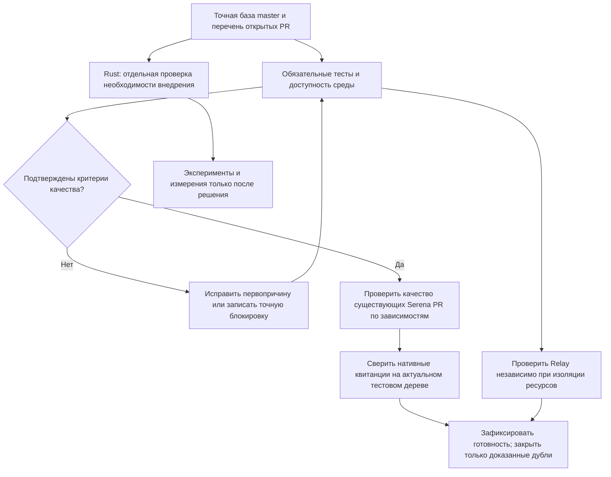

# План повышения качества и сокращения очереди PR mcp-local-hub

**Исходный снимок:** 17.11.2026, `master=a7d92d2852c4f6eb8afb0569ef76a545e38aacf7`. **Статус:** аудит и план качества; не свидетельство готовности PR и не разрешение на слияние.

## Оглавление

1. [Цель, источники и ограничения](#1-цель-источники-и-ограничения)
2. [Результат аудита](#2-результат-аудита)
3. [Порядок выполнения](#3-порядок-выполнения)
4. [Обязательные критерии приёмки](#4-обязательные-критерии-приёмки)
5. [Что сознательно исключено](#5-что-сознательно-исключено)
6. [Отчёт по каждому шагу](#6-отчёт-по-каждому-шагу)
7. [Ссылки и обозначения](#7-ссылки-и-обозначения)
8. [Адресная диагностика тайм-аутов и зависимостей, 17.11.2026](#8-адресная-диагностика-тайм-аутов-и-зависимостей-17112026)
9. [Измеренная ёмкость Go-тестов и оставшиеся квалификационные блокеры](#go-gates-20261117)
10. [Диагностическое разбиение Go-тестов](#go-testshards-20261118)
    - [Проверка POSIX-среды и повторяемости Rust](#platform-preflight-20261118)
11. [Воспроизводимые измерения и ревью чтения файлов](#measurements-review-20261118)
12. [Serena: исправление окружения и проверка чистого исходника](#serena-clean-source-20261118)
13. [Serena: ревью очистки и границ доказательств](#serena-cleanup-review-20261118)
14. [Serena: завершённое ревью и точный остаток](#serena-independent-review-20261118)
15. [UV, Relay и тестовый Product: завершённое ревью](#relay-uv-product-review-20261118)
    - [Исторический остаток после исправления Relay](#remaining-after-relay-20261118)
16. [Rust, измерительная проверка Relay и документация Product](#rust-measurement-product-review-20261118)
    - [Исторический остаток после полного source review](#remaining-after-rust-review-20261118)
17. [Карты потребителей CMake, Relay и процессов](#consumer-maps-20261118)
    - [Исторический остаток после карт потребителей](#remaining-after-consumers-20261118)
18. [R16: отдельное наблюдение PID и сохранение неизвестного результата](#r16-port-observation-20261118)
    - [Исторический остаток после PID-only исправления R16](#remaining-after-r16-port-observation-20261118)
19. [R16: Windows status на одном дескрипторе процесса](#r16-status-observation-20261119)
    - [Исторический остаток после status-наблюдения](#remaining-after-r16-status-observation-20261119)
20. [R17: контракты Task Scheduler и автозапуска](#r17-contracts-20261119)
    - [Исторический остаток после карты R17](#remaining-after-r17-contracts-20261119)
21. [Восстановленный результат R16 и исправление поиска скрытой задачи R17](#r17-hidden-task-20261119)
    - [Исторический остаток после восстановления R16 и hidden-исправления R17](#remaining-after-r17-hidden-task-20261119)
22. [R17: перепроверенный нативный экспорт и контракт потребителей](#r17-export-native-20261119)
    - [Действующий остаток после проверки экспорта R17](#remaining-after-r17-export-20261119)

## 1. Цель, источники и ограничения

Цель — повышать качество существующих запросов на включение изменений (**PR, pull request**) и уменьшать их количество **без слияния PR в любые ветки репозиториев**. Допустимы аудит, адресные исправления, упрощение зависимостей, устранение дубликатов и закрытие только доказанно поглощённых PR с сохранением уникального результата. Само слияние выполняет исключительно владелец, вне работы агента. Приоритет — корректность Hub и Serena, безопасность Windows и независимость исследований Rust.

Источники истины: текущие ветки GitHub, [правила репозитория](../../AGENTS.md), [подробный порядок приёмки](../../docs/agent-runbook.md#pr-review--merge-workflow-mandatory), [аудит всех 28 PR](https://github.com/applicate2628/mcp-local-hub/pull/637#issuecomment-6930360422) и сохранённые квитанции точных коммитов. Исторический результат не становится результатом нового HEAD только из-за совпадения имени ветки.

**На момент аудита:** 28 открытых PR, все Draft: 18 Serena, 1 Windows Product, 1 Relay и 8 Rust/измерений. Среди Serena 17 из 18 имеют завершённый ответ бота без замечаний к **своему текущему** коммиту; #632 обновлён после последнего ответа. У остальных десяти PR такого подтверждения нет. На протяжении аудита новых технических дублей, полностью поглощённых `master`, не доказано.

## 2. Результат аудита

**Таблица 1 — группировка без дублирования ответственности**

| Группа | PR | Решение |
|---|---|---|
| Подготовка Serena | [#632](https://github.com/applicate2628/mcp-local-hub/pull/632) → [#635](https://github.com/applicate2628/mcp-local-hub/pull/635) → [#636](https://github.com/applicate2628/mcp-local-hub/pull/636) → [#637](https://github.com/applicate2628/mcp-local-hub/pull/637) | Сохранить именно **цепочку зависимостей**: обнаружение UV → издатель исходников → защищённое пространство → реальные тесты |
| Serena, среда сборки и запуска | [#639](https://github.com/applicate2628/mcp-local-hub/pull/639), [#646](https://github.com/applicate2628/mcp-local-hub/pull/646)–[#649](https://github.com/applicate2628/mcp-local-hub/pull/649) | Проверять согласованно по контракту среды, не дублировать изменения в новом PR |
| Serena, файлы и очистка | [#643](https://github.com/applicate2628/mcp-local-hub/pull/643), [#645](https://github.com/applicate2628/mcp-local-hub/pull/645), [#651](https://github.com/applicate2628/mcp-local-hub/pull/651)–[#652](https://github.com/applicate2628/mcp-local-hub/pull/652) | Проверить общий владелец каталога, запрет подмены, файловые атрибуты и сроки |
| Serena, сеть и завершение | [#650](https://github.com/applicate2628/mcp-local-hub/pull/650), [#653](https://github.com/applicate2628/mcp-local-hub/pull/653)–[#656](https://github.com/applicate2628/mcp-local-hub/pull/656) | Проверить правильную последовательность получения, валидации и закрытия ресурсов |
| Настоящий тестовый Product | [#657](https://github.com/applicate2628/mcp-local-hub/pull/657) | Нативный результат (§10.1) сохранён, самостоятельное ревью границ завершено (§15.1); устанавливаемый Product не менялся |
| Relay | [#629](https://github.com/applicate2628/mcp-local-hub/pull/629) | Самостоятельное ревью и исправление потери отмены завершены (§15.2–§15.3); ранее влитый **в #629** [#630](https://github.com/applicate2628/mcp-local-hub/pull/630) повторно не переносить |
| Rust: план, базовые испытания и эксперименты | [#623](https://github.com/applicate2628/mcp-local-hub/pull/623)–[#628](https://github.com/applicate2628/mcp-local-hub/pull/628), [#644](https://github.com/applicate2628/mcp-local-hub/pull/644), [#631](https://github.com/applicate2628/mcp-local-hub/pull/631) | Отделить исследовательские доказательства от промышленного перехода, не сливать ради численного уменьшения очереди |

Пересечения `serena_build_environment.go`, `serena_owned_tree_windows.go`, `serena_prepared_acquisition.go` и `relay_qualification.go` означают **необходимость совместной проверки**, но не тождество правок. Историческое тестовое дерево `4c600ef` содержит 70 изменённых файлов относительно того же `master`, а его успешная нативная Serena-проверка привязана к точным исходникам; эти результаты нельзя автоматически переносить на новые коммиты PR.

## 3. Порядок выполнения

**Актуальный остаток на 19.11.2026 — в [§22.4](#remaining-after-r17-export-20261119).** Тринадцать ревью Serena, три зоны #632/#629/#657 и source review Rust/измерений завершены в указанном ниже объёме. В #629 исправлена потеря отмены синхронного ввода; в #626 — принятие повреждённых ответов измерительной проверкой. Документация Windows Product согласована с исходниками; карты потребителей CMake/Relay/process завершены (§17). Go PID-only срез R16 сохранён в #659 (§18); обычное Windows status-наблюдение на одном дескрипторе реализовано в существующем #628 (§19). Карта восьми операций R17, потребителей и доказательных пробелов завершена в §20; восстановление квитанции #628, выполненное ограниченное hidden-исправление и его проверки отражены в §21; семь чтений неизменённого PowerShell-сценария и очистка позднее прошли (§22.3), полная нативная квалификация остаётся открытой, обе полные Go-команды завершились FAIL. Текущие результаты общих Go-команд приведены в §21.3; прежние R16-результаты сохранены в §19.3. Адресные PASS их не заменяют. Последовательность ниже задаёт общие критерии; прежние отказы и результаты §10–§15 сохранены как история.

**Рис. 1 — минимальный поток повышения качества PR без слияния**



### Шаг 1. Зафиксировать базовую приёмку и реальные блокеры

- Сверить `master`, открытые PR и локальные деревья перед тестами; не запускать проверки по старым SHA (идентификаторам коммитов).
- На отдельном проверочном окружении выполнить обязательные Go build/vet/full/default/state-tag команды из `AGENTS.md`, сохранить настоящие имена отказов и отделить дефект программы от недостающих прав/политик среды. Не перезапускать неизменившийся сценарий без новой проверяемой гипотезы.
- Для [#657](https://github.com/applicate2628/mcp-local-hub/pull/657) самостоятельное ревью границ тестового режима завершено (§15.1): обычный JSON-план сохраняет прежнюю схему. Точный нативный Product/RunV5-результат на `4fa52b60` уже получен (§10.1); повторять его без изменившихся входов или конкретной гипотезы не требуется. Отказ хоста в отдельной PowerShell-фикстуре не обходить другим исполняющим путём.
- Не расширять локальный токен Windows или системные политики, чтобы искусственно сделать успешным тест чужого владельца. Отдельно сохранить CST/право-владения как внешние ограничения, пока нет разрешённого окружения.

**Выход шага:** воспроизводимый комплект обязательных проверок и матрица блокеров; наличие PASS не даёт агенту права сливать PR.

**Проверенный baseline на `master=a7d92d2` (17.11.2026, Comet, Go 1.27.4, локальный кеш, изолированные временные каталоги):** `go build ./...` и `go vet ./...` — PASS; `go test -count=1 -timeout 5m ./...` — **FAIL**; `go test -tags=test_state_path_env -count=1 -timeout 5m ./internal/api/ ./internal/cli/` — **FAIL**. Сохранены фактические журналы, коды возврата и SHA-256 в приватном изолированном каталоге проверки, вне `trash`. Полная готовность этих изменений не подтверждена; прав на слияние у агента нет независимо от результатов.

**Таблица 2 — исходные причины неуспешной приёмки 17.11.2026 (без ложной классификации всех как дефектов); последующие результаты — §10–§14:**

| Область | Наблюдение | Следующее действие без лишних повторов |
|---|---|---|
| `internal/api` | Оба полного прогона остановились по 300-секундному лимиту, на разных сценариях `Adopt` и `DeAdopt` | Отдельно установить зависимость от нагрузок и блокировок, без изменения лимитов вслепую |
| `internal/cli` | Полные прогоны остановились по 300 с; `RunV5UpgradeWindows_UnreadableIntentAbortsUpgrade` потребовал квалифицированный CLI Product, которого в обычном `go test` нет | Проверить актуальный #657 на нативном тестовом Product; отдельно исследовать таймауты |
| Serena | 14 сценариев не дошли до цели из-за консольного PE (фактически subsystem 3, требовался GUI subsystem 2); ещё один — `SERENA_BUILD_SOURCE_INVALID` | Использовать уже предусмотренную цепочку #632/#635–#637 и квалифицированную среду; не подменять предпосылку заглушкой |
| `internal/daemonrecovery` | Отказ записи аудита по deadline и зависший портовый запрос | Адресно воспроизвести на текущей основе; не переносить чужие исторические PASS |
| `internal/process` | Отсутствуют квалифицированные вводные для двух Windows Job-тестов; у другого теста дочерняя среда не содержит ожидаемого значения | Разделить входные предпосылки и действительную ошибку окружения |
| tagged API | `TestAttachExisting_PublicCLIReceiving` требует исходный tagged Product и ожидаемый digest | Готовить только реальный проверенный исполняемый тестовый артефакт, без ослабления проверки |

### Шаг 2. Повысить качество фундаментальных Serena PR без создания новых веток

- Сверить тесты изменённого #632 и восстановленную защиту пустых элементов `PATH`; зафиксировать, относится ли уже опубликованный ответ бота к текущему HEAD. Новый квотный запуск ревью требует отдельного разрешения и не является условием продолжения доступного аудита исходников.
- Затем проверить и при необходимости исправить **уже открытые** #635 → #636 → #637. Сравнить историю и самостоятельные изменения каждой ветки; записать отсутствующие исправления родителей, не перенося их между ветками. Не сливать и не удалять базовые ветки. Существенное изменение исходника требует новой проверки зависящего от него образа; прежняя квитанция остаётся привязанной к прежнему коммиту.
- Не объединять ответственность #635–#637 с несвязанными Rust, Relay или тестовым Product; никакого слияния PR не выполнять.

**Выход:** фундаментальные PR с подтверждённым качеством и документированными блокировками, сохранённые открытыми до действий владельца.

### Шаг 3. Довести оставшиеся Serena PR до проверенного состояния

- Улучшать существующие PR по их реальной зависимости: среда запуска #639/#646–#649 → файловые владельцы/очистка #643/#645/#651/#652 → протокол/квитанции #650/#653–#656. Пересечения проверять чтением точных исходников, самостоятельных патчей и сохранённых квитанций. **Не объединять PR-ветки или их изменения даже в локальном проверочном дереве.** Исторические объединённые деревья не считать текущими исходниками и не использовать для обхода этого ограничения.
- Не создавать «общий исправительный PR» и не объединять ветки с разными владельцами только ради числа открытых PR. Не наслаивать повторные фиксы поверх исправленной первопричины; если правки эквивалентны, доказать полноту поглощения до закрытия лишнего PR.
- Нативные проверки выполнять на точном чистом исходнике одной существующей ветки в разрешённом изолированном окружении. Если сквозной сценарий требует отсутствующих изменений других PR, зафиксировать зависимость и продолжить доступное самостоятельное ревью; необходимый единый исходник должен предоставить владелец. Установка пакетов и загрузка новых входов требуют отдельного разрешения. При доступных предпосылках проверять протокольный обмен, завершение исходных процессов, закрытие ресурсов, запись `Ready`, защитные записи и ожидаемые отказы по **квитанциям**, а не только по коду возврата.
- Полные проверки и точные ревью каждого PR остаются самостоятельными обязательными gates; прежний интеграционный PASS не подменяет их.

**Выход:** отдельный статус качества каждого исходного PR, нативные результаты для фактически проверенных коммитов и точные зависимости незавершённой приёмки; никаких слияний или объединения PR-изменений.

### Шаг 4. Проверить качество Relay отдельно

**Собственное полное ревью и исправление конкретного дефекта выполнены в §15.2–§15.3.** Общая приёмка остаётся ограничена перечисленными там условиями.

- Вести #629 параллельно Serena только при реально независимых тестовых ресурсах; иначе запускать последовательно без конкуренции за порты и рабочие каталоги. Проверить передачи ввода/вывода, отказы и закрытие владельца. Изменения #630 **уже внутри** #629; не открывать ещё один PR и не cherry-pick их вторично.
- После подтверждения тестов, ревью и совместимости с текущим `master` зафиксировать статус готовности #629 для владельца, не сливая его в репозиторий.

**Выход:** одно независимо проверенное изменение Relay либо точно описанная причина, мешающая признать качество достаточным.

### Шаг 5. Rust и производительность — не мешать основной приёмке

- Сохранить #623 как целевой документ перехода, но сначала проверить, **доказана ли необходимость** замены конкретного Go-владельца Rust-компонентом и какие реальные измерения это подтверждают. Нет решения — не интегрировать эксперимент в производственный код.
- При положительном решении последовательно проверить #625 → #644 → #631 (владение процессом → исходная идентичность → интерфейс Go/Rust); #627 — отдельный защищённый reader; #624/#626/#628 — независимые исходные измерения. Они не являются дубликатами.
- В #623 три исторических JSON-снимка занимают **12 312 из 15 171 изменённой строки**. Если есть верная архивная копия и проверенные хеши, можно заменить тяжёлое текстовое представление компактным индексом **в том же PR**. Уникальные доказательства не удалять и не помещать в `trash`.
- Локальные проверки Rust допустимы в разрешённом окружении; не запускать внешние модели, квотные CI, платные инструменты или установку ПО без отдельного подтверждения.

**Выход:** небольшое подтверждённое решение «внедрять / продолжать исследование / отложить» с сохранёнными текущими PR.

### Шаг 6. Сократить очередь только после доказательства избыточности

- Ещё раз сопоставить `master`, PR, коммиты и их конечные деревья. Закрыть как дубликат **только доказанно полностью поглощённый** PR, с ссылкой на преемника. Не закрывать уникальные черновики по возрасту или размеру.
- Проверить отсутствие несохранённых правок, живых ресурсов и использующих ветку параллельных сессий. Подтверждённо ненужные локальные материалы переносить в согласованный `trash` (не очищать); уникальные коммиты, необходимые сборки и доказательства оставить вне `trash`.
- Не удалять удалённые или базовые ветки действующего стека автоматически. Закрытие полностью дублирующего PR не должно уничтожать уникальные коммиты, доказательства или необходимые базы других открытых PR.

**Выход:** перечень действительно оставшихся независимых работ, а не искусственно нулевой счётчик PR.

## 4. Обязательные критерии приёмки

Для каждого изменяемого PR: (1) точный текущий коммит и обозримый diff; (2) обязательные тесты и честный отчёт об отказах; (3) действующий no-major-issues результат бота без inline-замечаний **на текущем HEAD** при разрешённой проверке; (4) самостоятельное ревью корректности и безопасности; (5) разрешения владельца на все платные/квотные агенты, ручную CI и публикацию; (6) проверка конечного дерева и квитанций только в изолированной тестовой копии. Неполный пункт не позволяет объявить PR готовым, но не запрещает независимую работу над качеством. **Агент не выполняет слияния PR ни при каких положительных результатах проверки; решения владельца остаются вне его операций.**

## 5. Что сознательно исключено

Не выполнять слияния PR в `master` или другие ветки, включая auto-merge, squash и merge отдельных PR-веток. Не создавать ещё один координационный/агрегирующий PR. Не «чинить» 28 PR пересозданием 28 веток. Не запускать полную дорогостоящую миграцию на каждом неизменном тестовом артефакте. Не повторять уже слитый #630. Не переписывать Rust-эксперименты в промышленный Go/Rust backend до архитектурного решения. Не менять Windows-политику, Task Scheduler, установленный Hub и разрешения. Не удалять необходимые исторические материалы ради уменьшения diff.

## 6. Отчёт по каждому шагу

После **каждого** шага обновлять в существующем PR или этом плане одну короткую сводку: `Что сделано → точный коммит → фактические проверки (PASS/FAIL/NOT RUN) → открытые блокеры → изменившийся остаток`. Сведения об уже принятых шагах не дублировать; следующий шаг не расширять до неавторизованной работы.

## 7. Ссылки и обозначения

1. [Полный аудит 28 PR, 17.11.2026](https://github.com/applicate2628/mcp-local-hub/pull/637#issuecomment-6930360422).
2. [Ревью Rust-веток и материалов](https://github.com/applicate2628/mcp-local-hub/pull/623#issuecomment-6930368840).
3. [Режим и неизменные правила ревью](../../docs/agent-runbook.md#pr-review--merge-workflow-mandatory).
4. [Обязательные инструкции агентов](../../AGENTS.md).

**Обозначения:** PR — запрос на включение изменений (pull request); CI — автоматизированная непрерывная интеграция (continuous integration); GUI — графический интерфейс; E2E — сквозной тест; MCP — Model Context Protocol; FFI — интерфейс вызова функций между языками (foreign function interface); Rust — системный язык программирования; UV — менеджер пакетов и сред Python; SHA — криптографический идентификатор содержимого; TCP — протокол управления передачей данных.

## 8. Адресная диагностика тайм-аутов и зависимостей, 17.11.2026

**Область доказательств:** отдельная чистая копия `#658 HEAD=c00241d0475c157c57bd1699239293799911e6e1` на Comet (Windows/amd64, Go 1.27.4), изолированные `TEMP=TMP=TMPDIR=GOTMPDIR`, `HOME=USERPROFILE`, только локальные кеши модулей; установок, изменения политики Windows, CI и запуска внешних моделей нет. Фактический исходный `master=a7d92d2` не менялся.

**Таблица 3 — воспроизведение адресных сценариев:**

| Сценарий | Команда (к `go test -count=1 -timeout 90s -run`) | Результат |
|---|---|---|
| Adopt: все обязательные приёмники | `'^TestExecuteAdoptExitZeroRequiresAllReceivers$' ./internal/api` | PASS, 4,499 с |
| StrictMode: возврат при ошибке shim | `'^TestStrictModeEnable_RevertOnShimFailure$' ./internal/cli` | PASS, 0,549 с |
| MCP-front: отказ при недоступном маршруте | `'^TestRunReconcileMCPFront_FailsClosedWhenRouteNotLive$' ./internal/cli` | PASS, 30,317 с |

Все три теста закончились с кодом 0; после них рабочее дерево чистое. Два предварительных диагностических запуска с **неверной изоляцией временных переменных** не считаются результатом о качестве продукта: их остановил штатный аудит песочницы. Данные действительного запуска сохранены в `.scratch/go-timeout-triage-20261117-verified-env` проверочной копии, вне `trash`.

Сохранённые полные прогоны на `#658 HEAD=c00241d` ранее дали **FAIL**: в `internal/api` 300-секундный пакетный предел достигнут на Adopt/DeAdopt, в `internal/cli` — на Reconcile/StrictMode. В дампах Windows видны `StringToSid`, `FlushFileBuffers` и ожидание проверки маршрутного слушателя. Поскольку отдельные тесты завершились, **постоянное зависание именно этих тестов не подтверждено**. Влияние общей длительности пакета, числа параллельных проверок, дискового ввода-вывода и порядка тестов остаётся гипотезой. Канонический предел `5m` и проверки безопасности не менялись.

**Зависимости Serena:** #635 (HEAD `6ca53c8`) построен от старого #632 `8cead42`, тогда как текущий #632 `ff4ba7f` содержит исправление пустых элементов `PATH`. Сравнение Git и исходных blob подтвердило отсутствие этого исправления также в HEAD #636 и #637. [Доказательства](https://github.com/applicate2628/mcp-local-hub/pull/635#issuecomment-6953061676). В существующих ветках не выполнялось слияние и не создавалось дублирующее исправление; до согласования зависимостей их совокупная проверка не квалифицирована.

**Windows Product:** #657 HEAD `4fa52b60` прошёл точный нативный тестовый билд, проверку хешей и RunV5, отдельную PowerShell-регрессию (без `ExecutionPolicy Bypass`). Это не означает прохождение обязательных полных Go-тестов или независимых security/bot-review; детали в [#657](https://github.com/applicate2628/mcp-local-hub/pull/657).

**Последующее состояние:** адресные тесты, совокупная локальная проверка 18 Serena PR, текущего Relay #629 и Rust-аудит зафиксированы в [аудите #658](https://github.com/applicate2628/mcp-local-hub/pull/658#issuecomment-6958877563). Расхождение истории #632→#635→#637 на GitHub не устранено слиянием. Количественная повторная проверка обязательного 300-секундного предела, отдельные нативные требования и дальнейший порядок приведены в [разделе 9](#go-gates-20261117).

<a id="go-gates-20261117"></a>
## 9. Измеренная ёмкость Go-тестов и оставшиеся квалификационные блокеры

**Повторная база и границы:** действующий `master=a7d92d2852c4f6eb8afb0569ef76a545e38aacf7`, отдельная чистая проверочная копия на Comet (Windows/amd64; Go 1.27.4), `GOMAXPROCS=4`, локальный кеш модулей без сети, временные каталоги и HOME только в разрешённой области диска D. Не запускались установщик Product, реальные пакеты Serena, внешние модели и ручные GitHub Actions. Ничего не менялось в `master` либо ветках PR. Результаты полного запуска из раздела 8 относятся к другому, хотя и совместимому по Go-коду, коммиту документации `c00241d`; нижеприведённые прогоны относятся **именно к master**.

**Таблица 4 — обнаружение реально компилируемых корневых тестов с помощью `go test -list '^Test'` (без выполнения их тел):**

| Пакет | Обычный Windows/amd64 | `-tags=test_state_path_env` | Дополнительных корневых тестов |
|---|---:|---:|---:|
| `internal/api` | **3436** | **3442** | 6 |
| `internal/cli` | **1960** | **1963** | 3 |
| **Итого** | **5396** | **5405** | **9** |

Списки уникальны внутри каждого режима. Это количество обнаруженных **корневых** функций `Test...`; они не включают дочерние `t.Run`, примеры (`Example...`) и начальные корпуса фаззинг-тестов (`Fuzz...`). Для любой будущей проверки полного покрытия нужно перечислять все применимые категории, а не только эту таблицу. Шесть дополнительных API-тестов включают получение `USERPROFILE`/Known Folder и публичную CLI-квитанцию; три CLI-теста — отдельные сценарии исходной привязки и восстановления.

**Таблица 5 — реальные повторные проверки на том же коммите (не подмена обязательных команд):**

| Команда/сценарий | Итог | Значение |
|---|---|---|
| `go test -json -count=1 -p=1 -timeout 300s ./internal/daemonrecovery` | **PASS**, 101 успешное событие, 0 отказов; ~4 с полная оболочка | Исторические ошибки committed-audit и port-owner deadline не воспроизведены вне общей нагрузки |
| `TestExecuteTerminationCommittedOutcomeMatrix`, `TestExecuteBlockingPortProbeReturnsOnContextDeadlineAndClosesHeldGeneration`, `TestStartWithJob_ChildSeesNormalizedEnvironment` | **3/3 PASS каждый** | Нет основания исправлять эти тесты по одному историческому отказу |
| `go test -json -count=1 -p=1 -timeout 300s ./internal/api` | **FAIL, exit 1**; пакет достиг `300.103s`, внешняя оболочка `320.983s` | До общего тайм-аута **655 корневых PASS**, **1112 PASS-событий** с подтестами и 18 SKIP; не наблюдалось отдельного `Test` FAIL до тайм-аута |
| `TestExecuteDeAdoptProviderPreInstallColdRetryAfterE2WithMissingManifest` | **3/3 PASS**, 0,78/0,62/0,57 с | Именно этот тест выполнялся около 1 с при срабатывании пакетного 300-секундного таймера; отдельное зависание не подтверждено |
| `TestRunReconcileMCPFront_FailsClosedWhenRouteNotLive` | **PASS**, 30,41 с | Ранее попадал в stack trace полного CLI-пакета; собственный отказ не воспроизведён |
| `TestStrictModeEnable_RevertOnShimFailure` | **3/3 PASS** | Ранее также фигурировал при общем CLI-тайм-ауте |

Журнал самостоятельного полного API-запуска: SHA-256 `eae32da1c146443d79b50542ec7ab147a30e28d81b24049c97d12514acdaa5ad`, 1 085 554 байта. Журнал полного `daemonrecovery`: `82a3b223e6fa6b20e13e5295a8a6d01ada0009b4e8849956bbb1822224e25767`. Списки обычных корневых тестов API и CLI: соответственно `d5235fd2ca7b822f44982e9a2ac616c7d0d0571109af6fe3f110d8e2ecc4f85f` и `1db89f4e328bb30032e5de97414b0748594cbb76e3c1f7c95ce70f52214cb84d`. Необходимые исходные квитанции сохранены в `.scratch/go-gate-isolated-full-20261117`, `.scratch/go-gate-focused-followup-20261117` и `.scratch/go-gate-test-inventory-20261117` проверочной копии, вне `trash`.

**Вывод о первопричине:** полный API-пакет действительно превышает 300-секундный общий бюджет **даже при отдельном запуске с `-p=1`**, без одновременных Go-пакетов. Пакет продолжал последовательно завершать тесты вплоть до тайм-аута. Поэтому «исправить последний тест из stack trace» — ложная локальная цель. Это доказывает несоответствие достигнутой длительности **текущему пакетному лимиту**, но не отсутствие дефектов в оставшихся невыполненных тестах и не полное объяснение причин затрат времени. Новый полный CLI-пакет на этом exact HEAD **не запускался**; его исторические 300-секундные отказы и 1960 корневых тестов зафиксированы отдельно.

**Независимые нативные входы — не лечить отключением тестов:** `TestRunV5UpgradeWindows_UnreadableIntentAbortsUpgrade` требует исходно квалифицированный тестовый Product и абсолютную `MCPHUB_CANONICAL_ENTRY_FIXTURE` (точная нативная проверка отдельно проходила в #657); два теста `internal/process` требуют `MCPHUB_JOB_FIXTURE_ENTRY_CONFIG` с проверяемой исходной Job-квитанцией; tagged `TestAttachExisting_PublicCLIReceiving` требует отдельные бинарный файл и ожидаемый digest; положительные Serena-сценарии требуют правильный Windows-subsystem и source-issued образ. Наличие `go test`-бинарника не создаёт этих полномочий. Провалы от отсутствующих квалифицированных входов отличать от истинных регрессий.

**Порядок дальнейшей приёмки (решение о смене обязательного gate не принималось):**

1. Сохранить обе обязательные команды из `AGENTS.md`/`docs/agent-runbook.md` и их реальный красный статус; **не повышать тайм-аут, не скрывать FAIL/SKIP и не объявлять выборочные PASS полным покрытием**.
2. Если владелец одобрит изменение механизма приёмки, спроектировать воспроизводимое разбиение большого пакета на полные неизменённые корневые тесты с исходным `TestMain`, примерами и фаззинг-корпусами, с отдельным ограничением `5m` **на каждый осколок** и без потери/повтора тестовых имён, с изолированными каталогами, совокупной fail-closed проверкой полноты и отказов. Такой дополнительный диагностический прогон **не превращает автоматически старую обязательную команду в PASS**; новый gate должен быть отдельно утверждён и доказан.
3. Квалифицировать требуемые Windows Product/Job/CLI/Serena источники отдельно, с исходными идентичностями и разрешениями на необходимые реальные пакетные операции. До этого полные tagged/positive сценарии честно остаются blocked/FAIL, а не SKIP-приёмкой.
4. После восстановленного обязательного тестового контракта — завершить точную нативную Serena-проверку, независимую безопасность, Rust-эксперименты и повторный аудит дублирующих PR. Ни одна проверка не даёт агенту полномочий на merge. Сохраняются **29 открытых PR**, пока не доказано поглощение уникальной работы.

<a id="go-testshards-20261118"></a>
## 10. Диагностическое разбиение Go-тестов

**Область и статус.** [Инструмент](../../tools/testshards/main.go) и его [тесты](../../tools/testshards/main_test.go) — дополнительная диагностика матрицы из [раздела 9](#go-gates-20261117), **не замена обязательных команд** `go test -count=1 -timeout 5m ./...` и tagged API/CLI. Эти команды остаются FAIL/не квалифицированы, пока не получен их собственный итог.

**Проверяемая схема.** На чистом HEAD `go test -list .` перечисляет реально собранные корневые `Test*`, `Example*`, `Fuzz*`; `Benchmark*` учитываются отдельно, потому что обычный тест их не запускает. Имена сортируются и без пересечений распределяются по точным `-run`-шаблонам. План содержит SHA коммита, Go version, теги, все имена и селекторы. При `-execute` каждая часть исполняется отдельным настоящим Go-процессом с исходным `TestMain`, `-count=1`, `-p=1` и неизменным `-timeout=5m`. Сохраняются исходный JSON-журнал и SHA-256. Процессный exit code, PASS пакета, все ожидаемые корни, отсутствие лишних или дублированных результатов и любой вложенный `SKIP` проверяются как единый fail-closed контракт. Входные каталоги и кеши должны быть изолированы вне рабочего дерева; скачивание модулей запрещено.

Повторный `TestMain` на каждую часть **не эквивалентен** одному процессу полного пакета. Наличие исходного кода, плана или результата отдельной части не подтверждает полное тестовое покрытие, отсутствие межтестовых зависимостей или нативную Product/Job/Serena-квалификацию. Никакие недостающие квитанции не имитируются.

**Таблица 6 — реальные инвентаризации**, `master=a7d92d2`, Go 1.27.4, Windows/amd64:

| Пакет / сборка | Корневых тестов | Частей по ≤80 |
|---|---:|---:|
| API, обычная | 3436 | 43 |
| CLI, обычная | 1960 | 25 |
| API, `test_state_path_env` | 3442 | 44 |
| CLI, `test_state_path_env` | 1963 | 25 |

Тесты самого инструмента `go test -race -count=3`, `go vet` и `go build` — PASS. Реальный одиночный CLI-тест `TestStrictModeEnable_RevertOnShimFailure` — PASS без пропусков. Диагностическая часть API завершила 80/80 корневых тестов, но содержит **8 событий SKIP** при exit 0; инструмент верно записал FAIL, не превратив его в ложный PASS. Другие части не выполнялись.

**Порядок запуска:** в чистом checkout заранее направить `GOROOT`, `GOCACHE`, `GOMODCACHE`, `TEMP`, `TMP`, `TMPDIR`, `GOTMPDIR`, `HOME`, `USERPROFILE`, `APPDATA` и `LOCALAPPDATA` в разрешённое окружение (на Comet — `D:\dev\ChatGPT`, кроме уже установленного read-only Go). Затем:

```powershell
& 'C:\msys64\ucrt64\bin\go.exe' run ./tools/testshards -repo (Get-Location).Path -evidence 'D:\dev\ChatGPT\new-go-test-evidence' -go 'C:\msys64\ucrt64\bin\go.exe' -package './internal/api' -max-roots=80
```

Без `-execute` выполняется только планирование; `-execute -shard=N` — явная диагностическая проверка одной части. Каталог `-evidence` обязан быть новым. Полный запуск частей требует проверки разрешённых нативных предпосылок и не меняет основную обязательную команду без отдельного решения владельца. PR не сливаются.

### 10.1. Windows: классификация пропусков и подлинные тестовые фикстуры, 18.11.2026

**Точная база наблюдений:** `master=a7d92d2852c4f6eb8afb0569ef76a545e38aacf7`, Comet, Windows/amd64, Go 1.27.4, локальные кеши и файлы только на D. Ни один установленный Product, системная политика, удалённая PR-ветка (кроме этого документа) или посторонний процесс не менялись.

**Таблица 7 — восемь событий `SKIP` в первой диагностической части API (80 корневых тестов):**

| Причина | Количество | Проверенный механизм |
|---|---:|---|
| `TestA3_*` | 7 корневых | [Исходные тесты](../../internal/api/client_write_init_a3_toctou_test.go) сами вызывают безусловный `t.Skip` для `runtime.GOOS == "windows"`. Простое получение Windows-привилегии их не запускает; требуются отдельные POSIX-проверки либо отдельно согласованное кроссплатформенное изменение тестов |
| `TestAdoptLeaseLeafWindowsRejectsWrongOwnerNilAndCallbackDACLBeforeLock/wrong-owner` | 1 вложенный | [Нативный тест](../../internal/api/adopt_lease_owner_windows_test.go) вызвал `SetSecurityInfo`, но ОС отказала в установке SID другого владельца: «This security ID may not be assigned as the owner of this object». Не требуется исправлять код допуска на основании этого `SKIP`; исходная privilege-квалификация здесь не пройдена |

**Таблица 8 — отдельно воспроизведённые Windows-фикстуры без установки Product:**

| Сценарий | Результат | Граница доказательства |
|---|---|---|
| Tagged `TestAttachExisting_PublicCLIReceiving` | **PASS**, шесть test-owned дочерних CLI с exit 0, без `SKIP` | Первый отрицательный запуск с обычной сборкой CLI вернул `ATTACH_SUPERVISOR_UNVERIFIED stage=plan`: дочерний CLI не имел тега `test_state_path_env` и не использовал изолированный `MCPHUB_STATE_DIR_OVERRIDE`. После сборки **обоих** участков с тегом тест прошёл, без изменения кода. SHA-256 tagged CLI: `3bb4b607f6ebaa2e70313e945512b0aac0d06f0e505336062adde65869777dcb`; журнала: `52e0f30e66cf7726a3dbde2d3594b8dba15bfc0cb04812d28b30a811d7eb45e9` |
| [`tools/test-job-entry`](../../tools/test-job-entry/README.md): два Job-теста и обязательный native subtest | **PASS**, оригинальный Job-владелец и три проверки | Контроллер собран из той же исходной копии без `trimpath`; тестовый исполняемый файл — с GUI-subsystem. Работа только внутри нового каталога с защищёнными правами для текущего пользователя и SYSTEM. Выдана оригинальная `MCPHUB_JOB_FIXTURE_ENTRY_CONFIG`, проверены `READY/GRANT/ACK`, хеши пакета/бинарников, исходное ожидание, отсутствие чужих участников и закрытие ресурсов. `success=true`, `originalExitCode=0`, `settlementComplete=true`, `stdoutEOF=true`, `stderrEOF=true`. SHA-256 `result.json`: `ec1f41c8a64a5bc26e1d0a03b445d81502625501199caa971aa8a0286543f088` |

Контроллер Job прошёл собственные unit-тесты; `go vet -p=1 ./internal/process ./tools/test-job-entry` — **PASS**. Все тестовые дочерние процессы завершены и дожданы, исходная рабочая копия чистая; оригинальные квитанции оставлены вне `trash`. Исходный [#657](https://github.com/applicate2628/mcp-local-hub/pull/657) подтверждал отдельную каноническую RunV5 Product-фикстуру на **своём** точном HEAD, но этот результат не переносится на `master` или #658 автоматически.

**Оставшиеся ограничения:** POSIX-контракты `TestA3_*` не выполнялись на Linux/macOS; `wrong-owner` остаётся неподтверждённым на данном токене Windows. Положительная Serena подготовка требует отдельного source-issued native образа, а полные Go default/tagged команды остаются **FAIL / не квалифицированы**. Эти адресные PASS не изменяют обязательные лимиты, правила приёмки или запрет агенту сливать PR.

<a id="platform-preflight-20261118"></a>
### 10.2. Пригодность POSIX-среды и независимый Rust-аудит, 18.11.2026

**Таблица 9 — новые проверки, не подменяющие прежние свидетельства.**

| Граница | Проверено | Итог и следующий необходимый вход |
|---|---|---|
| Семь `TestA3_*` на Comet | Существующая Ubuntu в WSL (Windows Subsystem for Linux, подсистема Windows для Linux), UID 1000; разрешённый диск D смонтирован через DrvFS/9p без `metadata`. В отдельном одноразовом каталоге после `chmod 700` каталог имеет режим **777**, после `chmod 600` файл — **777**; символическая ссылка создаётся | **BLOCKED**, не запуск тестов и не FAIL продукта. Для утверждений об owner-only/расширенных POSIX-правах этот рабочий путь непригоден. Go не найден в PATH и проверенных стандартных Linux-путях. Нужны разрешённые POSIX-файловая система и toolchain; монтирование, установки, права пользователя и системные политики не менялись |
| Принимающая Go-сторона [#631](https://github.com/applicate2628/mcp-local-hub/pull/631), точный `2fd3f017a9e5ccd0460293d71ea34aceb62f245e` | Из `experiments/rust-process-owner/ffi/go`: `go test -json -race -count=3 -p=1 -timeout 120s -run '^TestOutcome(AcceptsDefinedStatesWithoutCollapsingCleanup|RejectsIncoherentFields)$' .`, затем `go vet ./...` | **PASS**: 2 разных корневых теста и 32 разных подтеста повторены 3 раза — 6/96 PASS-событий, 0 FAIL/SKIP; vet exit 0. Это проверка валидатора результата ABI (Application Binary Interface, двоичный интерфейс), без запуска Rust DLL |
| Повтор нативной Rust/FFI-квалификации | Установленные Rust/Cargo 1.99.1; прямой установленный Cargo, отдельные CARGO_HOME/target под D, `cargo metadata --offline --locked --format-version 1 --manifest-path experiments/rust-process-owner/ffi/Cargo.toml` | **BLOCKED**, exit 101: отсутствует `windows-sys` в изолированном offline-кеше. Lock требует `windows-sys=0.61.2` и `windows-link=0.2.1`. Не загружались зависимости и не изменялся lock. Исторические native/DLL PASS из #644/#631 не являются новым запуском на Comet |

SHA-256 исходных журналов: POSIX preflight — `731d895af834c18c3c650cc9be212a1836399bfc578565a13aa3214241b930fe`; Go outcome/race — `f680da42ede0cd9fe751c936149adf81946692d430a441643ce4ab659662a25c`; Cargo offline — `cde5040dae7112d38238add7adbbcdd7ed37afec384e69c1e5e2400e34d018c1`. Журналы и исходники сохранены вне trash. Первая попытка через rustup-прокси не нашла default toolchain после изоляции HOME; прямой вызов уже установленного Cargo отделил эту ошибку окружения от настоящего отсутствия кеша.

При ограниченном чтении пути `NativeOwner::process_view()` → `mh_query_identity1` → `Owner.QueryIdentity()` сохранены раздельные observation/admission, исходный process/Job, блокировка после stop/terminal, единственный receiver и отказ без частичного результата. [Ревью на точном коммите #631](https://github.com/applicate2628/mcp-local-hub/pull/631#pullrequestreview-5948270182) фиксирует проверенный объём; это не полное ревью PR, не новый native PASS и не независимая сертификация безопасности. Новая абстракция, второй владелец и перенос Rust в продукт не нужны для этого этапа.

**Остаток:** подходящая разрешённая POSIX-среда и Windows wrong-owner-права; полная Go-приёмка с честным учётом SKIP; чистая source-issued Serena-квалификация; разрешённые offline-входы для Rust/DLL и независимые измерения; заключительный аудит поглощённых PR. Заблокированные внешними условиями действия не повторять без изменившегося входа. Слияния любых PR агентом по-прежнему запрещены.

<a id="measurements-review-20261118"></a>
## 11. Воспроизводимые измерения и ревью чтения файлов, 18.11.2026

**Таблица 10 — новый проход на Comet, Windows build 22631, Intel Core i5-10400, Go 1.27.4, `GOMAXPROCS=4`.** Измерения двух PR выполнялись последовательно, без детектора гонок и профилировщика; функциональные проверки с `-race` выполнялись отдельно.

| PR / точный измеренный исходник | Фактически выполнено | Сохранённый результат |
|---|---|---|
| #624, `87bf2fe6d612de296d4f30a8a5087adb8ee5cdbc` | Все тесты cmaketrace/publicresult: 45 разных корневых тестов и 15 подтестов ×3, 135/45 PASS-событий, 0 FAIL/SKIP; vet exit 0; 36 пробных сочетаний и 40 измерительных образцов | [Отчёт и исходные журналы](https://github.com/applicate2628/mcp-local-hub/blob/251fb4f03405ba438662976137afec0d9c27105e/docs/modernization/verification/cmaketrace-2026-11-18/RESULTS.md). Для repeated 50 000 медианы: разбор 84,260 мс, файл с индексами 99,811 мс, подготовленный публичный JSON 0,245 мс, файл → JSON 100,140 мс |
| #628, `c028db723295f02909969b57f9d1ee8837a22344` | Два native-observation теста ×3, 6 PASS-событий, 0 FAIL/SKIP; vet exit 0; 3 пробных сочетания и 30 измерительных образцов | [Отчёт и исходные журналы](https://github.com/applicate2628/mcp-local-hub/blob/9c2ae02bc1c3a5cf2e1fcd16101043d63bbd6fd9/docs/modernization/verification/native-observation-2026-11-18/RESULTS.md). Два поля собственного процесса: медианы 3175,500 / 1875,000 / 564,150 нс для двух открытий / одного открытия / удерживаемого дескриптора |

В каждом архиве сохранены все 14 исходных файлов: stdout/stderr шести команд, запись выполнения и сводка. SHA-256 архивов: #624 — `3ab9c0ccd2d69bc6e6fa6606457b5f8e9a5d5b42bf81e4d9107570f291ea7f02`; #628 — `5691d2fc6e077c241ea76d198a018e50c5e23d8c6358e3b1633e43129e0961e3`. Медианы повторно вычислены из сырых образцов; команды воспроизведения и гиперссылки оглавления проверены. Контрольные суммы сверены с байтами Git-коммитов; локальные `.gitattributes` в каталогах доказательств исключают изменение байтов при замене концов строк. Производственные исходники, тесты и зависимости в новых коммитах этих PR не изменены.

**Ограничения измерений:** синтетический вход CMake, прогретый файловый кеш, собственный процесс в #628; стоимость приобретения удерживаемого дескриптора исключена из его таймера. B/op означает суммарные выделения байтов на операцию, а не пиковую память. Старые числа с другой машины/версии Go не являются сравнением «до/после». Выигрыш Rust и всего Hub, другие платформы и производственная нагрузка не измерены.

В [#627 опубликовано ограниченное ревью](https://github.com/applicate2628/mcp-local-hub/pull/627#pullrequestreview-5953798373) точного `2c13114eabc7ad6cab416788b6e32faaa8c99935`: удержание исходных дескрипторов, контрольный байт над лимитом, хеш возвращаемых байтов и завершение ресурсов. Подтверждённого нового дефекта не найдено. Реальный отказ `CloseHandle`, полная заменяемость Go-интерфейса и новые нативные тесты не квалифицированы. Поиск существующих архивов `windows-sys`/`windows-link` в разрешённых каталогах проекта на Comet не дал нужного кеша; заблокированный Cargo-прогон повторно не запускался.

Сопоставлены самостоятельные изменения #624/#628 и изменённые пути #626. Полное поглощение уникальной работы не доказано; PR не закрывались. Сохраняются **29 открытых PR**. Обязательные полные Go-команды остаются FAIL / не квалифицированы; узкие PASS таблицы 10 их не заменяют. Слияния, интеграция веток, установки, ручной CI и платные запуски не выполнялись.

**Остаток:** подходящая разрешённая POSIX-среда и Windows wrong-owner-квалификация; полная Go-матрица и межтестовые эффекты; расхождение зависимостей Serena #632→#635→#636→#637 и чистый source-issued образ; разрешённые offline-зависимости Rust, нативные отказы/FFI и представительные измерения; дальнейший аудит доказанно поглощённых PR без слияний.

<a id="serena-clean-source-20261118"></a>
## 12. Serena: исправление окружения и проверка чистого исходника, 18.11.2026

**Таблица 11 — актуальные состояния проверенного стека.** Ветки не объединялись; номера коммитов различают исходник проверки и последующую публикацию доказательств.

| PR / текущий HEAD | Результат этого прохода | Сохраняющаяся граница |
|---|---|---|
| #632 — `ff4ba7f85fef35e19b39dced17d9df47bb9237a0` | Подтверждено расхождение истории: общий предок с #635 — `8cead428a6cee57c597e2bd3ed7b3877a6445d30`; новый запрет пустых элементов PATH остаётся только в своей ветке | Прежние адресные тесты не повторялись без изменения кода; дочерние PR этот коммит не содержат |
| #635 — `1c135914c108dda8b63816175347c5da77da26d9` | Исправлен воспроизведённый выход файлов телеметрии Go за work-root: сброс `TEST_TELEMETRY_DIR` и связанных `GO_TELEMETRY_CHILD*`. RED → GREEN; весь пакет сборщика с `-race -count=3`: 3 разных корневых теста и 10 подтестов, 9/30 PASS-событий, 0 FAIL/SKIP; vet PASS | Две строки реализации и четыре строки регрессии; это не новый полный source-issued build обновлённой #635. Поздняя правка #632 здесь отсутствует |
| #636 — `acac454e539a6b951d4b6ee998cc2142ee153069` | Собственное и дополнительное ревью владения каталогами, контекстов, закрытия и конкретных потребителей; нового доказанного дефекта не найдено. [Ревью на точном коммите](https://github.com/applicate2628/mcp-local-hub/pull/636#pullrequestreview-5955306325) | Старый родитель `6ca53c8`; новые исправления #632 и #635 сюда не переносились. Нативная проверка этой реализации выполнена в точном исходнике #637 ниже |
| #637 — `2542d63d2f917dc414a387e0ed2ceb494d118cfe` | Новый коммит содержит только доказательства. Из чистого `84615d465c54d52588ac17c37174d68096d0da90` выпущен и запущен настоящий qualification-образ: `TestSerenaQualificationNamespaceLifetime` и 4 подтеста PASS, exit 0, 0 FAIL/SKIP | Пятнадцать положительных сценариев подготовки пакета, их длинные рабочие пути и независимая очистка #643 в этом запуске не выполнялись |

На установленном Go 1.27.4 последовательность `go telemetry off` → `go version` с унаследованным `TEST_TELEMETRY_DIR` создала один файл `.count` и `local/weekends` во внешнем по отношению к work-root каталоге. Обе стороны опыта находились внутри `D:\dev\ChatGPT`; внешний режим был `local`, `GO_TELEMETRY_CHILD=2` подавлял служебный процесс. После очистки переменных внешний каталог содержал только исходный `mode`. Глобальная телеметрия, сеть и установки не включались. Дополнительные child-переменные сброшены как часть той же границы; отдельная утечка или отправка данных для них не заявляется.

Чистый source-issued образ #637 связан с **3227 исходными файлами**, source epoch `c882ff60ee204e41f79764cf53312ef9e0e4b7483a3df7aca0513017a3d31cd9` и SHA-256 образа `c67713e56639a5b0ff611ee43d02901d89914c3f135d20956913733bf919643e`. Все четыре шага сборщика завершились с известным exit 0, полным native/process и input/output settlement; удерживаемые входные дескрипторы закрыты. Ordinary Product admission отказал. В квитанции сборщика честно осталось `tests_executed=false`; отдельный журнал фиксирует последующий фактический запуск теста. Установленный Product, uv и подготовка пакетов для этого теста не требовались.

**Сохранённые материалы:** [#635 — ошибка окружения, правка, RED/GREEN и первичные источники](https://github.com/applicate2628/mcp-local-hub/blob/1c135914c108dda8b63816175347c5da77da26d9/docs/modernization/verification/serena-publisher-2026-11-18/RESULTS.md); [#637 — полный source snapshot, квитанции владельцев и нативный журнал](https://github.com/applicate2628/mcp-local-hub/blob/2542d63d2f917dc414a387e0ed2ceb494d118cfe/docs/modernization/verification/serena-namespace-2026-11-18/RESULTS.md). Архивы содержат 29 и 34 файла; SHA-256 соответственно `86fd4be6bf6fef814dc703f1ae02ccf3a558b528d61e5f825948cf501a35897a` и `89951300f1df94eb73f8a04c8f834af327106120f33b478bafb52f65f3824f3f`. Байты каждого члена архива сверены; `.gitattributes` сохраняют байты журналов. В публичной копии внешней квитанции только SID текущего пользователя заменён маркером; исходная контрольная сумма сохранена.

В описании #637 исправлен счётчик: **386** вызовов ошибок/утверждений `testing.T` (49 Fatal, 200 Fatalf, 21 Error, 116 Errorf) сохранены в базе и HEAD; прежние 392 включали шесть `fmt.Errorf`, создающих ошибки. Код проверок не ослаблялся. Квалификация lifetime проверяет отмену запроса, а не контекста владельца, и сравнивает живые сроки без ожидания истечения. Реальные отказы CloseHandle и освобождения native-ресурсов экспериментально не установлены.

Обязательные полные Go-команды остаются **FAIL / не квалифицированы**. Новый образ не содержит поздние исправления #632/#635 или независимую #643; для безопасного запуска старого сборщика runner заранее очищал telemetry-переменные. Никаких слияний, интеграции PR-веток, установок, ручного CI и квотных внешних ревью не выполнялось.

**Остаток:** ревью связанной очистки Serena #643 и остальных независимых изменений; устранение подтверждённых дефектов в владеющих PR без объединения веток; полная Go-матрица и межтестовые эффекты; положительная Serena-подготовка при наличии согласованного исходника и разрешённых входов; подходящие POSIX/native/offline-входы, Rust/DLL и представительные измерения; заключительный аудит полностью поглощённых PR. Точное внешнее ревью актуальных HEAD и все обязательные критерии готовности остаются открыты.

<a id="serena-cleanup-review-20261118"></a>
## 13. Serena: ревью очистки и границ доказательств, 18.11.2026

Проверены семь изменённых файлов #643, реальные потребители дерева, привязка политики и учёт завершения ресурсов. Собственное ревью дополнено тремя независимыми по предмету проверками: привязка родителя, жизненный цикл, зависимости/сложность. **Нового конкретного дефекта исполнения в проверенном объёме не установлено.** Результат не является нативной приёмкой или независимой сертификацией безопасности.

**Таблица 12 — самостоятельные обязанности и пересечения.**

| PR / точный исходник | Проверенная обязанность | Результат и ограничение |
|---|---|---|
| #643 — `527574928335142d95bc073c6ca4459fef9f9f90` | Исходный срок очистки, новое наблюдение родителя, удержание идентичности и ошибок закрытия | [Опубликованное ревью](https://github.com/applicate2628/mcp-local-hub/pull/643#pullrequestreview-5956820088). Новый коммит меняет только комментарий (+4/-3) относительно `5002fc643c80cabaab20c1b36483fd9ac2aaa09d`; все байты вне комментария совпадают. Поведение, тесты и зависимости сохранены |
| #645 — `98511ab9ea633b7e47e825396f002dc783c51d9f` | Пустой перечень файловых потоков при нативном `ERROR_HANDLE_EOF` | Самостоятельная коррекция, отсутствующая в #643. Для воспроизведённого поведения Windows нужна дополнительно к исправлению времени жизни; ревью пересечения не заменяет полное ревью этого PR |
| #648 — `fc4dc5c7145e4f4d709b91654ab4bc1fd7abe259` | Владение файлом ограничений сборки и его закрытие при установке | Не поглощает #643. Пересечения в owner.close и acquireRoots требуют сохранения обеих причин ошибки (`cleanupParentErr`, `constraintErr`), обоих сроков дерева и владения файлом; объединение не выполнялось |

Все четыре места создания дерева — проба, поколение, попытка установки и квалификация — передают уже выделенный абсолютный срок очистки. Закрытые владельцы, опубликованные читатели, отменённые/продлённые контексты и сохранённые ошибки отвергаются до нового наблюдения. Нативная проверка нового наблюдения и привязка полного идентификатора файла/тома предшествуют очистке; исходное рабочее наблюдение остаётся неизменным. Инвентаризация сохраняемых жёстких ссылок и итогового поколения использует путь очистки. Новый владелец, срок, зависимость или дополнительный слой не вводились; обоснованного удаления либо упрощения кода в этом объёме не найдено.

**Исправленная граница комментария.** `createMissing=false` запрещает создание компонентов проверяемого родительского пути. Однако при допускающем ослабление отказе строгой проверки существующий наблюдатель может вызвать запись аудита, прежде чем #643 отвергнет результат `default-relax`. Журнал может открываться/создаваться, ротироваться, дополняться и синхронизироваться. Формулировка «read-only» заменена точным описанием; подавление аудита или изменение исполнения не требуются. Источники: [наблюдатель политики](https://github.com/applicate2628/mcp-local-hub/blob/5002fc643c80cabaab20c1b36483fd9ac2aaa09d/internal/api/config_parent_policy_observed_windows.go), [приобретение родителя аудита](https://github.com/applicate2628/mcp-local-hub/blob/5002fc643c80cabaab20c1b36483fd9ac2aaa09d/internal/api/hub_mcp_log_parent_observed_windows.go), [новый комментарий](https://github.com/applicate2628/mcp-local-hub/blob/527574928335142d95bc073c6ca4459fef9f9f90/internal/api/serena_owned_tree_windows.go#L211-L215).

**Что действительно проверялось.** [Сохранённый прогон 17.11](https://github.com/applicate2628/mcp-local-hub/pull/643#issuecomment-6956230884) относится к `5002fc6`: `go test -count=1 -timeout 90s -run '^TestSerenaOwnedTreeCleanup' ./internal/api` и `go vet ./internal/api` — PASS, Windows/amd64, Go 1.27.4. В семи Windows-функциях 42 конечных случая: срок 8, привязка родителя 28, исходный издатель 1, отменённый контекст 1, опубликованный читатель 1, закрытый владелец 1, сохранённые ошибки 2. Это условия допуска и сравнения построенных данных; успешное приобретение реального дерева и его удаление позже рабочего срока ими не выполняются. Ошибки закрытия внесены в состояния теста, а не получены настоящим отказом `CloseHandle`. Прежний результат 27 семейных случаев сохранён как исторический; точный селектор из предположенного префикса не восстанавливается.

В этом проходе тесты, сборки и нативная очистка **не запускались**. Комментарий проверен точным сравнением коммитов и повторным чтением опубликованных байтов; это не новый результат исполнения. Прежний завершённый ответ бота относится к `5002fc6`; новый внешний запуск не запрашивался. Комментарий меняет идентичность исходника, поэтому прежняя квитанция образа не становится квитанцией нового HEAD.

**Открытая нативная граница.** Самостоятельная #643 ещё использует обычный нативный механизм определения системного каталога Windows; её валидатор принимает только `CoTaskMemFree-void`. Проверка заимствованного издателя на искусственных данных не доказывает реальное закрытие/повторное открытие пространства #636. Выполненный ранее тест пространства #637 не содержит #643. Узкий прямой опыт с деревом на D не объявляется невозможным, но безопасная изоляция политики и настоящие доказательства закрытия исходных владельцев здесь не установлены; одной подмены временных/профильных переменных недостаточно. Требуются фактическое приобретение под рабочим контекстом, очистка в ранее выделенном более позднем сроке, инвентаризация/удаление, сохранение исходного наблюдения и правдивые квитанции ресурсов.

**История и действующий порядок.** [Прежняя проба #643+#645](https://github.com/applicate2628/mcp-local-hub/pull/643#issuecomment-6956230884) и [проба #643+#645+#648](https://github.com/applicate2628/mcp-local-hub/pull/648#issuecomment-6956465238) были незафиксированными объединёнными деревьями. Эти записи объясняют прежние результаты, но не доказывают включение изменений в текущие ветки, готовность чистого образа или полное поглощение PR. В действующих шагах 2–3 устранены устаревшие указания повторять объединение: проверять каждый точный исходник самостоятельно; для общего сценария записать недостающий исходник как вход от владельца и продолжить доступное ревью. Запрет распространяется и на локальные проверочные деревья. История проверок сохранена.

Обязательные полные Go-команды остаются **FAIL / не квалифицированы**. Изменения опубликованы только в существующих #643 и #658; новых PR, слияний, объединений веток, установок, ручных запусков CI (непрерывной интеграции) или квотных внешних ревью не выполнялось. Три рассмотренных PR сохраняют уникальную работу и остаются открытыми черновиками.

**Остаток на момент §13 (исторический):** самостоятельное ревью #645/#648 и следующих файловых владельцев #651/#652, затем оставшихся изменений среды и протокола; нативная очистка и положительная подготовка Serena при доступных точных исходниках и разрешённых входах; полная Go-приёмка и межтестовые эффекты; подходящие POSIX-права, Windows wrong-owner и offline-входы Rust/DLL; проверка актуальности внешних ревью и заключительный аудит только доказанно поглощённых PR. Объединение PR-изменений агентом не является шагом плана. Завершение перечисленных самостоятельных ревью и действующий остаток записаны в [§14](#serena-independent-review-20261118).

<a id="serena-independent-review-20261118"></a>
## 14. Serena: завершённое ревью самостоятельных изменений и точный остаток, 18.11.2026

Завершено собственное ревью всех изменённых файлов и необходимых потребителей **13 самостоятельных Serena PR** из таблицы 13. Дополнительные независимые проверки охватили контракты среды, файловых владельцев, времени жизни, протокола и доказательств. **Нового конкретного дефекта исполнения в проверенных изменениях не установлено.** Вывод ограничен рассмотренными исходниками; полная нативная приёмка и независимая сертификация безопасности им не установлены.

Опубликованы 13 ревью с типом `COMMENT`, уточнены описания этих PR и связанные исторические статусы #635/#637/#643 — **16 описаний**. Исполняемые исходники, тесты, зависимости и HEAD этих PR не менялись. **В этом проходе не выполнялись тесты, сборки, нативные пробы или установки.** Исторические PASS остаются результатами своих исходников и селекторов; новых результатов исполнения или статусов CI не заявляется.

**Таблица 13 — точные исходники, установленные контракты и границы ревью.**

| PR / опубликованное ревью | Точный HEAD | Что установлено и чем ограничен вывод |
|---|---|---|
| [#639](https://github.com/applicate2628/mcp-local-hub/pull/639#pullrequestreview-5959654251) | `98c4b54a69f2776fdabc2b8b8d19f09110e02a74` | Точный ключ `PYTHONUNBUFFERED` исключается до разрешения значения и не входит в идентичность сборки. Случай NUL проверяет нормализатор непосредственно, а не отказ подготовки на уже исключённой декларации. Новые тесты не запускают Python/UV и не сравнивают полные идентичности запросов. |
| [#645](https://github.com/applicate2628/mcp-local-hub/pull/645#pullrequestreview-5959530115) | `98511ab9ea633b7e47e825396f002dc783c51d9f` | Только `ERROR_HANDLE_EOF` принимается как пустой перечень потоков; текущая ошибка контекста сохраняется. Для обычного файла инвентаризация требует единственный основной поток нужного размера. Восемь нативных случаев проверяют примитив, а не полную очистку; отмена и слишком малый буфер заданы до вызова. |
| [#646](https://github.com/applicate2628/mcp-local-hub/pull/646#pullrequestreview-5959654873) | `1df32782e7ade719e1d7f8c6153b4455a6ea740a` | Предпочтение UV `system` сохраняет последующую нативную квалификацию Python, работу без сети и запрет загрузки интерпретатора. Это не поиск только в PATH: реестр и управляемый Python остаются возможными источниками. Текущий тест проверяет аргументы; историческое сравнение двух вариантов UV не является полной подготовкой. |
| [#647](https://github.com/applicate2628/mcp-local-hub/pull/647#pullrequestreview-5959655249) | `6de482cdd09034f71b5e091cc9e385e229cd96a2` | Фиксированные `PATHEXT=.EXE` и параметры процесса Git `core.longpaths=true` входят в проекцию идентичности вместе с правилами. Пользовательские декларации Git получают отказ; PATHEXT исключается из входов сборки. Девять конечных случаев проверяют среду и отказы без запуска Git/UV. |
| [#648](https://github.com/applicate2628/mcp-local-hub/pull/648#pullrequestreview-5959530461) | `fc4dc5c7145e4f4d709b91654ab4bc1fd7abe259` | Байты `setuptools<84\n` и правило связаны с идентичностью до вычисления пакета; путь попытки исключён. Проверены передача управления исполнителю, удержание файла до завершения исходного процесса и сохранение ошибок закрытия. Новые тесты не выполняют успешный полный производственный цикл файла ограничения. |
| [#649](https://github.com/applicate2628/mcp-local-hub/pull/649#pullrequestreview-5959655594) | `73caa97a860f1eaec205ec84c1502c47ce05cdc0` | `USERPROFILE` указывает на принадлежащий исходному запросу каталог квалификации; закрытая среда проверяется перед созданием процесса. Прямого положительного теста `HostInputs/USERPROFILE` нет. Историческая проба `Path.home()` использует стандартную библиотеку Python, без Serena и производственного цикла ресурсов. |
| [#650](https://github.com/applicate2628/mcp-local-hub/pull/650#pullrequestreview-5959915031) | `686a54c0efbe9f99cb6ffa8d6480b289c6f465bf` | Приватная привязка сохраняет исходные срок и отмену POST/DELETE; `activeDials` охватывает валидацию и закрытие при ошибке. Приём завершённого протокола не отменяет отдельные доказательства освобождения endpoint, процесса и ввода/вывода. Пять выбранных корней содержат 18 конечных случаев; реальные локальные сокеты доходят до контролируемого отказа валидатора, а не успешного MCP. |
| [#651](https://github.com/applicate2628/mcp-local-hub/pull/651#pullrequestreview-5959530807) | `01c08819cb0d3fc4fe2b9e11833e40de3c28c3d6` | Удаление получает `FILE_WRITE_ATTRIBUTES` и использует `DELETE \| IGNORE_READONLY_ATTRIBUTE`, не меняя общий атрибут readonly. Нативный тест сохраняет другую жёсткую ссылку, но закрывает её наблюдающий дескриптор до удаления. Полный `RemoveOwned`, каталоги readonly и реальные отказы закрытия не проверены этой выборкой. |
| [#652](https://github.com/applicate2628/mcp-local-hub/pull/652#pullrequestreview-5959531154) | `b079e4c9503f080d8ab09742270c89a3bf88d7d5` | Чтение установленных файлов связано с исходным владельцем поколения; приватная ссылка не сериализуется. UV не объявляется исполняемым файлом поколения, установленный Python проверяется через него. Пять корней содержат 50 конечных случаев; положительный внутренний пакет чтений не является успешным внешним квалификатором с настоящим исходным владельцем. |
| [#653](https://github.com/applicate2628/mcp-local-hub/pull/653#pullrequestreview-5959915445) | `90fd6f69ea4a59856375e29b34cebf4953cb2ff4` | Округление бюджета вниз сохраняет абсолютный срок. Точная грамматика заголовков и числовых зон IPv6 сохраняет положительную привязку IPv4 и отказ слушателю на всех интерфейсах. Полная описанная выборка — 6 корней / 85 случаев; селектор 17.11 — 5 / 84. Нативный запрос получает настоящее завершение ресурсов, но не требует адреса с зоной в живом сетевом кадре. |
| [#654](https://github.com/applicate2628/mcp-local-hub/pull/654#pullrequestreview-5959915844) | `d01fb6e73013d6a47628b1a9cbecd2d5f3b8e32c` | `readyWritten` принимает исходное чтение с пределом `len(raw)`, отдельно сохраняя непустоту и потолок 1 MiB; вызывающий код закрывает исходное пространство Ready. Два выбранных корня содержат 10 случаев. Положительное условие теста — следующий отказ `PREREQUISITES_MISSING`, без выдачи публикации. |
| [#655](https://github.com/applicate2628/mcp-local-hub/pull/655#pullrequestreview-5959916312) | `2defe618259f7db4144824d19927b032300d160d` | Конкретный финализатор и получение его результата предшествуют локальному `workCancel`, затем отменяется контекст очистки. Сроки, родительская отмена и ранние отказы сохранены. Два выбранных корня содержат восемь случаев с настоящим writer при контролируемой ошибке `LockPackage`; установка не выполняется. |
| [#656](https://github.com/applicate2628/mcp-local-hub/pull/656#pullrequestreview-5959916789) | `5efac36d1e2b4be998fadfa4ccfed1a5da098cff` | Единственный исходный `Conn.Close` публикует фактический результат; получатель затем ждёт исходный ввод/вывод. Сохранены проверка контекста и неизменность ранее полученного отказа. Три корня содержат 12 случаев; ошибка Close внесена после настоящего закрытия сокета. Первый синхронный Close и весь `CloseIdleConnections` сохраняют прежние ограничения. |

Числа в таблице 13 описывают прочитанные тесты и сохранённые селекторы, **не новый запуск**. Конечный случай — тест без вложенных подтестов; отдельный результат родительского теста не увеличивает число конечных случаев. Нативные примитивы, искусственно построенные отрицательные состояния, реальные локальные соединения и полный сценарий с проверенным исходником различаются по силе доказательства. Подробные сведения и ссылки на точные квитанции находятся в ревью.

Здесь HTTP — протокол передачи запросов; POST и DELETE — его методы. IPv4/IPv6 — версии интернет-протокола; зона IPv6 уточняет сетевую область адреса. MiB — мебибайт, 1 048 576 байт. `Ready` — сохранённая запись готовности пакета; writer/readback — исходный записывающий владелец и результат контрольного чтения. Термины PR, CI, MCP, UV и TCP определены в §7.

### 14.1. Уже принятая историческая Serena-серия

[Итоговый отчёт 15.11.2026](https://github.com/applicate2628/mcp-local-hub/pull/653#issuecomment-6896966516) подтверждает выбранные сценарии на чистом историческом исходнике **`4c600ef464769e0766edf276408a5f89464f3433`**, дерево `c7853dba6f96f4d2503b0b37a845399716509819`, образ квалификации SHA-256 `35310c00af3cf77b7e74c8ce6398032c85cd387dcabda1b6740108fba249bbe9`. Эта серия уже выполнена; её нельзя оставлять в действующем остатке как ещё не начатую.

**Таблица 14 — историческая серия без повторного сложения одинаковых результатов.**

| Часть серии на `4c600ef` | Нативных запусков | Сохранённых конечных случаев | Терминальных результатов PASS | Граница |
|---|---:|---:|---:|---|
| Исходная миграционная проба | 1 | 1 | 1 | Реальная подготовка и квалификация с публикацией защищённого состояния |
| Последующее продолжение | 8 | 9 | 10 | Последний запуск содержит родительский тест и два конечных случая |
| **Вся серия, включая обе строки выше** | **9** | **10** | **11** | Продолжение повторно к этому итогу не прибавляется |

В десяти сохранённых случаях выполнялись **реальная установка закреплённой Serena и MCP-квалификация**. Все девять процессов завершились с кодом 0, пустым stderr и без внешнего тайм-аута. Отчёт связывает исходник, образ, операции, поколения, Ready и квитанции; одноразовые каталоги попытки и квалификации отсутствуют после завершения. **Запуск, получение результата завершения и согласование состояния Supervisor выполнялись заглушками.** Supervisor — процесс управления запущенными сервисами; успешный тест ожидаемой ошибки не доказывает его настоящий перезапуск или готовность установленного продукта.

[Проверка целостности 16.11](https://github.com/applicate2628/mcp-local-hub/pull/653#issuecomment-6923787383) повторно сопоставила те же девять запусков и десять случаев, журналы, конфигурации, исходник, образ, состояния и старый журнал отказа. SHA-256 отчёта: `96028dd6702c521cd7e74f407127663ceb350a0b6f1705110e4dcbf549f5edb0`. Это повторное чтение доказательств, а не новая установка или восстановление исходного нативного владения.

**Старый stage06 не переклассифицирован.** Запуск на `72f4e9e5a618b347c79a269cf665f7995f5a3bb7` сохраняет **FAIL / original settlement NOT_ESTABLISHED** — исходное полное завершение ресурсов не установлено. Его исходный TCP-кадр не сохранён, а отдельная последующая диагностика не содержала TCP-адресов с зоной. Исправление IPv6 и новый успешный случай поэтому не доказывают причину старого отказа и не восстанавливают утраченное свидетельство завершения. **Пять ранее принятых конечных случаев продолжения остаются на `72f4e9e`; все пятнадцать случаев не объявляются заново выполненными на `4c600ef`.** Неисполненные стадии старой серии сохраняют NOT_RUN. [Исходная запись отказа](https://github.com/applicate2628/mcp-local-hub/pull/653#issuecomment-6895352400).

Историческая серия не подтверждает полный Go-набор, новые HEAD, установленный Product или текущий статус CI. Product здесь — обычный исполняемый продукт, отдельный от образа квалификации. Поздние незафиксированные совместные деревья также не становятся исходником `4c600ef` и не заменяют его квитанции. Исторические ограничения фикстур из отчёта 15.11 не переносятся автоматически в действующий остаток: отдельный RunV5 Product-тест #657 уже имеет свой результат (§10.1).

### 14.2. Поздние изменения имеют разные последствия для доказательств

**Таблица 15 — изменения после исторической серии.**

| PR / текущий HEAD | Характер позднего изменения | Что сохраняется и что остаётся открытым |
|---|---|---|
| #635 — `1c135914c108dda8b63816175347c5da77da26d9` | **Изменение исполнения:** очистка `TEST_TELEMETRY_DIR` и связанных `GO_TELEMETRY_CHILD*`; отдельная регрессия | RED/GREEN и проверки пакета сборщика сохранены в §12. Историческая Serena-серия предшествует этой правке и не проверяет её в полной подготовке. Поздняя защита PATH из #632 в этой ветке отсутствует. |
| #637 — `2542d63d2f917dc414a387e0ed2ceb494d118cfe` | **Только доказательства:** архив исходников, квитанций и журналов | Образ выпущен из чистого `84615d465c54d52588ac17c37174d68096d0da90`; проверены время жизни пространства и четыре подтеста. Этот исходник является предком `4c600ef`. Сам прогон 18.11 не добавляет результата подготовки пакета и не включает позднюю телеметрическую правку. |
| #643 — `527574928335142d95bc073c6ca4459fef9f9f90` | **Только комментарий:** +4/-3 относительно `5002fc643c80cabaab20c1b36483fd9ac2aaa09d` | Исправлена формулировка «read-only»: проверяемый родитель не создаётся, но аудит может записываться. Остальные байты совпадают; `5002fc6` является предком `4c600ef`. Условия допуска и историческая интеграционная серия не заменяют полную матрицу реальных отказов закрытия и очистки. |

[Сравнение #635](https://github.com/applicate2628/mcp-local-hub/compare/4c600ef464769e0766edf276408a5f89464f3433...1c135914c108dda8b63816175347c5da77da26d9), [сравнение #637](https://github.com/applicate2628/mcp-local-hub/compare/4c600ef464769e0766edf276408a5f89464f3433...2542d63d2f917dc414a387e0ed2ceb494d118cfe) и [сравнение #643](https://github.com/applicate2628/mcp-local-hub/compare/4c600ef464769e0766edf276408a5f89464f3433...527574928335142d95bc073c6ca4459fef9f9f90) показывают по одному более позднему коммиту и разные общие предки. Квитанция не переименовывается в результат нового HEAD/эпохи, но правка только комментария или доказательств не объявляется новым изменением исполнения, требующим повторной миграции сама по себе.

### 14.3. Остаток предыдущего этапа

**Исторический снимок перед этапом §15.** Следующие три зоны ревью из пункта 1 уже выполнены; актуальные задачи теперь находятся в [§21.4](#remaining-after-r17-hidden-task-20261119). Пункты ниже сохранены для истории решения.

1. **Следующие самостоятельные зоны ревью — #632, #629 и #657.** У #632 проверить полный контракт обнаружения UV и последнюю защиту PATH, сохранив уже выполненные RED/GREEN. У #629 — сквозное владение вводом/выводом и передачу разрешения CLI на прерывание ввода; #630 уже входит в #629. У #657 — границы тестового режима, обычного плана и допуска Product; его точные нативные RunV5-результаты уже получены. Объём полного самостоятельного ревью этих зон ещё не подтверждён; прежние адресные проверки и авторские ревью сохраняются.

2. **Затем — оставшийся объём Rust и измерений.** Проверять #625 → #644 → #631 по самостоятельным обязанностям; узкое ревью `QueryIdentity` не является полным ревью двоичного интерфейса между языками и владельца процесса. Для #627 уже выполнено ограниченное ревью reader; остаются заменяемость интерфейса и неподтверждённые нативные отказы. В #623/#624/#626/#628 нужны архитектурная необходимость и представительность измерений; сохранённые выборки #624/#628 не повторяются без нового вопроса.

3. **Общие критерии и внешние вводные.** Полные обязательные Go-команды — **FAIL / не квалифицированы**. Диагностические части не доказывают эквивалентность полному запуску в одном процессе. Нужны подходящие файловая система POSIX (стандарт интерфейсов операционных систем) и инструментарий Go, Windows-фикстура `wrong-owner` для чужого владельца и разрешённые локальные архивы Rust `windows-sys=0.61.2` / `windows-link=0.2.1`. В адресных самостоятельных тестах не покрыты полный цикл ограничения #648, внешний квалификатор #652 и отдельные ветви очистки/закрытия; это не отменяет принятую серию `4c600ef` и не требует её повторения ради неизменного PASS. Заблокированные прогоны не повторяются без изменившегося входа или проверяемой гипотезы; сроки и критерии не ослабляются.

4. **Зависимости и актуальность ревью.** Если сценарию недостаёт изменений других PR, необходимый точный исходник предоставляет владелец. Агент не объединяет ветки или патчи, включая локальные проверочные деревья. Уже существующие внешние квитанции сопоставляются с точными HEAD; новые платные/квотные запуски, ручной CI и установки требуют отдельного разрешения. Отсутствие внешней квитанции не мешает доступному собственному ревью.

Повторная сверка сохраняет **29 открытых PR, все Draft**, и `master=a7d92d2852c4f6eb8afb0569ef76a545e38aacf7`. Полного поглощения уникальной работы какого-либо PR не доказано. Исправления описаний и этого плана не являются основанием для закрытия. Слияний, объединения исходников, создания новых PR или закрытия существующих не выполнялось.

<a id="relay-uv-product-review-20261118"></a>
## 15. UV, Relay и тестовый Product: завершённое ревью, 18.11.2026

Следующий самостоятельный этап из прежнего §14.3 выполнен: полностью прочитаны изменённые файлы **#632, #629 и #657**, существенные потребители и границы владения. Собственное ревью дополнено независимыми чтениями; опубликованы три ревью типа `COMMENT` и уточнены три описания. В #629 найден и исправлен конкретный дефект; для #632/#657 дополнительная правка кода не потребовалась. Их исходники и HEAD не менялись, тесты этих двух PR в этом проходе не повторялись.

### 15.1. Точные исходники и результаты ревью

**Таблица 16 — завершённые самостоятельные зоны.**

| PR / ревью | Точный HEAD | Результат и граница |
|---|---|---|
| [#632](https://github.com/applicate2628/mcp-local-hub/pull/632#pullrequestreview-5961115560) | `ff4ba7f85fef35e19b39dced17d9df47bb9237a0` | Обнаружение UV, выдача квалифицированной среды, подсказки установки, квалификатор файла и явный запуск проверены. Нового введённого дефекта не установлено. Девять конечных тестовых случаев выбирают путь по текстовым фикстурам; файл не исполняется. Случай с пустым завершающим элементом возвращает предшествующего кандидата и сам ветвь пропуска не достигает. |
| [#629](https://github.com/applicate2628/mcp-local-hub/pull/629#pullrequestreview-5961299828), [уточнение области](https://github.com/applicate2628/mcp-local-hub/pull/629#issuecomment-6985672889) | `e07dc80fe737e8e0c17d639f24a0c9a3581e037c` | Полные исходные 12 файлов и исправление прочитаны. Локальная потеря отмены синхронного ввода исправлена (§15.2); адресные нативные проверки, детектор гонок и статический анализ прошли (§15.3). Остаточные ограничения нативной отмены, заимствованных потоков и полной приёмки сохранены. |
| [#657](https://github.com/applicate2628/mcp-local-hub/pull/657#pullrequestreview-5961115872) | `4fa52b60b719664ede441be339e196a8b9766c50` | Границы режима тестового Product, схемы плана, сборщика, наблюдения набора файлов и нативного потребителя проверены. Нового введённого дефекта не установлено. Полученный 17 ноября точный нативный Product/RunV5 PASS сохранён (§10.1), без повторной сборки. |

В #632 сначала выбирается первый присутствующий кандидат в квалифицированном PATH — списке каталогов поиска исполняемых файлов. Отказ его последующей квалификации не начинает поиск следующего. Подсказки установки по-прежнему расширяют переменные окружения; устранён запасной поиск именно через PATH окружающего процесса. Синхронный `Stat` не становится прерываемой системной операцией. [Квитанция 17 ноября](https://github.com/applicate2628/mcp-local-hub/pull/632#issuecomment-6953358844) относится к точному `ff4ba7f`; более старый ответ бота относится к `8cead428`.

В #657 JSON — данные сборки, а не нативное полномочие. Потребитель заново проверяет хеши и наблюдение набора, затем вызывает `AcquireWindowsCanonicalEntrySetV1`; проверяется и сам исполняющийся Product. Поддельный Go в тесте сборщика пишет текст, а поддельный валидатор возвращает заданные данные: такой тест не доказывает метаданные настоящего PE — Portable Executable, формата исполняемых файлов Windows. Ограничение лишних файлов относится к `mcphub*.exe`, а не ко всем именам EXE. Начальная проверка пути `.scratch` лексическая; проверка предков и reparse-объектов выполняется позже. Это прежние границы реализации, а не новые дефекты двух изменённых файлов.

RunV5 здесь проверяет отказ при повреждённом намерении обновления, отсутствие вызова исполнителя обновления и сохранность прежнего Product/намерения. Успешное обновление этим сценарием не установлено. Устаревшее описание одного GUI Product было вынесено в остаток §15.4 и исправлено на этапе §16.3; действующая схема содержит канонический launcher и вложенный Product.

### 15.2. Исправленная потеря отмены синхронного ввода #629

**Замечание P2 подтверждено исходниками, без нативного RED старого HEAD.** На `cd9da98419bb2c5f8c7c0ee621f767ae4bdcc627` прежний владелец унаследованного канала Windows предоставлял однократный `File.Close`. Для рассматриваемого синхронного унаследованного канала stdin — стандартного ввода — Go 1.27.4 использует блокирующую ветвь без регистрации в runtime poller, механизме ожидания ввода-вывода. Достижима последовательность: чтение удерживает ссылку файла до системного `ReadFile`; закрытие выполняет `CancelIoEx`, когда ожидающего запроса ещё нет; затем чтение подаёт запрос при остающемся открытым writer, а закрытие ждёт освобождения ссылки. Уже наблюдённая ошибка вывода может так и не вернуться из Relay. Историческая проба с отложенной отменой проверяла уже начатое чтение и не закрывала это окно.

[Исправление](https://github.com/applicate2628/mcp-local-hub/commit/e07dc80fe737e8e0c17d639f24a0c9a3581e037c) сохраняет существующего владельца ввода. Нативно подтверждается синхронный режим канала. Одно чтение удерживает реальный дескриптор потока и публикует запись своего времени жизни. Отмена запрещает следующие чтения и при точном `ERROR_NOT_FOUND` повторяется с задержкой 1 мс, пока активна та же запись. Успех `CancelSynchronousIo` означает запрос отмены, а не завершение: callback ждёт исходный `File.Read` и освобождение дескриптора, затем закрывает входной файл. Возврат обёртки чтения и callback дополнительно присоединяет существующий синхронный `pumpInput`.

Проверяемый канал, консоль, обычный файл и асинхронный overlapped-канал различаются до выдачи полномочия. Только подтверждённый синхронный канал получает нового владельца отмены. Ошибки инспекции, отказ отмены, независимые ветви составных ошибок и ошибки закрытия сохраняются. Нормализуется лишь прямой `ERROR_OPERATION_ABORTED` либо единственный такой системный отказ внутри `os.PathError`, после успешного запроса собственной отмены. Это условие не определяет фактического инициатора нескольких совпавших отмен.

**Доказательство нового протокола:** управляемый каналом тест держит чтение до `ReadFile`, требует настоящий первый `ERROR_NOT_FOUND`, затем допускает чтение и проверяет повторную отмену при открытом writer. Это проверка новой границы, а не запуск этого теста на старом владельце. Дочерний тест перенесён из daemon в CLI — интерфейс командной строки — и использует настоящий производственный владелец вместе с Relay. Режимы немедленной и задержанной отмены сохраняют родительский writer открытым до `Wait` ребёнка. Прежняя самостоятельная тестовая схема `Read + Close` больше не подменяет production-путь.

**Ограничения:** при настоящем отказе отмены чтение всё равно необходимо законно завершить, например предоставить EOF — конец потока — закрытием пишущего конца. Безусловного верхнего предела завершения этот путь не обещает. `LockOSThread` закрепляет существующий поток; это не полная upstream-мера со свежим изолированным потоком против APC — асинхронных вызовов процедур Windows. Заимствованный ввод и произвольный блокирующий stdout — стандартный вывод — не получают новых прав прерывания. Нативные main-тесты используют тестовый исполняемый файл, не установленный квалифицированный Product.

Первичные источники: [старый владелец](https://github.com/applicate2628/mcp-local-hub/blob/cd9da98419bb2c5f8c7c0ee621f767ae4bdcc627/internal/cli/relay_process_input.go), [Go 1.27.4 FD Read/Close](https://github.com/golang/go/blob/go1.27.4/src/internal/poll/fd_windows.go), [нынешний владелец](https://github.com/applicate2628/mcp-local-hub/blob/e07dc80fe737e8e0c17d639f24a0c9a3581e037c/internal/cli/relay_process_input_windows.go), [контракт CancelSynchronousIo](https://learn.microsoft.com/en-us/windows/win32/api/ioapiset/nf-ioapiset-cancelsynchronousio), [upstream issue 64482](https://github.com/golang/go/issues/64482). FD — дескриптор файла.

### 15.3. Проверки и привязка исходников

Comet, Windows/amd64, установленный Go 1.27.4; существующие локальные кеши, `GOTOOLCHAIN=local`, `GOPROXY=off`, `GOSUMDB=off`, `GOFLAGS=-mod=readonly`. Нативные флаги `MCPHUB_RX03_NATIVE_PIPE=1` и `MCPHUB_RX03_MAIN_NATIVE=1` заданы явно. Новых загрузок зависимостей и установок не было.

**Таблица 17 — адресные проверки исправления.**

| Проверка | Исходник | Фактический результат |
|---|---|---|
| Выбранные CLI bootstrap/owner/native/URL-тесты, `-race -count=2` | Окончательные локальные изменения только #629 | PASS; stdout SHA-256 `137085dc31cb7fc00f520e793cbe293d521c40cea450a84ea729a03c723d4d4e` |
| Main: broken-output и version без stdin, `-race -count=1` | То же дерево | PASS; stdout `34a678aa335e4c8e422ed7e5b0c6109c4a95071561fbab89e5282ac091061178` |
| Daemon: Relay/ReadJSONRPC/Qualif, `-race -count=1` | То же дерево | PASS; stdout `b9ef039e30561c63c7c2e793fc6df0676535a8364a06f9a71065cb641b7fbbb7` |
| `go vet -p=1 ./internal/daemon ./internal/cli ./cmd/mcphub` | То же дерево | PASS; stdout пуст |
| Отмена до чтения и унаследованный канал, default `-count=1` | Чистый опубликованный `e07dc80` | PASS; stdout `73c153cc729f4f581dfec7dc27e9b708ef0aa4d115bdf143bf7b0087e5b8a84d` |
| Выбранные daemon/CLI/main, `-tags=test_state_path_env -race -count=1` | Чистый опубликованный `e07dc80` | PASS; stdout `27f8113c1989f21a358fafe0b736c810b78b8619cbd3c6b23c423c990f1d9b20` |

Все шесть Go-команд завершились с кодом 0 и пустым stderr — стандартным потоком ошибок. В пяти тестовых JSON-журналах отсутствуют события skip; прочитаны PASS выбранных пакетов и нужных нативных случаев. `git diff --check` прошёл. Детектор гонок не является доказательством всех возможных расписаний; адресная выборка не заменяет полный набор тестов.

Проверенное локальное дерево и дерево опубликованного коммита совпали: **`e30250997edbf762030837629052424678306a24`**. Новый коммит имеет одного родителя `cd9da98419bb2c5f8c7c0ee621f767ae4bdcc627`; после получения своей опубликованной ветки рабочая копия переключена на точный коммит и осталась чистой. Изменены пять путей, включая перенос нативного теста; общий объём #629 остался 12 файлов. Ветки и чужие патчи не объединялись.

Полные команды, время UTC, SHA-256, исходные blob-идентификаторы и журналы сохранены в `D:\dev\ChatGPT\mcp-local-hub-pr629-cancel-fix-20261118\.scratch\relay-cancel-20261118\`: `final-verification.json`, `published-verification.json` и соответствующие журналы. Проверки таблицы 17 закончились 18 ноября в 19:54:59 по Москве. Первый нативный Go-прогон тоже прошёл, но его первоначальная запись метаданных отказала из-за отсутствующего `Get-FileHash`; эта неуспешная попытка сохранена и в шесть успешных команд не включена. Исправлены только вычисление хеша и запись квитанции, политика PowerShell не менялась.

Исторические отказы copylocks и кросс-сборки Product сохраняются со своими исходниками. Нынешний адресный vet прошёл; старый отказ не переписан в PASS. Историческое совместное дерево проверки совместимости с master не является чистым интегрированным коммитом и не повторялось. Ненужная копия прежнего daemon native test сразу перенесена в отдельный `trash`; исходный коммит, полезные исходники и журналы сохранены вне него. Корзина не очищалась.

<a id="remaining-after-relay-20261118"></a>
### 15.4. Исторический остаток после Relay

**Снимок до этапа §16.** Перечисленные ниже source review Rust/измерений и правка документации Product выполнены. Действующие незавершённые условия перенесены в [§21.4](#remaining-after-r17-hidden-task-20261119); сохранённые строки не являются второй очередью.

1. **Следующий доступный этап — Rust и измерения.** Полностью проверить #625 → #644 → #631 по отдельным обязанностям: двоичный интерфейс между языками, владение процессом, отмена и завершение. Ограниченное `QueryIdentity`-ревью не заменяет этот объём. В #627 остаются заменяемость интерфейса и неподтверждённые нативные отказы; уже выполненное ограниченное ревью reader сохраняется. Для #623/#624/#626/#628 проверить архитектурную необходимость и представительность измерений. Полученные выборки и сырые архивы #624/#628 не повторять без нового вопроса.

2. **Документация Windows Product.** Согласовать устаревшую формулировку runbook об одном GUI — графическом — Product с действующим launcher + вложенный Product и отдельным режимом командных тестов. Это самостоятельная документационная правка; поведение #657 и его полученный нативный RunV5 PASS не требуют повторения ради неё.

3. **Общие критерии и внешние вводные.** Полные обязательные Go-команды остаются **FAIL / не квалифицированы**. Диагностические части не доказывают эквивалентность полному запуску в одном процессе. Нужны подходящие файловая система POSIX и инструментарий Go, разрешённая Windows-фикстура чужого владельца (`wrong-owner`) и локальные архивы Rust `windows-sys=0.61.2` / `windows-link=0.2.1`. Отдельный отказ PowerShell-фикстуры не обходится другим способом запуска. При неизменных входах заблокированные прогоны не повторяются, сроки и критерии не ослабляются.

4. **Сохранённые границы Serena и Relay.** В адресных проверках не квалифицированы полный цикл ограничения #648, внешний квалификатор #652 и отдельные реальные отказы очистки/закрытия. Серия `4c600ef` (§14.1) остаётся выполненной в своём точном объёме; её не возвращать в остаток как отсутствующую и не объявлять свежим результатом новых HEAD. Для Relay сохраняются ограничения §15.2, нативные Unix/arm64 и приёмка установленного Product.

5. **Зависимости, актуальность и сокращение очереди.** Если сценарию недостаёт изменений других PR, точный исходник предоставляет владелец: агент не объединяет ветки или патчи даже локально. Уже существующие внешние ревью сопоставляются с HEAD; новые квотные/платные проверки, ручной CI и установки не запускаются без разрешения. Отсутствие внешнего ревью не блокирует доступное собственное чтение. Закрывать можно лишь доказанно поглощённый PR, сохранив весь полезный остаток.

Повторная сверка GitHub сохраняет **29 открытых PR, все Draft**, и неизменный `master=a7d92d2852c4f6eb8afb0569ef76a545e38aacf7`. Новых PR и закрытий нет; полностью поглощённой уникальной работы не установлено. Слияний, force-push, объединения исходников, установок и внешних модельных запусков не было.


<a id="rust-measurement-product-review-20261118"></a>
## 16. Rust, измерительная проверка Relay и документация Product

Продолжение этапа §15 выполнено по отдельным обязанностям существующих PR. Самостоятельный разбор дополнен независимым чтением; внешние оплачиваемые/квотные ревью не запускались. Код Rust не менялся, новые нативные Rust-прогоны и повторная полная аттестация архивов не заявляются. В #626 найден, воспроизведён и исправлен дефект измерительной проверки; это не наблюдавшийся сбой производственного Relay.

### 16.1. Завершённое чтение и опубликованные уточнения

**Таблица 18 — проверенные области и окончательные источники.**

| PR / точный HEAD | Выполненный объём и результат | Изменение этого этапа / ревью |
|---|---|---|
| #625 `287a7772a4be75ed9fb2f9ba1feb68cf035ed907` | Нативный владелец, исходные process/thread/Job, создание, стандартные потоки, одноразовый допуск, root/descendant/close и тесты отказов. Нового runtime-дефекта не установлено | Одна строка README больше не отрицает уже описанные реальные close-failure случаи; [ревью](https://github.com/applicate2628/mcp-local-hub/pull/625#pullrequestreview-5962469822) |
| #644 `1cf5754b81c850a3569be269642b49605895eeb2` | Creation-time binding, исходный Job, wait state, бинарный TokenUser SID, происхождение/границы буфера, независимые query/close failures и read-only view. Нового runtime-дефекта не установлено | README отделяет исторические 71 debug/release от поздних 76 debug и признаёт уже реализованный foreign identity interface; [ревью](https://github.com/applicate2628/mcp-local-hub/pull/644#pullrequestreview-5962472237) |
| #631 `ebfa4ef32b57cfa022acdcfcb4a2745f32b815c6` | Полная граница Go/C/Rust: ABI — двоичный интерфейс, память, callback, частичное создание/освобождение, потоки, отмена наблюдателя, query и завершение. Нового runtime-дефекта не установлено | README описывает независимый QueryIdentity и ссылки на правильные исторические этапы; [ревью](https://github.com/applicate2628/mcp-local-hub/pull/631#pullrequestreview-5962471640) |
| #627 `b827398ef127a1556b7b2bdcdcec7fe03fa6651d` | Завершено узкое сопоставление Rust reader с действующими Go Windows/common/caps и реальными потребителями. Ошибочного объявления взаимозаменяемости нет | Таблица caps/hash/cancellation/absence/paths/separate inode API; исторические 15 PASS и реальные fault gaps разделены; [ревью](https://github.com/applicate2628/mcp-local-hub/pull/627#pullrequestreview-5962470418) |
| #623 `9e948c92047d5b05419f01983ed743e358a79989` | Проверены действующий план, принимающий контракт и архитектурная необходимость по данным измерений; все 47 исторических файлов заново целиком не проверялись | Исправлено устаревшее ожидание публикации #644/#631; добавлены ссылки на результаты и завершённое сопоставление reader; [ревью](https://github.com/applicate2628/mcp-local-hub/pull/623#pullrequestreview-5962468737) |
| #624 `251fb4f03405ba438662976137afec0d9c27105e` | Прочитаны оба изменённых Go-файла, ограниченная публичная сериализация и отчёт. Синтетические тёплые трассы не доказывают выгоду Rust для Hub | Исходники и измерения не менялись; обновлены описание и [ревью](https://github.com/applicate2628/mcp-local-hub/pull/624#pullrequestreview-5962469263) |
| #628 `9c2ae02bc1c3a5cf2e1fcd16101043d63bbd6fd9` | Прочитан весь изменённый Go-код и используемые функции. Измерение двух полей собственного процесса не включает цену длительного удержания и весь process snapshot | Исходники и измерения не менялись; обновлены описание и [ревью](https://github.com/applicate2628/mcp-local-hub/pull/628#pullrequestreview-5962471074) |
| #626 `04e1e19650318725850225ebadc521cbf97dadd9` | Все пять исходных изменённых Go-файлов; обнаружены отсутствующая проверка версии ответа и незамеченный хвост stdout | Минимальная правка и воспроизводимые нативные контроли; [ревью](https://github.com/applicate2628/mcp-local-hub/pull/626#pullrequestreview-5962690160), §16.2 |

Для #625/#644/#631 сохранена цепочка зависимостей, но обновления родительских веток не переносились в дочерние. Текущая вершина родителя не объявлена новым совместно проверенным деревом. Каждый документационный коммит имеет одного собственного родителя.

В #627 различия имеют реальные последствия: backup-reader Go допускает 16 MiB и первоначальный пустой SHA-256, Rust ограничен 1 MiB и требует digest; Go сохраняет `ctx.Err()` и stage-scoped `os.ErrNotExist`. Потребитель `.inverse.json` создаёт новую запись только при доказанном отсутствии. Дополнительный inode/policy/audit-контракт остаётся отдельным. Внедрённый hook с `Win32(123)` после открытия root не объявлен настоящим отказом stat/read/close.

Измерения #624/#628 **не повторялись**. Варианты сохранить действующий Go, минимально улучшить его или принять квалифицированный перенос остаются допустимыми архитектурными исходами. Исторические числа разных машин не образуют сравнение «до/после», а независимые серии нельзя вычитать как точную цену этапа. Полного поглощения уникального кода/доказательств какого-либо PR не установлено.

### 16.2. Исправление измерительной проверки #626

На исходном `06d8706a446b456642a13f23cfa58e10c6e3c28f` `TestRXRelayBinaryProbe` получал ожидаемые initialize и 16 call-ответов, затем ожидал reader/child, но не проверял оставшиеся элементы буферизированного канала. Один дубликат последнего ответа принимался вместе с успешной записью измерения. Проверки initialize и call также не требовали `JSONRPC == "2.0"`.

Исправление добавляет два условия версии и проверку пустого закрытого канала до выпуска результата. Проверка хвоста стоит после успешного reader result, `cmd.Wait()` и `joined=true`: она не заставляет cleanup повторно ждать уже потреблённый результат reader. Обычный receive дожидается следующего close; неверный неблокирующий default не введён.

**Таблица 19 — фактические нативные контроли на одном исполняемом файле.**

| Вывод контрольного Relay | Старый тест | Исправленный тест | Файл измерения после исправления |
|---|---|---|---|
| Правильный | PASS, exit 0 | PASS, exit 0 | Есть |
| Дописан дубликат последнего ответа | Ошибочный PASS, exit 0 | Ожидаемый FAIL, exit 1, trailing-response diagnostic | Нет |
| Версия initialize изменена на 1.0 | Ошибочный PASS, exit 0 | Ожидаемый FAIL, exit 1, bad init | Нет |
| Версия первого обычного ответа изменена на 1.0 | Ошибочный PASS, exit 0 | Ожидаемый FAIL, exit 1, wrong response | Нет |

Контроль запускает тот же производственный `HTTPToStdioRelay`; меняется только видимый stdout. Все восемь запусков — Windows/amd64, установленный Go 1.27.4, родительский тест с `-race` и один собственный child. Штатная нагрузка содержит 16 последовательных вызовов `tools/call`; исправленные отрицательные проверки версии завершаются раньше, на initialize либо первом обычном ответе. Контрольный child собран обычным `go build`; детектор гонок внутри child не заявляется. Для каждого отрицательного случая подтверждены ровно ожидаемые fail-события, одна диагностика, отсутствие дополнительной ошибки очистки/panic/race, пропусков, stderr и файла измерения.

При первом разборе журналов длинная trailing-диагностика была ошибочно разделена классификатором по нескольким событиям test2json. Исправлено восстановление строки перед её проверкой; исходный неуспешный classifier result сохранён. Уже полученные журналы повторно классифицированы с проверкой SHA-256, без повторения Go-тестов. Отрицательные Go-тесты остаются **ожидаемым FAIL**, а не переписаны в PASS.

На исправленном исходнике прошли `gofmt -l`, `go vet ./internal/daemon`, четыре верхнеуровневых RelayLoad-теста с `-tags=test_state_path_env -race` (включая шесть подслучаев нагрузки), и `git diff --check`. В адресных тестах нет skip; stderr пуст. [Отчёт, контроль, runner и точные журналы](https://github.com/applicate2628/mcp-local-hub/blob/04e1e19650318725850225ebadc521cbf97dadd9/docs/modernization/verification/relay-oracle-2026-11-18/RESULTS.md) отделяют эти результаты от измерений производительности.

SHA-256 изменённого тестового исходника — `6de4d1554dd967402e7fbfb14d2e97a9ebf65f87b6ef31e5676601e1c2a87684`; опубликованный файл побайтово совпал с нативно проверенным. При переходе на опубликованный `a00cbd013348163526b2ec3cd213f27a2c126c70` Git сначала отказал из-за локальной правки; она сохранена отдельно вне trash. Затем собственная рабочая копия переключена на этот точный коммит и подтверждена чистой. Первая предохранительная попытка полного runner остановилась на проверке HEAD **до любой Go-команды**; только пустой созданный каталог перенесён в trash.

**Полные обязательные проверки выполнены на чистом точном `a00cbd013348163526b2ec3cd213f27a2c126c70` 18 ноября, 21:12–21:24 по Москве.** Последующий `04e1e19650318725850225ebadc521cbf97dadd9` меняет только отчёт/квитанцию; испытанный Go-файл остаётся побайтово тем же.

- `go build ./...` — PASS, код 0, stdout/stderr пусты.
- `go vet ./...` — PASS, код 0, stdout/stderr пусты.
- `go test -count=1 -timeout 5m ./...` — FAIL, код 1. Восемь неуспешных пакетов: cmd/mcphub, internal/api, internal/api/lsp_routing, internal/api/serena_routing, internal/cli, internal/clients, internal/process и internal/tray. API и CLI достигли лимита 300 секунд.
- `go test -tags=test_state_path_env -count=1 -timeout 5m ./internal/api/ ./internal/cli/` — FAIL, код 1; оба пакета достигли лимита 300 секунд, ранее выданные ошибки тестов сохранены.

Первая обязательная цепочка build/vet/test в целом неуспешна; вторая команда также неуспешна. Оба stderr тестов пусты, диагностика находится в stdout. Хеш первого полного stdout — `a190a8d80e621e22c4d262ebd2515ea0ad7664697db06679db167fd0f1c4491d`, state-tag — `2603983a1fbf4f4cbcabcd5b86ea4b0f25110750b3d2866a2cec759959302bb0`. В квитанции опубликованы точные команды, времена, контекст, все имена отказов, результаты пакетов и исходный runner; сырые журналы сохранены в собственном каталоге доказательств вне trash. По невёрбозному выводу полных команд отсутствие skip не заявляется.

Контекст явно включает `MCPHUB_NO_AUTO_GUI=1`, `MCPHUB_E2E_SCHEDULER=none`, собственные profile/tmp и отсутствие квалифицированных Product/source inputs. Отказы содержат несовпадения ожиданий entry mode, проверки DACL — списков управления доступом к каталогам, недостающие нативные фикстуры и общий временной бюджет пакета. Они не объявлены введёнными исправлением измерительной проверки. Имя текущего теста в момент общего тайм-аута само по себе не доказывает его зависание. Сроки, права и требования к входам не ослаблялись.

После проверок checkout оставался чистым. По завершении он переключён на окончательный опубликованный `04e1e19650318725850225ebadc521cbf97dadd9`, хеш Go-файла повторно совпал, `git diff --check` прошёл. Проверка процессов по исполняемому пути/командной строке этого checkout обнаружила только сам завершающийся диагностический вызов. Это адресное наблюдение, а не утверждение обо всех процессах машины.

### 16.3. Документация Windows Product и состояние очереди

В [runbook](../../docs/agent-runbook.md#windows-console-contract) исправлена устаревшая модель единственного графического корневого Product. Изменения ограничены соответствующим разделом; строка AGENTS о побайтовом сохранении бывшего руководства заменена ссылкой на поддерживаемые процедуры.

**Таблица 20 — роли канонического набора, действующего в master `a7d92d2`.**

| Путь от корня выдачи | Роль | Подсистема PE — формата исполняемого файла Windows |
|---|---|---|
| `mcphub.exe` | Ожидающий launcher из `./cmd/mcphub-launcher` | CUI — консольная, 3 |
| `mcphub-product/mcphub.exe` | Вложенный Product из `./cmd/mcphub`, версия и идентичность | GUI — графическая, 2 |
| `windows-product-identity.json` | Данные привязки канонического набора | Не исполняемый файл |

Обычный state-isolated Product в master отделён от draft-режима #657: `-CanonicalEntryCommandTestProduct` требует `-TestStateIsolatedProduct` и собирает вложенный тестовый Product через `go test -c` из `./internal/cli`. План/JSON сборщика, наблюдение набора, нативный допуск и успешное исполнение различаются. Обычные планы не получают три тестовых поля.

Исторический RunV5 PASS точного #657 `4fa52b60` от 17 ноября сохранён как проверка **отказа при повреждённом намерении обновления**, отсутствия вызова upgrade runner и сохранения прежних данных. Ни успешное обновление, ни новый нативный Product-прогон в этом документационном этапе не заявляются.

Сверка GitHub сохраняет **29 открытых PR, все Draft**, `master=a7d92d2852c4f6eb8afb0569ef76a545e38aacf7`. Новых PR, закрытий, слияний, force-push и объединённых деревьев нет. Полное поглощение ещё одного PR не доказано. Опубликованы восемь собственных COMMENT-ревью текущих Rust/измерительных вершин и обновлены описания.

18 ноября в 21:24 по Москве повторно прочитаны formal reviews, inline comments и обсуждения всех восьми PR, включая конечную страницу каждой коллекции. **Внешнего Codex-ревью нет ни у одного из восьми**, а не только нет свежего PASS. Все найденные отзывы принадлежат владельцу репозитория и имеют COMMENTED; построчные коллекции пусты. Новый собственный отзыв #626 не меняет эту классификацию. Для этих восьми выполнена сверка наличия внешнего ревью; получение требуемого независимого внешнего результата остаётся открытым, без самовольного запуска.

Подтверждённо ненужные пустой каталог предохранительной попытки и устаревший производный анализ журналов перенесены в собственный trash без удаления. Проверенные исходники, контрольный бинарный файл, сырые результаты, журналы отказов и восстановление сохранены вне него. Корзина не очищалась.

<a id="remaining-after-rust-review-20261118"></a>
### 16.4. Исторический остаток после source review

**Снимок до этапа §17.** Карты потребителей из пункта 2 завершены; текущие незакрытые условия находятся в [§21.4](#remaining-after-r17-hidden-task-20261119). Записанные ниже результаты и ограничения сохранены как история.

1. **Принимающий продуктовый контракт Rust.** Полный source review #625 → #644 → #631 завершён; не возвращать его как непрочитанную область. Открыты реальный private owner/lifecycle/custody-адаптер, настоящая SID-formatting receipt и CreatorIdentity, context/identity-in-flight/retirement, исходные root/member/action/close outcomes и выбранный реальный потребитель. Одно получение диагностических полей либо формальное извлечение интерфейса с единственным Go backend не закрывает задачу. Нативные acquisition/setup/allocation/attribute-update и loader/unloader failure-классы остаются отдельной квалификацией.

2. **Reader и остальные измеренные решения.** Узкое сопоставление #627 закончено. Остаются адаптация по политикам конкретных потребителей и настоящие native stat/read/close/combined-failure случаи, а также целесообразность дальнейшего переноса. Для #624/#628 нужны разрешённые представительные входы и карта реальных потребителей/полей/частот, для #626 — вопрос целого Go executable и корректно названные виды памяти/нагрузки. Следующее независимое доступное чтение — карта этих потребителей и условий retain/improve/replace в шести этапах #623; повтор прежних выборок без нового вопроса не сокращает остаток.

3. **Полные проверки и необходимые входы.** Обе обязательные полные Go-команды остаются FAIL / не квалифицированы, с отдельными адресными PASS §16.2. Нужны подходящая POSIX-файловая система и Go, разрешённая Windows wrong-owner-фикстура и локальные архивы Rust `windows-sys=0.61.2` / `windows-link=0.2.1`. Ранее отвергнутый запуск PowerShell-фикстуры не обходится другим исполнителем. Заблокированные прогоны на неизменных вводных не повторять; сроки/критерии не ослаблять.

4. **Непокрытые нативные и установленные границы.** Сохраняются полный цикл ограничения #648, внешний квалификатор #652, отдельные реальные отказы cleanup/close, ограничения Relay §15.2, Unix/arm64 и приёмка установленного Product. Принятые Serena `4c600ef` (§14.1), точный RunV5 #657 и выполненные source reviews не возвращать в отсутствующий остаток; их исторические PASS не распространять на новые SHA.

5. **Зависимости и внешние ревью.** Для восьми Rust/измерительных PR отсутствие внешнего ревью установлено в §16.3; остаётся необходимый внешний результат, а для остальных PR — актуальность имеющихся отзывов на точных вершинах. Собственный COMMENT не выдаётся за formal bot PASS. Новые платные/квотные проверки, ручной CI и установки требуют отдельного разрешения. Если нужен совместный исходник других PR, его предоставляет владелец: агент не объединяет ветки или патчи даже локально. Закрывать можно лишь доказанно поглощённый PR с сохранением всего уникального результата.

<a id="consumer-maps-20261118"></a>
## 17. Карты потребителей CMake, Relay и процессов

### 17.1. Завершённое чтение и решения

На точном принятом `master=a7d92d2852c4f6eb8afb0569ef76a545e38aacf7` завершены карты реальных потребителей #624, #626 и #628: вход, нужные поля, материализация/публикация, время жизни, частоты из кода, кеши/пакетирование, владельцы и границы сохранённых измерений. Полный результат опубликован в существующем #623: [карты и следующие контракты](https://github.com/applicate2628/mcp-local-hub/blob/385d0ae7a58012001ec06ebddc658bcd90c1fd18/docs/modernization/plans/measurement-consumers-2026-11-18.md). Это самостоятельный документационный этап; код и измерительные серии не менялись.

**Таблица 21 — что позволяет и чего не позволяет заключить карта.**

| Кандидат | Подтверждённое уточнение | Решение и оставшаяся работа |
|---|---|---|
| R12 / #624, `251fb4f` | Один прямой consumer — `vcpkg_cmake_trace`. Индексы строятся до фильтра/max_records. Для repeated/50k большой публичный ответ — минимальная проекция без четырёх коллекций; 0,245 мс не измеряет передачу 1000 Records | Сохранить Go. Определить нужный ответ большой трассы и один критерий памяти/задержки на разрешённом реальном входе; только затем текущий/минимальный Go и обоснованный Rust. R13 graph/log отдельно |
| R09 / #626, `04e1e196` | Шесть opt-in классов Relay-адаптеров не задают число процессов. Обычный generated config запускает вложенный Product напрямую; явный root route включает launcher + Product. 1/8/32 child и 16 последовательных вызовов не подтверждают реальную параллельность или GET-SSE reconnect | Сохранить Go; исследовать при необходимости целую допущенную точку входа. Различать рабочий набор, частный рабочий набор, commit и пики; учитывать конкретный маршрут и весь lifecycle. Маленький control не реализует полный вход #629 |
| R16 / #628, `9c2ae02b` | Реальный Windows status может открыть один PID трижды: liveness, image/creation, RSS. Есть собственные кеши, batch и удерживаемые owners. Пять из шести legacy lookupProcess call sites выбрасывают RAM/uptime, шестой status fallback использует | Следующий контракт — PID-only получение вместе с metrics fallback, found/absent/unknown, timeout/WaitDelay, Unix-поведением и TestMain seal. Полный commandline/PPID census и R17 scheduler не закрыты двумя полями |

Сверено равенство 15 файлов между соответствующим измерительным PR и master: шести производственных CMake-файлов, семи файлов Relay/entry/discovery и двух Windows process helpers. Это соответствие конкретных файлов, а не перенос старых PASS на всё дерево. #629 отличается в main/CLI/Relay и не включался в #626. Неполный ответ, неизвестность поля и полномочие действия не смешаны.

### 17.2. Исправленные формулировки и границы

В #623 текущая таблица больше не требует заново составлять уже завершённые карты. Два нижних RX-пункта о Rust-прототипах согласованы с разрешённым исходом сохранить Go: прототип нужен при остающемся измеренном дефиците после достаточного сравнения с минимальной Go-правкой. Семантические, платформенные и ресурсные критерии принимаемого изменения остаются. R09/R12/R16 и этапы целиком не объявлены закрытыми.

В описаниях #644 и #631 исправлена одна неточная метка: SHA из поля `base.sha` снимка PR больше не назван текущей вершиной родительской ветки. Прямое чтение refs подтвердило #625 `287a7772a4be75ed9fb2f9ba1feb68cf035ed907` и #644 `1cf5754b81c850a3569be269642b49605895eeb2`; тела двух PR повторно прочитаны, код/HEAD не менялись.

Параллельная Rust-работа сохранена: пользователь сообщил о локальных раздельных wait/close изменениях. Старые публичные #644/#631 не доказывают отсутствия этой реализации. Рабочие файлы параллельного чата не исследовались; до дальнейшего изменения нужен фактически опубликованный либо предоставленный исходник.

У `lookupProcess` установлено конкретное существующее различие исходов: сбой netstat и отсутствие строки дают одинаковый false; ownership-пути сохраняют unknown/отказ, но отдельные пути ожидания освобождения могут вернуть no-listener/released. Это не введено #628, не объявлено нативно воспроизведённым в этом этапе и не исправлялось здесь. Следующая правка обязана сохранить отдельный успешный kill и неизвестный port-release outcome, метрики status и изоляцию TestMain.

### 17.3. Проверка и состояние

Подготовленные документы прошли собственное чтение и отдельную независимую проверку итогового текста; замечания к обобщениям устранены до публикации. Проверены внутренние якоря, относительные ссылки изменённого документа, номера таблиц/источников, сохранность 24 R-ID/шести этапов и отсутствие whitespace-ошибок. Это проверки документации, не новые Go/Rust/native результаты. Опубликованный текст повторно прочитан.

Сохранённые серии #624/#628 не повторялись; новых нагрузочных запусков #626 нет. Обе полные Go-команды остаются FAIL / не квалифицированы с точными историческими результатами §16.2. Адресные PASS #629, #626, принятая Serena `4c600ef` и точный RunV5 #657 сохранены в своих границах. Внешний Codex-review не подменён независимым чтением этого документа и не запускался.

Сверка очереди: 29 открытых PR, все Draft; master остаётся на `a7d92d2852c4f6eb8afb0569ef76a545e38aacf7`. Новых PR, закрытий, merge, объединения веток, force-push, установок и ручного CI нет. Отдельный собственный снимок master использовался только для чтения; результаты и источники сохранены вне trash. Активных собственных терминальных команд после проверки не осталось; корзина не очищалась.

<a id="remaining-after-consumers-20261118"></a>
### 17.4. Исторический остаток после карт потребителей

**Снимок завершённого этапа. Действующий остаток после выбранного исправления R16 — в [§21.4](#remaining-after-r17-hidden-task-20261119).**

1. **R16: выбранный Go-потребитель наблюдения.** Карта завершена. Следующее независимое изменение — согласованный PID-only/metrics-fallback контракт с found/absent/unknown, прежними пределами ожидания и TestMain seal. Отдельно квалифицировать смысл port-release outcome при отказе запроса. Для возможного status-эксперимента — локальное на операцию наблюдение одного процесса, обязательные liveness/image/creation и независимо необязательная RAM; нового глобального реестра не требуется. Полная commandline/CIM-замена остаётся отдельным контрактом.

2. **R12/R09 и остальные измеренные решения.** Для CMake определить требуемый ответ большой трассы и один реальный критерий памяти/задержки. Для Relay — конкретный клиент, аргументы, маршрут Product/root, число/длительность сессий, запросы/ответы/уведомления и бюджеты; затем сравнение целого допущенного Go-входа с минимальным Go при сохранённом lifecycle. Старые серии без нового вопроса не повторять. R10/WP-11E, R13 graph/log, R14 общий snapshot и R15 events этим не закрыты.

3. **Rust и reader.** Полный source review #625 → #644 → #631 и узкое сравнение #627 завершены. Продуктовый private owner/lifecycle/custody-адаптер, настоящая SID-квитанция/CreatorIdentity и квалификация потребителя открыты с учётом параллельной локальной работы. Перед продолжением сверить её предоставленные/опубликованные коммиты; не переписывать чужие рабочие правки. Для #627 остаются политика конкретного потребителя и настоящие native stat/read/close/combined failures; нативные acquisition/setup/allocation/attribute/loader отказы Rust сохраняются отдельно.

4. **Общие проверки и входы.** Полные Go default/tagged команды остаются неуспешными. Нужны подходящая POSIX-среда, разрешённая Windows wrong-owner-фикстура и локальные Rust-архивы `windows-sys=0.61.2` / `windows-link=0.2.1`. Ранее отвергнутую фикстуру не обходить другим исполнителем; неизменные заблокированные прогоны не повторять и критерии не ослаблять.

5. **Нативные и установленные границы.** Сохраняются полный цикл #648, внешний квалификатор #652, реальные cleanup/close отказы, остаток Relay §15.2, Unix/arm64 и установленный Product. Выполненные Serena `4c600ef`, RunV5 #657 и source reviews не возвращать в непройденное; их PASS не распространять на новые SHA.

6. **Зависимости, внешние отзывы и дублирование.** Необходимый внешний результат для восьми Rust/измерительных PR и актуальность отзывов остальных PR на точных вершинах остаются открытыми. Платные/квотные модели, ручной CI и установки требуют отдельного действующего разрешения. Если нужен совместный исходник PR, его предоставляет владелец: агент не объединяет ветки/патчи даже локально. Дополнительного полностью поглощённого PR не доказано.

<a id="r16-port-observation-20261118"></a>
## 18. R16: отдельное наблюдение PID и сохранение неизвестного результата

### 18.1. Исправленный контракт и граница PR

Этап выполнен 18–19 ноября 2026 (МСК, UTC+3).

Выбранный в §17.4 Go-контракт реализован в [#659](https://github.com/applicate2628/mcp-local-hub/pull/659), точный коммит `a3568dfe3426afaca4176d57a2310097e5214e77`, от принятого `master=a7d92d2852c4f6eb8afb0569ef76a545e38aacf7`. PID — идентификатор процесса. Управляющие потребители получают PID без запроса неиспользуемых метрик и различают найденного слушателя, подтверждённое отсутствие и ошибку наблюдения. Прежний `lookupProcess` сохраняет диагностические память и время работы для scalar fallback статуса; пакетный вариант `lookupProcessBatch` сохранён. Устранён запрос неиспользуемых метрик; остальные WMIC-пути этим не заменяются.

Причина дефекта подтверждена исходниками: ошибка `netstat` и отсутствие строки превращались в одинаковый `false`, который отдельные потребители принимали за освобождённый порт. Это существующий дефект принятой базы, не изменение #628. Новый результат ошибки не отменяет факт ранее успешного возврата операции остановки и не разрешает завершать нового владельца порта.

**Таблица 22 — реализованные границы выбранного R16-контракта.**

| Граница | Изменение и сохраняемая политика |
|---|---|
| `lookupPortPID` / `queryLoopbackPortPID` | Из прежнего scalar collector выделен PID-only этап. `err != nil` означает неизвестность даже при одновременно возвращённом PID; только успешный запрос без подходящей строки означает отсутствие. Используется прежний parser точного IPv4 loopback-слушателя; недопустимый номер порта возвращает ошибку |
| Статус с метриками | `queryPortProcessInfo` использует тот же конкретный PID collector, затем прежний WMIC-запрос. WMIC — командная утилита Windows Management Instrumentation. Ошибка необязательных метрик сохраняет известный PID, память/время остаются неизвестными; scalar fallback и исключение собственного PID проверяются отдельно. Batch не переведён на последовательные запросы |
| Владение и остановка | Ownership-пути сохраняют отказ/unknown. `killDaemonByPortOutcome` возвращает `portKillProbeUnknown` вместе с ошибкой; до первого kill не происходит identity/action, после kill сохраняются причина ошибки и факт выполненного действия. Действующие проверки образа и SID — идентификатора безопасности владельца — сохранены |
| Следующие потребители результата | Ошибка освобождения передаётся в force-stop. `RemoveSerenaSupervisorIntentForWorkspace` получает неблагоприятный outcome и сохраняет намерение supervisor; она не подавляет ошибку как прежний `portKillNoListener`. Положительное подтверждение отсутствия по-прежнему разрешает удаление описания и соответствующей записи остановки |
| Время и платформы | Сохраняется `runProbeCommand`: 45 секунд на дочернюю команду и `WaitDelay` 2 секунды для завершения ожидания её вывода. Это не строгий общий пятисекундный предел stop и не новая гарантия отмены от вызывающего контекста. На non-Windows указатель остаётся `nil`; после доверенного успешного PID/tree kill сохраняется предупреждение о недоступном port proof |
| Изоляция и совместимость | `TestMain` отключает новый указатель до `m.Run()`; runtime guard проверяет его отключение без вызова сборщика. Старые управляющие фикстуры переведены на PID-only seam; диагностические фикстуры остаются на своих метриках. Сохранены already-exited, foreign reuse и предупреждение об автоматическом перезапуске mcphub |

Исправление оформлено отдельно от измерительного #628: владелец здесь `internal/api` и политика остановки, а #628 сохраняет сравнение стоимости двух нативных полей собственного процесса. Его результаты не используются как проверка нового поведения; кодовой зависимости от #628 нет. В текущем исходном diff 21 Go-файл: четыре производственных файла, два новых тестовых файла и необходимые изменения прежних фикстур/изоляции. Проверки и квитанции входят в ту же принимающую ответственность. Полного поглощения #628 или другого PR не доказано; общий R16 и этап 4 целиком не закрыты.

### 18.2. Ревью, чувствительность проверок и область результата

Собственное ревью окончательного diff: **проверены требования, корректность, безопасность, совместимость, сложность, полный diff и все найденные потребители исходов; незакрытых обязательных замечаний к выбранной правке не найдено**. Независимое чтение нашло дефект тестового оракула: неожиданный WMIC мог завершиться до регистрации запуска, и тест ошибочно подтверждал отсутствие запроса метрик. Регистрация допущенного дочернего процесса перенесена до чтения ответа и проверки аргументов; исправление повторно прочитано. Независимый проверяющий также проследил дополнительные потребители outcome и отдельно прочитал добавленную проверку сохранения Serena intent. Дополнительных обязательных правок в этом проверенном снимке не найдено. Автор тестов не засчитан независимым проверяющим своей работы.

Проверяется настоящая производственная цепочка сборщика и существующий runner: приватные копии тестового исполняемого файла отвечают на вызовы `netstat`/`wmic` и регистрируют обращения. Они не читают таблицу процессов хозяина. Policy-тесты проверяют итоговые ошибки, запрещённые действия и настоящий файл намерения; для Serena используется реальный `killDaemonByPortOutcome`, а не подстановка ожидаемого enum. Успешный контроль на том же сохранённом intent разрешает его настоящее изменение и согласование состояния supervisor.

Три отрицательных контроля намеренно ослабляют **новый** исходник: потеря ошибки collector; лишний WMIC с подавленной ошибкой; возврат «безобидного» `portKillNoListener` вместе с ошибкой, которую Serena consumer исторически подавляет. Каждый должен провалиться на своём содержательном утверждении. Итог контроля, ожидаемые FAIL, отсутствие посторонних отказов и точное восстановление файлов: **все три Go-команды завершились ожидаемым кодом 1 с точными именами отказов и требуемой диагностикой; stderr пуст, пропусков нет; после каждой мутации восстановлены точные байты, итоговые хеши совпали; управляющая проверка завершилась с кодом 0**; [квитанции](https://github.com/applicate2628/mcp-local-hub/blob/a3568dfe3426afaca4176d57a2310097e5214e77/docs/modernization/verification/port-observation-2026-11-18/RESULTS.md). Это проверка чувствительности нового оракула, а не заявленный нативный RED точного старого коммита.

Командные фикстуры подтверждают исполнение производственной цепочки на выданных ответах. Они не квалифицируют настоящие системные `netstat`/WMIC, все локализованные/повреждённые выводы, повторное использование PID, атомарность identity→kill, чужого владельца, нативную POSIX-среду или установленный Product. Количественный выигрыш скорости/памяти не измерялся; серии #624/#628 не повторялись.

### 18.3. Выполненные проверки и опубликованное состояние

Проверенное дерево Go-кода `47550052c8fa5504967720e85fb7b1f7f28245da`; полное дерево опубликованного коммита — `317a0b0763f311cef209b563a9d911e33de92bbe`. Среда, команды, число завершённых/пропущенных случаев, коды возврата и SHA-256 исходных журналов — в [отчёте проверки](https://github.com/applicate2628/mcp-local-hub/blob/a3568dfe3426afaca4176d57a2310097e5214e77/docs/modernization/verification/port-observation-2026-11-18/RESULTS.md).

Адресный контракт с детектором гонок: **PASS, код 0, 16,406 с; 14 функций верхнего уровня, 44 события завершения тестов/подтестов и PASS пакета, 0 FAIL/skip; исходники до/после совпали**.

Затронутые прежние API-тесты в обычном режиме и с `test_state_path_env`, включая сопоставление обнаруженных отказов с точной исходной базой: **широкая обычная выборка — FAIL с 17 test/subtest отказами; те же 17 имён воспроизведены на чистом a7d92d2. Tagged-выборка — FAIL одного прежнего сценария подготовки Serena, 110 PASS-событий, 0 skip. Причины Product/Serena сохранены в отчёте; это сравнение не распространяется на все отказы полных прогонов**.

Полные обязательные команды `go build ./...`, `go vet ./...`, `go test -count=1 -timeout 5m ./...` и `go test -tags=test_state_path_env -count=1 -timeout 5m ./internal/api/ ./internal/cli/`: **build PASS (код 0), vet PASS (код 0), полный default FAIL (код 1, 425,571 с), полный tagged API/CLI FAIL (код 1, 320,549 с). В обеих тестовых командах API/CLI исчерпали общий 300-секундный бюджет пакета; отдельно записаны Product/Serena вводные, DACL — списки контроля доступа, opt-out GUI и recovery-settlement отказ. Критерии не ослаблялись**.

Адресный PASS не заменяет эти критерии. Предварительный `contract-initial` с изменившимся во время запуска тестовым файлом не засчитан; окончательный `contract-final` выполнен заново на стабильном наборе исходников.

Повтор на точном опубликованном коммите: **PASS на a3568dfe3426afaca4176d57a2310097e5214e77, код 0, 17,427 с; те же 44 test/subtest PASS и PASS пакета, 0 FAIL/skip, stderr пуст; [полная квитанция и JSON-журнал](https://github.com/applicate2628/mcp-local-hub/pull/659#pullrequestreview-5965249309)**.

Сверка публикации: **описание, отчёт, полный набор 23 путей #659 и опубликованный отзыв повторно прочитаны; байты совпали. В #623 опубликовано обновление текущего R16-пункта [7feec21c](https://github.com/applicate2628/mcp-local-hub/commit/7feec21c87760afa3900193974b1d3c71e97dcc1), текст повторно сверён. Очередь — 30 открытых PR, все Draft; master остаётся a7d92d2852c4f6eb8afb0569ef76a545e38aacf7. Единственный новый PR — самостоятельный #659; закрытий нет**. `master` и чужие PR-ветки не интегрировались; новый PR остаётся Draft — черновиком. Внешний Codex-review не запрашивался и не подменён собственным COMMENT либо независимым чтением. Параллельная Rust-работа не изменялась. Установки, изменение системных политик, ручной CI — непрерывная интеграция — и квотные внешние запуски не выполнялись. Состояние собственной рабочей копии, завершение команд и сохранность результатов вне trash: **на Comet чистая рабочая копия точного a3568df; 21 контрольная сумма исходников совпала, активных собственных команд и исполняемых образов из проверочных каталогов не найдено. Три завершённых временных каталога успешных адресных проверок/контролей перенесены в trash; исходники, обязательные журналы и диагностическое состояние отказавших прогонов сохранены вне него**; корзина не очищалась.

<a id="remaining-after-r16-port-observation-20261118"></a>
### 18.4. Исторический остаток после PID-only исправления

**Снимок до этапа §19.** Обычное Windows status-наблюдение на одном дескрипторе из пункта 1 реализовано в существующем #628. Действующие незавершённые условия перенесены в [§21.4](#remaining-after-r17-hidden-task-20261119); прежний якорь и записи сохранены для ссылок и истории.

1. **R16 после выбранного PID-only исправления.** Контракт PID-only/metrics fallback, передача неизвестного результата port-release и сохранение TestMain-изоляции завершены в границах §18; не возвращать их в задачу «составить карту/реализовать разделение». Оставшиеся критерии приёмки этого PR определяются §18.3. Для возможного следующего status-эксперимента нужны локальное на операцию наблюдение одного процесса, обязательные liveness/image/creation и независимо необязательная память; нового глобального реестра не требуется. Полная замена наблюдения командных строк, CIM (общей информационной модели) и PPID (идентификатора родительского процесса), а также R17 Scheduler остаются отдельными контрактами.

2. **R12/R09 и остальные измеренные решения.** Для CMake определить требуемый ответ большой трассы и один реальный критерий памяти/задержки. Для Relay — конкретный клиент, аргументы, маршрут Product/root, число/длительность сессий, запросы/ответы/уведомления и бюджеты; затем сравнение целого допущенного Go-входа с минимальным Go при сохранённом жизненном цикле. Старые серии без нового вопроса не повторять. R10/WP-11E, R13 graph/log, R14 общий snapshot и R15 events этим не закрыты.

3. **Rust и reader.** Полный source review #625 → #644 → #631 и узкое сравнение #627 завершены. Продуктовый private owner/lifecycle/custody-адаптер, настоящая SID-квитанция/CreatorIdentity и квалификация потребителя остаются с учётом параллельной локальной работы по раздельным wait/close. До продолжения читать фактически предоставленные/опубликованные коммиты; старые публичные вершины не доказывают отсутствия новой реализации. Не переписывать чужие рабочие правки. Для #627 сохраняются политика конкретного потребителя и настоящие native stat/read/close/combined failures; Rust acquisition/setup/allocation/attribute/loader отказы квалифицируются отдельно.

4. **Общие проверки и необходимые входы.** Сохраняется работа по оставшимся отказам/неподтверждённым случаям полных Go-команд, с точными результатами §18.3 и историей §16.2. Нужны пригодная разрешённая POSIX-среда, Windows wrong-owner-фикстура и соответствующие локальные Rust-архивы; последний неподтверждённый набор — `windows-sys=0.61.2` / `windows-link=0.2.1`. При новых предоставленных входах сначала пересверить их фактическую пригодность. Ранее отвергнутую фикстуру не обходить другим исполнителем; неизменные заблокированные прогоны не повторять, критерии не ослаблять.

5. **Нативные и установленные границы.** Сохраняются полный цикл #648, внешний квалификатор #652, реальные cleanup/close отказы, остаток Relay §15.2, Unix/arm64 и установленный Product. Принятая Serena `4c600ef`, точный RunV5 #657 и выполненные source reviews не возвращаются в непройденное; их PASS не распространяются на новые SHA.

6. **Зависимости, внешние отзывы и дублирование.** Проверить необходимый внешний результат и актуальность отзывов на точных новых вершинах; собственное и независимое чтение не являются formal bot PASS. Платные/квотные модели, ручной CI и установки требуют отдельного действующего разрешения. Если нужен совместный исходник других PR, его предоставляет владелец: агент не объединяет ветки или патчи даже локально и не выполняет merge/auto-merge/force-push. Новый самостоятельный PR не служит основанием закрыть #628; закрытие допустимо только после доказательства сохранности всего уникального результата.

<a id="r16-status-observation-20261119"></a>
## 19. R16: Windows status на одном дескрипторе процесса

### 19.1. Выбранный потребитель и граница изменения

Срез 19 ноября 2026 (МСК, UTC+3) продолжает **существующий [#628](https://github.com/applicate2628/mcp-local-hub/pull/628)** от его прежней вершины `9c2ae02bc1c3a5cf2e1fcd16101043d63bbd6fd9`; новый коммит — `453e856347cabcebb289ec1c9af70f12af3376c0`. Это девять Go-файлов одного status/process-контракта и относящиеся к нему доказательства. Новый PR для изменения не создаётся; #659, master и параллельные Rust-ветки не интегрируются. Сохранённая серия двух полей из прежнего #628 не повторяется и не используется как измерение производительности нового status.

В прежней обычной Windows-строке status liveness, identity и память открывали один числовой PID отдельно. После закрытия identity-дескриптора последующий RSS-запрос уже не был программно связан с проверенным объектом процесса. Этот промежуток подтверждён чтением исходника; нативный сбой старого коммита не заявляется. Новое наблюдение одной строки привязывает обязательные и необязательные данные к одному дескриптору. RSS — resident set size, здесь размер рабочего набора процесса в байтах; RAM — диагностическая оперативная память, а не полномочие владеть или завершать процесс.

**Таблица 23 — реализованная область status-наблюдения.**

| Граница | Реализовано и сохранено |
|---|---|
| Обычная Running-строка Windows без stopPending | Один временный дескриптор с правами чтения сведений и ожидания завершения: начальная проверка завершения, прежняя image/creation identity, необязательная RAM, заключительная проверка завершения с нулевым ожиданием и закрытие. Значения одного наблюдения не требуют повторного открытия PID |
| Обязательные и необязательные результаты | Ошибки обязательных запросов и закрытия сохраняются; error/Unknown не становятся положительным доказательством. Ошибка RAM либо известный ноль только опускают `ram_bytes`. После выбора общего наблюдения скалярного RSS fallback нет |
| Ожидаемая identity и публичная проекция | Сохраняется прежний comparator и допуск времени создания 2 секунды; принятый proof сверяется с proof канонического gate, включая возможное изменение разрешения команды через PATH. `started_at` остаётся из tracker, port/grace/unknown policy и набор публичных полей не заменены новым classifier |
| Stop receipt и остальные платформы | stopPending по-прежнему пропускает обязательный liveness gate и сохраняет прежний скалярный RSS, включая локальное Running-состояние публичной Stopping/Failed-строки. Вне Windows callback равен nil; старые PIDAlive/PIDIdentity/RSS-подмены продолжают работать |
| Время жизни и полномочия | Результат локален одной строке; нет общего реестра PID, кеша дескрипторов, нового владельца restart/kill либо передачи raw handle. Автономный sweep, readiness и target settlement используют прежний канонический предикат. Один handle не делает чтения одновременными и не создаёт полномочий original creator |

Необязательная RAM может быть прочитана до последующего отрицательного port verdict; в отвергнутой строке она не выдаётся. Ошибка закрытия теперь сохраняется явно, тогда как старые скалярные helpers её игнорировали. Поэтому сохранение публичной схемы и основной policy не объявлено полной идентичностью всех прежних отказов. Подробные исходники, команды и связь проверенного дерева с публикацией — в [отчёте среза](https://github.com/applicate2628/mcp-local-hub/blob/453e856347cabcebb289ec1c9af70f12af3376c0/docs/modernization/verification/status-observation-2026-11-19/RESULTS.md).

### 19.2. Ревью и чувствительность проверки

Собственное и независимое чтение, замечания и их разрешение фиксируются в [ревью](https://github.com/applicate2628/mcp-local-hub/pull/628#pullrequestreview-5966200735). Формальное внешнее Codex-ревью не подменяется этими результатами. Дополнительная проверка CLI различает изменение ожидаемого executable path между двумя gates; тест параллельных запросов проверяет локальность результата и возможность обновить tracker, пока другое наблюдение ожидает.

Отрицательный нативный контроль намеренно исключил заключительную wait-проверку из нового исходника. Проверка с настоящим принадлежащим тесту дочерним процессом дала **ожидаемый FAIL, код 1, 2,247 с**; точные байты после контроля восстановлены. Это подтверждение чувствительности к отсутствующей заключительной проверке, а не измерение выигрыша и не заявленный native RED прежнего #628.

### 19.3. Выполненные проверки и публикация

**Таблица 24 — результаты проверенного status-среза.**

| Проверка | Полученный результат | Граница результата |
|---|---|---|
| 11 новых тестовых функций, `-race -count=2` | Код 0; 82 test/subtest PASS и 2 package PASS; 0 FAIL/skip; 63,743 с | Два повторения адресного контракта, не 82 различных теста |
| Те же новые функции, `test_state_path_env`, `-race -count=1` | Код 0; 41 test/subtest PASS и 2 package PASS; 0 FAIL/skip; 48,352 с | Тегированная адресная проверка |
| Затронутая обычная выборка, `-race`, 75 функций верхнего уровня | Код 0; 115 test/subtest PASS и 2 package PASS; 0 FAIL/skip; 39,756 с | Затронутые прежние и новые свойства, не весь репозиторий |
| Та же затронутая выборка с `test_state_path_env` и `-race` | Код 0; 115 test/subtest PASS и 2 package PASS; 0 FAIL/skip; 38,852 с | Отдельный тегированный результат, без обобщения на полную команду |
| Native-контроль без заключительной wait-проверки | Ожидаемый код 1; 2,247 с; точные байты восстановлены | Намеренный отказ проверки настоящего дочернего процесса (§19.2) |
| Linux/amd64 | Кросс-компиляция: код 0; 51,164 с | Нативные Unix-тесты не выполнялись этим действием |
| Полный `go build ./...` | Код 0; 20,6 с | Сборка, не исполнение тестов |
| Полный `go vet ./...` | Код 0; 9,642 с | Статический анализ, не нативная квалификация |
| Полная обязательная Go-тестовая команда | **FAIL, код 1, 427,177 с; `go test -count=1 -timeout 5m ./...`; stderr пуст, проверяемые исходники стабильны. API/CLI исчерпали общий 300-секундный бюджет пакета (300,355/300,090 с). Другие отказы: пять GUI-routing тестов `cmd/mcphub` при `MCPHUB_NO_AUTO_GUI=1`; CLI RunV5 — требования квалифицированного CLI Product и абсолютного `MCPHUB_CANONICAL_ENTRY_FIXTURE`; `lsp_routing` и `serena_routing` — строгая DACL-проверка фикстуры (`S-1-5-11`, маска `0x1013f`); две process-проверки требуют квалифицированного original outer entry; `tray` — `context canceled`. Принадлежность всех отказов прежней базе либо одной лишь среде отдельно не доказана** | Адресные PASS не подставляются вместо этого результата |
| Полная обязательная команда с `test_state_path_env` | **FAIL, код 1, 330,946 с; `go test -tags=test_state_path_env -count=1 -timeout 5m ./internal/api/ ./internal/cli/`; stderr пуст, проверяемые исходники стабильны. API/CLI исчерпали общий 300-секундный бюджет пакета (300,036/300,054 с); CLI также содержит отказ RunV5 по требованиям квалифицированного CLI Product и абсолютного `MCPHUB_CANONICAL_ENTRY_FIXTURE`. Короткое время активного теста в alarm не доказывает зависания этого отдельного теста** | Отдельный результат полного API/CLI-прогона |

Числа test/subtest включают верхние функции и вложенные случаи; package PASS подсчитаны отдельно. Точные команды, источник каждого журнала, контрольные суммы и связь с исходниками сохранены в [отчёте](https://github.com/applicate2628/mcp-local-hub/blob/453e856347cabcebb289ec1c9af70f12af3376c0/docs/modernization/verification/status-observation-2026-11-19/RESULTS.md). Новые адресные результаты не заменяют полные Go-критерии, внешний Codex-результат, Windows-фикстуру другого владельца, native Unix/arm64 или установленный Product.

**Исторический статус повтора на момент §19; результат восстановлен в §21.1.** Результат и завершение тогда ещё не были получены. На Comet успешно выполнены fetch и checkout `453e856347cabcebb289ec1c9af70f12af3376c0`; перед повтором рабочая копия была чистой, девять Go-исходников совпали с проверенной версией. Около 01:14 МСК 19 ноября (22:14 UTC 18 ноября) запущена фаза `published-exact / contract-race`, PID `47984`. Из-за сбоя удалённого сервиса её результат, квитанция и подтверждение завершения ещё не получены; текущее состояние процесса неизвестно. При восстановлении около 03:04 МСК 19 ноября сервис явно сообщил Comet offline; старые сохранённые ответы недоступны. Это не свидетельствует ни о результате проверки, ни о завершении процесса. Допубликационные адресные и общие проверки и архив уже закреплены в #628; девять опубликованных Go-файлов, отчёт и архив повторно прочитаны и совпали с подготовленными. Это не заменяет квитанцию начатого повтора на точном опубликованном коммите. Отсутствие активных процессов и финальная очистка проверочных каталогов не заявляются. Сначала необходимо получить состояние уже начатого процесса и его квитанцию, без повторного запуска проверки.

Текущий R16-пункт #623 обновляется в [коммите плана](https://github.com/applicate2628/mcp-local-hub/commit/1e04fea613edc909b13c19f8dad4db5977b3bd69). Окончательный размер diff, повторное чтение опубликованных исходников/описания/отчёта/ревью и планов, состояние очереди и собственных проверочных каталогов: **#628: новый коммит меняет 11 путей, +949/−15 строк, включая девять Go-файлов (+817/−15) и отчёт с архивом; весь PR — 17 файлов, +1281/−15, исходные шесть файлов сохранены. Девять опубликованных исходников, отчёт, архив, описание и ревью #628 повторно прочитаны и совпали с подготовленными. #623: один файл плана, +10/−4 строки; текст, описание и ревью также сверены после публикации. Проверка этой документационной публикации #658 закрепляется отдельным ревью. При сверке 30 открытых PR, все Draft; master остаётся a7d92d2852c4f6eb8afb0569ef76a545e38aacf7. Новых PR, закрытий и слияний нет. Результат начатого повтора на Comet и окончательное состояние его процессов неизвестны; проверочные каталоги, исходники и журналы сохранены вне trash. Только два подтверждённо ненужных локальных файла кеша Python перенесены в trash, корзина не очищалась**. Нативные результаты старой измерительной серии, #659 и прежних этапов не выдаются за новые прогоны status. Общий R16 и этап 4 целиком не закрыты.

<a id="remaining-after-r16-status-observation-20261119"></a>
### 19.4. Исторический остаток после status-наблюдения

**Снимок до карты R17 (§20).** Тогда квитанция R16 ещё ожидалась; её результат восстановлен в §21.1. Текущие конкретные исправления и входы находятся в [§21.4](#remaining-after-r17-hidden-task-20261119). Реализации R16 повторно в невыполненную разработку не возвращаются.

1. **Получить состояние и квитанцию уже начатого повтора на точном опубликованном коммите.** Для `453e856347cabcebb289ec1c9af70f12af3376c0` запущена фаза `published-exact / contract-race` (PID `47984`, около 01:14 МСК 19 ноября; 22:14 UTC 18 ноября), но удалённый сервис не вернул её результат и завершение. Сначала восстановить чтение состояния именно этого запуска и получить его квитанцию; повторно проверку не запускать. До этого не заявлять отсутствие активных процессов или завершённую очистку. Реализация status остаётся выполненной; незавершён здесь учёт результата проверки.

2. **R16 после PID-only и status-срезов.** Разделение PID-only/metrics fallback и политика неизвестности port-release сохранены как завершённый результат §18. Обычное Windows status-наблюдение liveness/image/creation/необязательной RAM на одном дескрипторе реализовано в §19; не возвращать его в задачу «составить карту/реализовать объединение». Прежняя скалярная RSS-ветвь stopPending остаётся вне обязательного observer. Сохраняются реальные нагрузки/бюджеты, непокрытые нативные границы и полные критерии приёмки §19.3. Полная замена наблюдения командных строк, CIM (общей информационной модели) и PPID (идентификатора родительского процесса), а также R17 Scheduler остаются отдельными контрактами. Из единственного handle не следует atomic snapshot либо необходимость общего PID registry.

3. **R12/R09 и остальные измеренные решения.** Для CMake определить требуемый ответ большой трассы и один реальный критерий памяти/задержки. Для Relay — конкретный клиент, аргументы, маршрут Product/root, число/длительность сессий, запросы/ответы/уведомления и бюджеты; затем сравнение целого допущенного Go-входа с минимальным Go при сохранённом жизненном цикле. Старые серии без нового вопроса не повторять. R10/WP-11E, R13 graph/log, R14 общий snapshot и R15 events этим не закрыты.

4. **Rust и reader.** Полный source review #625 → #644 → #631 и узкое сравнение #627 завершены. Продуктовый private owner/lifecycle/custody-адаптер, настоящая SID-квитанция/CreatorIdentity и квалификация потребителя остаются с учётом параллельной локальной работы по раздельным wait/close. До продолжения читать фактически предоставленные/опубликованные коммиты; старые публичные вершины не доказывают отсутствия новой реализации. Не переписывать чужие рабочие правки. Для #627 сохраняются политика конкретного потребителя и настоящие native stat/read/close/combined failures; Rust acquisition/setup/allocation/attribute/loader отказы квалифицируются отдельно.

5. **Общие проверки и необходимые входы.** Действующие точные результаты полных Go-команд — в §19.3, история — в §18.3 и §16.2; адресные новые PASS не закрывают оставшиеся отказы/неподтверждённые случаи. Нужны пригодная разрешённая POSIX-среда, Windows wrong-owner-фикстура и соответствующие локальные Rust-архивы; последний неподтверждённый набор — `windows-sys=0.61.2` / `windows-link=0.2.1`. При новых предоставленных входах сначала пересверить их фактическую пригодность. Ранее отвергнутую фикстуру не обходить другим исполнителем; неизменные заблокированные прогоны не повторять, критерии не ослаблять.

6. **Нативные и установленные границы.** Сохраняются полный цикл #648, внешний квалификатор #652, реальные cleanup/close отказы, остаток Relay §15.2, Unix/arm64 и установленный Product. Принятая Serena `4c600ef`, точный RunV5 #657 и выполненные source reviews не возвращаются в непройденное; их PASS не распространяются на новые SHA.

7. **Зависимости, внешние отзывы и дублирование.** Проверить необходимый внешний результат и актуальность отзывов на точных новых вершинах; собственное и независимое чтение не являются formal bot PASS. Платные/квотные модели, ручной CI и установки требуют отдельного действующего разрешения. Если нужен совместный исходник других PR, его предоставляет владелец: агент не объединяет ветки или патчи даже локально и не выполняет merge/auto-merge/force-push. Продолжение существующего #628 не доказывает полного поглощения других PR; закрытие допустимо только после доказательства сохранности всего уникального результата.

<a id="r17-contracts-20261119"></a>
## 20. R17: контракты Task Scheduler и автозапуска

### 20.1. Завершённая область

19 ноября 2026 года завершено собственное чтение восьми операций Create/Import/Export/Status/List/Run/Stop/Delete и выбранных API/CLI/autostart-потребителей. Отдельные независимые проходы проверили системные контракты, потребителей и реальную область тестов. [Полный отчёт #623](https://github.com/applicate2628/mcp-local-hub/blob/e8268f067a7fbf797b55352ec601ae8d6b5e41f2/docs/modernization/plans/scheduler-contracts-2026-11-19.md) содержит шесть таблиц, условия выводов, первичные источники и следующий контракт; [манифест](https://github.com/applicate2628/mcp-local-hub/blob/e8268f067a7fbf797b55352ec601ae8d6b5e41f2/docs/modernization/plans/scheduler-contracts-2026-11-19.sources.json) закрепляет 50 Git blob. Эти исходники на master `a7d92d2852c4f6eb8afb0569ef76a545e38aacf7` совпадают с #623 `1e04fea613edc909b13c19f8dad4db5977b3bd69`. Манифест не означает полного ревью всех больших тестовых анализаторов или всего репозитория.

**Завершена карта; исполняемый код, исправления и удаление COM не реализованы.** COM — компонентная модель Windows. Create/ImportXML и обычный Run уже используют `schtasks`; существующий собственный COM обслуживает остальные пути и защищённый RunOwned. XML содержит определение задачи, а не её живое состояние. `Owner` здесь означает учётную запись выполнения, не доказанный владелец дескриптора безопасности; короткое имя из List не является SID — идентификатором безопасности Windows.

Первым кандидатом удаления собственного COM выбрано чтение определения одной задачи через ExportXML при сохранённой классификации исходов и кодировке. Готовность такой замены не установлена. Числовое состояние, RunOwned, остановка/удаление и восстановление имеют собственные обязательства. Go допустим окончательно; необходимость Rust, нового общего реестра или замены на Registry Run из аудита не следует.

### 20.2. Установленные расхождения и границы

**Таблица 25 — конкретные результаты R17.** Все условия относятся к исходникам и системным контрактам; падающих нативных прогонов не было.

| Область | Условие и последствие | Следующий результат |
|---|---|---|
| Create и скрытая задача | Create обещает конфликт существующего имени, но передаёт `/F`. `GetTasks(0)` исключает Hidden=true: Status/Export дают ложное отсутствие, Stop/Delete — успешный no-op | Разделить создание и намеренный Import replacement; устанавливать отсутствие самой задачи, не строки отфильтрованного списка |
| Сохранность при замене | Windows Enable и legacy weekly не сохраняют prior; обычный upgrade подавляет Export failure до Delete; обычный/lazy upgrade теряет Import failure. При неудачном Create прежняя конфигурация может быть потеряна, ошибка восстановления скрыта | Не мутировать при неполученном обязательном снимке; сохранять независимые причины и доказанный итог восстановления |
| Weekly post-create recovery | После успешного Create внешний автор меняет определение; несовпадение либо неизвестный verify ведёт к безусловному Import prior/Delete current. Кооперативная блокировка внешнего автора не исключает | Сохранять конфликт и чужое/неизвестное текущее определение; не копировать этот rollback как готовую атомарную схему |
| Расписание и публичное состояние | Обычный per-server upgrade сбрасывает weekly schedule на Sunday 03:00; Windows Disabled становится enabled-stopped; POSIX ошибка менеджера может стать той же успешной меткой | Сохранить обещанное расписание и отличать отключённое/неизвестное от известной остановки |
| Небольшие дефекты и доказательные пробелы | Справка CLI использует несуществующие формы set/disable; Linux путь не экранирует `%`. COM catch не классифицирует реальные denied/corrupt; LastResult=0 не наблюдён. Тесты JSON и fake PowerShell не доказывают нативные исходы | Отдельные минимальные исправления; квалифицировать ровно нужные нативные границы, не расширяя смысл mock PASS |

OFF относится к удалению регистрации/файла автозапуска и не устанавливает завершение прежнего дерева процессов; при выявленном ложном отсутствии скрытой задачи даже успешный ответ не доказывает удаления регистрации. RunOwned проверяет определение и SID и повторно читает XML, однако не является атомарным compare-and-run против внешнего автора. Поведение `Stop` при системном `S_FALSE` и конкретном PowerShell-преобразовании остаётся проверяемым вопросом, а не доказанным дефектом. `KeepAlive=true` macOS отличается от on-failure; неточный комментарий не разрешает произвольно менять продуктовую политику. Гипотеза о цикле только из systemd After/WantedBy снята и в остаток не включается.

### 20.3. Что действительно проверено и что недоступно

Выполнены сравнение исходных blob, чтение кода/тестов/первичных документов и собственное ревью с независимым уточнением. Уточнены два тестовых ограничения: раздельные списки Create/Delete не подтверждают взаимный порядок, а искусственный GetTasks в RunOwned игнорирует flags и не выявляет hidden-filter. В таблице состояний Unknown исправлен на реальный отказ нижнего COM-слоя: успешно проецируются Disabled/Queued/Ready, а не неизвестное числовое состояние.

**Новых Go/Rust тестов, сборок и измерений нет.** `schtasks`, `systemctl`, `launchctl`, пользовательские задачи, системная политика и установленный Product не менялись. Обе полные Go-команды остаются FAIL в точных границах §19.3. Отдельные исходниковые выводы не закрывают нативную, внешнюю или продуктовую приёмку.

**Историческое наблюдение R16 на момент §20; результат позднее восстановлен (§21.1):** около 03:04 МСК 19 ноября удалённый сервис явно сообщил Comet offline; старые сохранённые ответы уже недоступны. Результат/квитанция `published-exact / contract-race` на #628 `453e856`, начатого около 01:14 МСК, и завершение его процесса неизвестны. Новый дублирующий запуск не создавался; смена исполнителя для обхода блокера не выполнялась. Исходники/журналы/восстановление остаются вне trash, финальная удалённая очистка не заявляется. Это не отменяет допубликационные результаты §19.3 и не доказывает результат начатого повтора.

Публикация этого документа меняет только существующий план #658; отчёт, манифест и текущая строка этапа 4 — в существующем #623. Точные коммиты, diff и повторное чтение опубликованных байтов фиксируются сопроводительными COMMENT-ревью. Оба PR остаются Draft; исходники #628/#659 не меняются. Полного поглощения уникальной работы для закрытия PR не установлено.

<a id="remaining-after-r17-contracts-20261119"></a>
### 20.4. Исторический остаток после карты R17

**Снимок до восстановления квитанции #628 и подготовки ограниченной правки R17 (§21).** Ожидание результата из пункта 1 снято; остальные незавершённые условия и нативная квалификация исправления находятся в [§21.4](#remaining-after-r17-hidden-task-20261119). Якорь и прежние пункты сохранены для истории.

1. **Квитанция уже начатого R16-повтора.** После восстановления доступа к Comet прочитать состояние и результат именно `453e856 / published-exact / contract-race`, затем подтвердить завершение принадлежащих запуску ресурсов. Не запускать дубликат и не объявлять очистку до установления состояния. Две реализации R16 в #659/#628 остаются выполненными.

2. **R17 после завершённой карты.** Исправления и различающие проверки — таблица 25 и [таблица 6 полного отчёта](https://github.com/applicate2628/mcp-local-hub/blob/e8268f067a7fbf797b55352ec601ae8d6b5e41f2/docs/modernization/plans/scheduler-contracts-2026-11-19.md#next). Сначала достоверное точечное чтение/отсутствие, сохранность определения и всех ошибок; первый кандидат удаления собственного COM — ExportXML при доказанных кодировке/исходах. Защищённый запуск, разрушительные действия, внешнее поколение при rollback и проекция состояния — отдельные ответственности. Нативная квалификация только на разрешённых собственных задачах; существующая карта и mock-тесты её не заменяют.

3. **Оставшийся R16.** Реальные нагрузки/бюджеты, commandline/PPID/CIM, stopPending scalar RAM и непокрытые нативные границы отдельно. PID-only/metrics fallback, неизвестность port-release и обычный status через один дескриптор повторно не реализовывать; один handle не означает атомарный снимок или право управлять процессом.

4. **R12/R09 и остальные измеренные решения.** Для CMake определить полезный ответ большой трассы и критерий памяти/задержки; для Relay — конкретный клиент/маршрут/параллельность/время жизни/уведомления и бюджеты. Затем необходимое сравнение целого допущенного Go-пути. Старые серии #624/#628 без нового вопроса не повторять; R10/WP-11E, R13, R14 и R15 не считать закрытыми.

5. **Rust и reader.** Source review #625 → #644 → #631 и узкое сравнение #627 завершены. Остаются private owner/lifecycle/custody с настоящим потребителем, SID/CreatorIdentity и нативная квалификация. Сначала сверить фактически предоставленную параллельную wait/close-работу; старые публичные вершины не доказывают её отсутствия. Для #627 — политика потребителя и реальные stat/read/close/combined failures; другие native failure-классы отдельно.

6. **Общие Go-команды и необходимые входы.** Действующие полные FAIL — §19.3; новые source-выводы их не закрывают. Нужны пригодная разрешённая POSIX-среда, Windows wrong-owner-фикстура и локальные Rust-архивы; последний неподтверждённый набор — `windows-sys=0.61.2` / `windows-link=0.2.1`. Новые входы сначала проверить; неизменные заблокированные сценарии не повторять и не обходить другим исполнителем.

7. **Нативные и установленные границы.** Полный цикл #648, внешний квалификатор #652, реальные cleanup/close, остаток Relay §15.2, Unix/arm64 и установленный Product сохраняются. Принятые Serena `4c600ef`, точный RunV5 #657 и завершённые source reviews не возвращать в непройденное; их PASS не переносить на новые коммиты.

8. **Точные внешние отзывы, зависимости и дубли.** Проверить актуальность обязательных внешних отзывов на новых вершинах; собственное/независимое чтение не является formal bot PASS. Установки, платные/квотные модели и ручной CI требуют отдельного действующего разрешения. Совместный исходник предоставляет владелец: ветки/патчи не объединяются даже локально. Закрывать PR только после доказанного сохранения всего уникального результата.

<a id="r17-hidden-task-20261119"></a>
## 21. Восстановленный результат R16 и исправление поиска скрытой задачи R17

### 21.1. Полученная квитанция #628 без повторного запуска

19 ноября около 06:03 МСК восстановлен доступ к Comet и прочитан итог уже начатой фазы `published-exact` на `453e856347cabcebb289ec1c9af70f12af3376c0`. [COMMENT 5968784333](https://github.com/applicate2628/mcp-local-hub/pull/628#pullrequestreview-5968784333) опубликован на неизменной вершине #628, тело отзыва повторно прочитано. Он содержит полный архив **10 086 байт**, SHA-256 **`db472807f97db3c70d8bc806ebe4852f328c028dfc92de90209ec583edd7f2ba`**. Исторический отчёт в коммите сохранён; нового тестового или измерительного запуска #628 нет.

Обе адресные команды завершились ещё 19 ноября в 01:15:48 и 01:15:56 МСК, задолго до восстановления связи: обычная `-race -count=2` — **код 0, 15,514 с, 82 PASS тестов/подтестов и 2 PASS пакетов**; тегированная `-race -count=1` — **код 0, 8,721 с, 41 и 2 PASS**; в обоих случаях 0 FAIL/SKIP и пустой stderr. Проверены исходные и сохранённые хеши, временные границы и полное совпадение событий с квитанцией. Девять исходников до/после и в checkout совпадают. Отдельное чтение 06:07:59 МСК подтвердило точный коммит, дерево, исходники и чистую рабочую копию. Отсутствие любых процессов ОС не выводится из списка терминальных сессий; код выхода первоначальной внешней оболочки Python не сохранён. **Ожидание результата снято; обе полные Go-команды §19.3 остаются FAIL.**

### 21.2. Выполненное ограниченное исправление и самостоятельная ответственность

Срез очереди **19 ноября 06:06:25 МСК** содержит 30 открытых Draft и 331 вхождение изменённого пути. Во всех списках отсутствуют продуктовые `internal/scheduler/`, `internal/autostart/`, `scheduler_*` и `weekly_refresh*`; существующего владельца этой кодовой правки нет. #623 сохраняет документацию R17, #658 — канонический остаток, #628/#659 — собственные R16-изменения. Исходники и доказательства изолированной правки опубликованы в ветке `fix/scheduler-hidden-task-lookup-20261119`; после полученного результата её точной вершины создан **один отдельный небольшой [Draft #660](https://github.com/applicate2628/mcp-local-hub/pull/660)**. Код Scheduler не добавлен в существующие документационные или R16-PR. База — `a7d92d2852c4f6eb8afb0569ef76a545e38aacf7`; ветки и патчи других PR не объединялись.

**Реализация выполнена и опубликована в ветке:** три Go-файла — `scheduler_com_windows.go`, новый `scheduler_hidden_task_windows_test.go` и прежний `scheduler_owned_run_windows_test.go`; дельта **+145/−6**, производственная часть **+3/−1**. Проверенное кодовое дерево — **`3b2229b7e31cfca4a4847488739b8af71fca8f4c`**, до добавления отчёта и архива. Опубликован [коммит `1b870e04f58bbf60fde2d2339fcd4ae9b50b24c3`](https://github.com/applicate2628/mcp-local-hub/commit/1b870e04f58bbf60fde2d2339fcd4ae9b50b24c3), единственный родитель — `a7d92d2852c4f6eb8afb0569ef76a545e38aacf7`, полное дерево — `f4b20c7ff7c0e0224f056cd9d8ec6b15013dff2a`. Все пять файлов — три Go, [RESULTS из 131 строки](https://github.com/applicate2628/mcp-local-hub/blob/1b870e04f58bbf60fde2d2339fcd4ae9b50b24c3/docs/modernization/verification/scheduler-hidden-task-2026-11-19/RESULTS.md) и [архив свидетельств](https://github.com/applicate2628/mcp-local-hub/blob/1b870e04f58bbf60fde2d2339fcd4ae9b50b24c3/docs/modernization/verification/scheduler-hidden-task-2026-11-19/evidence-redacted.zip) — повторно прочитаны и совпали побайтно. Архив: **123 047 байт**, SHA-256 **`a092d2516200b5a2f39d85dedbbbd820b3ae2727e5a78be3007010a130060b4d`**. Создан [Draft #660](https://github.com/applicate2628/mcp-local-hub/pull/660), опубликован [COMMENT 5969075719](https://github.com/applicate2628/mcp-local-hub/pull/660#pullrequestreview-5969075719). Начальное описание PR и отзыв точной версии повторно прочитаны и совпали побайтно.

**Таблица 26 — выполненное ограниченное hidden-исправление и его доказательная граница.**

| Область | Выполненное изменение / проверка | Сохранённая граница |
|---|---|---|
| Точные именованные операции | Status/Export/Stop/Delete/RunOwned выбирают `GetTasks(1)` для доступной скрытой задачи с точным именем в корневой папке; старый фильтр `0` дал семь ожидаемых дочерних FAIL | Общая гарантия отсутствия при ограниченных правах, вложенные пути и новые полномочия не установлены; нативная квалификация остаётся |
| List и SchedulerUpgrade | List сохраняет `GetTasks(0)`; контроль безусловного `1` дал ровно один ожидаемый дочерний FAIL List | Видимость списка и прежние входы обновления регистраций не расширены; другие дефекты сохранности SchedulerUpgrade не исправлены |
| RunOwned и искусственные объекты | Прежние проверки определения/SID сохранены; коллекция учитывает флаг, hidden-matching и hidden-wrong-owner включены в прошедшую адресную выборку | Счётчик относится к искусственному Run; нативный запуск, атомарность и исключение внешнего автора не доказаны |
| Производственный сценарий и восстановление | Двенадцать новых случаев исполняют PowerShell со строго одной заменой подключения Schedule.Service; методы фикстуры не вызывают системный планировщик. После обоих контролей исходные байты восстановлены, хеши стабильны | Реальные задачи ОС, нативные отказы доступа и удаление COM этой серией не квалифицированы |

### 21.3. Выполненные проверки и их пределы

На окончательных исходниках выполнены форматирование, два различающих контроля, адресная выборка восьми верхнеуровневых функций с детектором гонок и полные Go-команды. Старый hidden-фильтр дал **ровно семь ожидаемых дочерних FAIL**; безусловный `GetTasks(1)` для List — **ровно один**. Родительские тесты и пакет добавляют собственные FAIL-события и не входят в эти числа дочерних сценариев. Контрольные исходники затем восстановлены побайтно; хеши исходников до/после совпали.

**Адресные результаты:** `-race -count=2` — **код 0, 42,147 с, 102 PASS тестов/подтестов + один PASS пакета**; с `-tags=test_state_path_env -count=1` — **код 0, 20,689 с, 51 + один PASS**. В обоих случаях 0 FAIL/SKIP и пустой stderr. 51 имя включает восемь верхнеуровневых функций и 43 дочерних имени; 103/52 записи квитанции не означают столько независимых сценариев. **`go build ./...` — код 0, 19,161 с; `go vet ./...` — код 0, 8,956 с.** Эти результаты относятся к кодовому дереву §21.2 до публикации.

**Отдельная проверка опубликованной вершины завершена:** на чистой копии `1b870e04f58bbf60fde2d2339fcd4ae9b50b24c3` `published-exact` дал **код 0, 39,112 с** для `-race -count=2` и **код 0, 20,521 с** для тегированного `-race -count=1`; соответственно **102 и 51 PASS тестов/подтестов плюс по одному PASS пакета**, 0 FAIL/SKIP, пустой stderr. Три исходных хеша стабильны, заключительный `git status` пуст; внешняя оболочка завершилась кодом 0 за **59,87 с**. [COMMENT 5969075719](https://github.com/applicate2628/mcp-local-hub/pull/660#pullrequestreview-5969075719) закрепляет квитанцию и отдельный архив **12 429 байт, семь записей**, SHA-256 **`728cdc0c67d7424b0d2e64474c96c6e78603b2f3eb259203773d8fcdc38bf4ee`**; манифест и JSON-события сверены. Длительности 39,112/20,521 с не смешиваются с допубликационными 42,147/20,689 с. Исторический основной архив остаётся отдельным 42-записным контейнером §21.2; полные Go-команды этим адресным повтором не заменяются.

**Полные обязательные команды остаются FAIL:** `go test -count=1 -timeout 5m ./...` — **код 1, 406,293 с**; `go test -tags=test_state_path_env -count=1 -timeout 5m ./internal/api/ ./internal/cli/` — **код 1, 319,812 с**. В обычном прогоне семь FAIL-пакетов: `cmd/mcphub`, `internal/api`, `internal/api/lsp_routing`, `internal/api/serena_routing`, `internal/cli`, `internal/gui`, `internal/process`. Зафиксированы GUI-routing ожидания при запрете автоматического графического входа, общие 300-секундные тайм-ауты API/CLI, строгие DACL-предпосылки, недостающие квалифицированные Product/outer-entry-фикстуры. Дополнительно `internal/gui` не прошёл `TestProbe_RecentPidport_StartupWindow_RetriesAndClassifiesHealthy`: пустой pidport и Malformed вместо здорового порта; `internal/tray` здесь **PASS**, в отличие от прежнего R16-прогона. Первопричина и повторяемость нового GUI-отказа не установлены; формулировки «все отказы прежние» и «всё вызвано только окружением» не подтверждены. Текущая строка scheduler в полном обычном прогоне PASS сама по себе не даёт числа SKIP или нативной квалификации. Сохранённые прежние результаты §19.3 не переписаны.

**В тегированной API/CLI-команде** перед тайм-аутом API зафиксированы недостающие квалифицированный tagged-принимающий бинарный файл и ожидаемый digest; в CLI — предпосылка RunV5 и 14 верхнеуровневых Serena-отказов: 13 несовпадений PE subsystem (ожидалось 2, получено 3), один `SERENA_BUILD_SOURCE_INVALID`. Затем оба пакета достигли тайм-аута. У активного API-теста отмечено 5 с, у его дочернего сценария 1 с; у активного CLI-теста 0 с и стек CreateDirectory/MkdirAll. Эти короткие интервалы и снимки стека не доказывают индивидуальное зависание конкретного теста. Точные причины и журналы опубликованы в [RESULTS этой версии](https://github.com/applicate2628/mcp-local-hub/blob/1b870e04f58bbf60fde2d2339fcd4ae9b50b24c3/docs/modernization/verification/scheduler-hidden-task-2026-11-19/RESULTS.md); результат отдельного адресного повтора закреплён [отзывом точной опубликованной вершины](https://github.com/applicate2628/mcp-local-hub/pull/660#pullrequestreview-5969075719).

**Отдельный нативный read-only опыт для ExportXML:** [опубликованная квитанция отдельного комментария #623](https://github.com/applicate2628/mcp-local-hub/pull/623#issuecomment-6999007155) фиксирует 19 ноября 06:34:07 МСК два завершившихся `schtasks /Query /TN <новое имя> /XML`: обычный процесс вернул **`1`**, вариант с `/HRESULT` — **`0x80070002`**; stdout обоих пуст. Создания, изменения, запуска или удаления задачи не было. Случайно построенное имя само по себе не доказывает отсутствия, `semantic_verdict=null`; зафиксирована пара исходов для одного конкретного запроса. Это не доказанная матрица отсутствия/denied/unavailable, не проверка существующего Unicode XML/его кодировки и не квалификация hidden-поддержки.

Исправление ограничено выбором видимости в имеющемся корневом поиске. Оно не исправляет Create `/F`, правила доступа, вложенные пути, сохранность определения/ошибок, внешнее поколение при rollback, расписание, Disabled/unknown или атомарность. COM остаётся. Следующий отдельный срез — ExportXML без собственного COM при доказанных исходах, корректном отсутствии/отказах и кодировке XML. RunOwned, Stop/Delete, OFF и жизненный цикл сохраняют дальнейшие требования; снятие hidden-фильтра не является полной квалификацией этих действий.

Планы меняются только у существующих документационных владельцев #623/#658. Исторические отчёты, 50 исходных blob карты R17, измерительные серии и код #628/#659 сохранены. Параллельная Rust-работа `mh_wait1` / `WaitForExit` и `mh_close1` / `CloseExited` не затрагивается и не объявляется отсутствующей по старым публичным вершинам. Собственное и обычное независимое чтение не являются внешним Codex PASS или квотной приёмкой. Никакие Product, системные задачи, настройки доступа или разрешения на установку/внешнее ревью этим исправлением не меняются.

<a id="remaining-after-r17-hidden-task-20261119"></a>
### 21.4. Исторический остаток после hidden-исправления

**Снимок до перепроверки нативного экспорта (§22).** Все восемь пунктов сохранены; действующие уточнения и следующий допуск находятся в [§22.4](#remaining-after-r17-export-20261119).

1. **Нативная квалификация выполненного hidden-исправления R17.** Три Go-файла, различающие контроли и адресные проверки, включая отдельный повтор опубликованного #660, уже выполнены (§§21.2–21.3); их повторная реализация не требуется. Квалифицировать доступную скрытую задачу с точным именем в корневой папке только на разрешённых собственных задачах ОС; сохранить List=`GetTasks(0)`, прежние RunOwned-проверки и границы исходов. Не расширять эту правку на ACL/вложенные пути или атомарность. Полные Go FAIL и ещё не квалифицированные нативные исходы остаются явными; получение квитанции #628 из очереди снято, его тесты повторять не требуется.

2. **R17 после выполненной ограниченной правки.** Следующий самостоятельный кандидат удаления собственного COM — точечный ExportXML с квалифицированными исходами и кодировкой. Единственная нативная query-пара `1` / `0x80070002` (§21.3) не закрывает классификацию отсутствия/denied/unavailable или существующий Unicode XML. Сохранность определения и всех ошибок, Create conflict, защищённый запуск, разрушительные действия, внешнее поколение при rollback, расписание и проекция Disabled/unknown остаются отдельными обязанностями [таблицы 25](#r17-contracts-20261119) и [таблицы 6 полного отчёта](https://github.com/applicate2628/mcp-local-hub/blob/e8268f067a7fbf797b55352ec601ae8d6b5e41f2/docs/modernization/plans/scheduler-contracts-2026-11-19.md#next). Завершённую карту не повторять; искусственные PowerShell-объекты не заменяют нативную квалификацию только на разрешённых собственных задачах.

3. **Оставшийся R16.** Реальные нагрузки/бюджеты, commandline/PPID/CIM, stopPending scalar RAM и непокрытые нативные границы отдельно. PID-only/metrics fallback, неизвестность port-release и обычный status через один дескриптор повторно не реализовывать; один handle не означает атомарный снимок или право управлять процессом.

4. **R12/R09 и остальные измеренные решения.** Для CMake определить полезный ответ большой трассы и критерий памяти/задержки; для Relay — конкретный клиент/маршрут/параллельность/время жизни/уведомления и бюджеты. Затем необходимое сравнение целого допущенного Go-пути. Старые серии #624/#628 без нового вопроса не повторять; R10/WP-11E, R13, R14 и R15 не считать закрытыми.

5. **Rust и reader.** Source review #625 → #644 → #631 и узкое сравнение #627 завершены. Остаются private owner/lifecycle/custody с настоящим потребителем, SID/CreatorIdentity и нативная квалификация. Сначала сверить фактически предоставленную параллельную работу `mh_wait1` / `WaitForExit` и `mh_close1` / `CloseExited`; старые публичные вершины не доказывают её отсутствия. Для #627 — политика потребителя и реальные stat/read/close/combined failures; другие native failure-классы отдельно.

6. **Общие Go-команды и необходимые входы.** Новые полные R17 FAIL — §21.3; прежние R16 FAIL сохранены в §19.3. Восстановленные адресные PASS #628 и адресные результаты hidden-исправления их не закрывают; новый GUI-отказ не объявлен прежним или чисто средовым. Нужны пригодная разрешённая POSIX-среда, Windows wrong-owner-фикстура и локальные Rust-архивы; последний неподтверждённый набор — `windows-sys=0.61.2` / `windows-link=0.2.1`. Новые входы сначала проверить; неизменные заблокированные сценарии не повторять и не обходить другим исполнителем.

7. **Нативные и установленные границы.** Полный цикл #648, внешний квалификатор #652, реальные cleanup/close, остаток Relay §15.2, Unix/arm64 и установленный Product сохраняются. Принятые Serena `4c600ef`, точный RunV5 #657 и завершённые source reviews не возвращать в непройденное; их PASS не переносить на новые коммиты.

8. **Точные внешние отзывы, зависимости и дубли.** Проверить актуальность обязательных внешних отзывов на новых вершинах; собственное/независимое чтение не является formal bot PASS. Установки, платные/квотные модели и ручной CI требуют отдельного действующего разрешения. Совместный исходник предоставляет владелец: ветки/патчи не объединяются даже локально. Закрывать PR только после доказанного сохранения всего уникального результата.

**Уточнение обозначений §21:** Hidden — признак скрытой задачи; ACL — список правил доступа; DACL — дискреционный список управления доступом; PE — Portable Executable, формат исполняемого файла Windows; digest — контрольная сумма; HRESULT — 32-битный код результата Windows; XML — расширяемый язык разметки определения задачи; SID — идентификатор безопасности Windows; UTC/МСК — всемирное координированное/московское время. PASS/FAIL/SKIP означают успех/отказ/пропуск. Число 1 в GetTasks — включение скрытых задач, 0 сохраняет прежний видимый список; это параметр перечисления, не проверка прав или владельца.

<a id="r17-export-native-20261119"></a>
## 22. R17: перепроверенный нативный экспорт и контракт потребителей

### 22.1. Полученные результаты без повторения нативных запросов

Восстановлены результаты двух сохранённых серий 19 ноября 15:02 и 15:14 МСК, отсутствовавшие в предыдущем итоговом сообщении. Новый файловый анализатор на Comet в **17:24:02 МСК** проверил два исходных сценария, две квитанции, **12 потоков**, четыре COM-снимка, два успешных CIM-экспорта и числовой отрицательный ответ. В этом продолжении анализатор не вызывает планировщик или дочерние процессы. [Отчёт и точная граница доказательств #623](https://github.com/applicate2628/mcp-local-hub/blob/faccabb9bb8b16d553c2a7c51a7b750faf108a02/docs/modernization/verification/scheduler-export-2026-11-19/RESULTS.md), [обезличенная квитанция](https://github.com/applicate2628/mcp-local-hub/blob/faccabb9bb8b16d553c2a7c51a7b750faf108a02/docs/modernization/verification/scheduler-export-2026-11-19/evidence.json).

**Таблица 27. Принятые наблюдения и решение.**

| Маршрут | Реально наблюдалось | Решение |
|---|---|---|
| `schtasks /Query /TN … /XML /HRESULT` | Код 0; исходный COM XML 1427 UTF-8-байт, stdout 1462 байта; ровно один U+00A7 заменён на U+0015 и 36 CRLF на CRCRLF; результат не разбирается как XML | Прямая передача stdout отклонена для этой среды. Не восстанавливать текст догадкой и не повторять запрос без новой различающей гипотезы |
| `Export-ScheduledTask`, точное имя | Одна строка, 1427 UTF-8-байт, побайтное совпадение со всеми четырьмя COM-снимками | Перспективный следующий системный интерфейс; один успех не закрывает весь контракт |
| Та же команда, иной регистр имени | Успех, но имя в `RegistrationInfo/URI` изменено согласно запросу; байты отличаются | Нужен канонический объект/селектор с прежней точностью; молчаливое расширение области имени не допускается |
| Прежнее отрицательное имя | Вложенный UInt32 `error_Code=0x80070002` | Подтверждён этот ответ, но не независимое отсутствие и не матрица denied/unavailable |

Исходные локальные определения и ошибки остаются приватными вне trash; опубликованы хеши, длины, числовые исходы, сравнения и исполненный файловый анализатор. Совпадение до/после означает наблюдённую стабильность, не атомарный снимок. Производственный ExportXML и #660 остаются без кодовых изменений; Go не подменяет необходимую квалификацию новым неиспользуемым адаптером.

### 22.2. Уточнение настоящего контракта и остатка R17

Независимое чтение и собственная сверка исходников #660 установили: `ExportXML` возвращает UTF-8-байты строки, хотя XML-декларация может сохранять `UTF-16`; `entrypoint_migration_windows.go:1172` отвергает UTF-16-байты, а `autostart/windows.go:335` их не перекодирует. Weekly-пути сравнивают определения побайтно, поэтому URI, BOM, декларация и переводы строк влияют на конфликты и восстановление. Текущий поиск ограничен корнем и регистрозависимым сравнением. Реальный COM catch выдаёт unavailable; искусственный mapper-тест не квалифицирует нативное permission-denied.

К прежнему остатку сохранности определений добавлены два конкретных install-пути: `internal/api/install.go:3822–3839` подавляет Export/Delete и добавляет восстановление текущей задачи только после успешного Create; при Delete-success/Create-failure прежняя задача не восстанавливается даже с полученным снимком. `install.go:4266–4289` удаляет устаревшую задачу и после отказа экспорта, поэтому последующее восстановление может остаться без определения. Это выводы по коду; новый нативный отказ установщика не заявляется. [Места, условия и последствия](https://github.com/applicate2628/mcp-local-hub/blob/faccabb9bb8b16d553c2a7c51a7b750faf108a02/docs/modernization/verification/scheduler-export-2026-11-19/RESULTS.md#findings).

### 22.3. Первоначальный отказ, адресное восстановление и ограниченный нативный PASS

В первой попытке пользователь дал точный допуск на один процесс PowerShell с RemoteSigned, две собственные отключённые задачи и условную очистку. Он использован один раз. Исходный сценарий `6a7d1233…a2ee4c` и источник #660 `e2594cbe…ed43fa` совпали с проверенными байтами; до запуска каталог нативной попытки отсутствовал. [Результат и пределы](https://github.com/applicate2628/mcp-local-hub/blob/30b94aedebcacfa1e528d2d23fb80a31488e1f51/docs/modernization/verification/scheduler-export-2026-11-19/NATIVE-RESULTS.md), [обезличенная квитанция](https://github.com/applicate2628/mcp-local-hub/blob/30b94aedebcacfa1e528d2d23fb80a31488e1f51/docs/modernization/verification/scheduler-export-2026-11-19/native-attempt-redacted.json).

**Таблица 28. Историческая первая попытка 19 ноября, до отдельного восстановления.**

| Наблюдение | Подтверждённый исход |
|---|---|
| Первый `status-visible`, начало 18:35:33 МСК | Дочерний процесс завершён с кодом 0; сохранён корректный JSON и совпадающее XML. Сценарий отверг непустой stderr до своих семантических проверок |
| Stderr | Один CLIXML progress, Completed, подготовка модулей. Это ложный отказ дополнительного критерия фикстуры |
| Нативный набор | `checks=[]`, `reads_passed=false`; остальные шесть чтений не выполнялись. Квалификация не пройдена |
| Очистка | Обе задачи созданы; скрытая удалена, видимая сохранена с `confirmed=false`; `cleanup_complete=false` |
| Отдельное чтение в 18:40:26 МСК | Видимая соответствует исходному XML/принципалу и отключённой конфигурации без триггеров/существующего executable; скрытая отсутствует |

Исправленная V2 убирает только дополнительный предикат непустого stderr, сохраняя ненулевой код, JSON, семантические проверки и диагностику. SHA-256 V2 `8118e1c02937dbf27a9aaa12f63f4e34a91b0ce3e7ad675b4e1758960c9cb010`; адресного recovery — `3e0f68e2858d6a214a2ecd14db26a973d92149c553275df2e3a323b06a1a0c89`. После собственного и независимого ревью пользователь дал новый точный допуск: один recovery и, только после записанного подтверждённого успеха, один V2. Оба вызова исполнены по одному разу с RemoteSigned для своих сессий и потомков. Квитанция восстановления прочитана и проверена до V2; это подтверждает запись действий исполнителя, а не одно сравнение времён. [Точный результат](https://github.com/applicate2628/mcp-local-hub/blob/5c406be6b8cf5364df619595f3e009671dcd185b/docs/modernization/verification/scheduler-export-2026-11-19/NATIVE-V2-RESULTS.md), [запись исполнения](https://github.com/applicate2628/mcp-local-hub/blob/5c406be6b8cf5364df619595f3e009671dcd185b/docs/modernization/verification/scheduler-export-2026-11-19/native-v2-execution.json).

**Таблица 29. Завершённая разрешённая последовательность и проверенные границы.**

| Наблюдение | Подтверждённый исход |
|---|---|
| Адресное восстановление, завершение 20:01:56 МСК | `ABSENCE_OBSERVED`, `delete_attempted=true`, `absence_observed=true`, `error=null`; результат записан и прочитан |
| Новый V2, первое дочернее чтение в 20:02:45 МСК | Семь checks и семь settled-детей с кодом 0: status/export видимой и скрытой, видимый List, status/export отсутствующего имени |
| Семантическая приёмка и очистка V2 | Точные XML/имена/принципалы и маркер `Ж§`; только видимая строка List; два `task_absent`; обе новые задачи `removed`, `reads_passed=true`, `cleanup_complete=true` |
| Отдельное чтение в 20:05:58 МСК | `GetTasks(1)` не нашёл ни одного из четырёх точных имён двух попыток; пять положительных ответов имеют исходный принципал |
| Файловый анализ в 20:11:20 МСК | Проверены 31 файл и сохранность прежнего FAIL; все семь stderr по 441 байту совпали с прежним завершённым progress CLIXML |

[Безопасная сводка исполненного файлового анализа](https://github.com/applicate2628/mcp-local-hub/blob/5c406be6b8cf5364df619595f3e009671dcd185b/docs/modernization/verification/scheduler-export-2026-11-19/native-v2-evidence.json) прочитана после выполнения и совпала по 11202 байтам и SHA-256 `85fcbd2e4e5324c7b8e7ce9f88fd5fa6b364e1ff662a97314fc01452b0d7e1b2`. Числовые коды внешних оболочек инструмент не сообщил; им не приписан 0. Нулевые коды записаны семи дочерним процессам. Исходные `confirmed=false`, `checks=[]` и неуспешная квитанция первой попытки не переписаны. Оба новых допуска использованы, автоматических повторов нет; постоянные политики не менялись.

Этот PASS относится к семи чтениям извлечённого неизменённого PowerShell-сценария #660 через `-EncodedCommand`. Публичный Go backend с `-Command`, его сроки/ошибки/состояния, настоящие RunOwned/Stop, производственный Delete, полная матрица прав/Unicode и установленный Product остаются открытыми. COM-вызовы не имеют общего доказанного срока, сравнение и удаление не атомарны. Текущий COM-экспорт сохраняется до отдельной квалификации следующего механизма. **Обе полные Go-команды остаются FAIL**, отдельное GUI-наблюдение сохранено. Новых Go/Rust-сборок, Go-тестов или измерительных серий нет; ветки и патчи не объединялись, внешние квотные отзывы не запускались.

<a id="remaining-after-r17-export-20261119"></a>
### 22.4. Действующий остаток

1. **Оставшиеся нативные границы #660.** Адресное восстановление прежней видимой задачи и семь чтений неизменённого PowerShell-сценария V2 завершены; обе новые задачи удалены, все четыре имени наблюдались отсутствующими. Этот набор не повторять без нового различающего вопроса. Следующий пробел — публичный Go backend с его транспортом, преобразованием ошибок/состояний и сроками; настоящие RunOwned/Stop, производственный Delete и остальные нативные границы вести отдельно с подходящими точными допусками. Реализованное GetTasks(1), искусственные контроли и сохранённые результаты не возвращать в реализацию.
2. **Следующий ExportXML и остальной R17.** Прямая передача stdout schtasks отклонена в наблюдённой среде. Квалифицировать ScheduledTasks/CIM по точному имени, видимости, отсутствию/отказам, UTF-8 и стабильному представлению у настоящих потребителей; до этого сохранить текущий COM-путь. Затем исправлять Create conflict, сохранность определения и всех ошибок, включая install-пути §22.2, внешнюю замену при восстановлении, расписание и Disabled/unknown. Карта восьми операций уже выполнена.
3. **Оставшийся R16.** Реальные нагрузки/бюджеты, commandline/PPID/CIM, отдельная скалярная RAM-ветвь stopPending и непокрытые нативные границы. Выполненные #659/#628 и восстановленные квитанции в разработку не возвращать.
4. **R12/R09 и измеренные решения.** Полезный ответ большой CMake-трассы и бюджет памяти/задержки; для Relay — конкретный клиент/маршрут/параллельность/время жизни/уведомления. Затем нужное сравнение целого допущенного Go-пути. Старые серии без нового вопроса не повторять; R10/WP-11E, R13–R15 остаются открытыми.
5. **Rust и reader #627.** Сначала сверить фактически предоставленную параллельную работу `mh_wait1`/`WaitForExit`, `mh_close1`/`CloseExited`; затем private owner/custody с настоящим потребителем, SID/CreatorIdentity и непокрытые нативные отказы. Для reader — политика потребителя и реальные stat/read/close/combined failures. Завершённые source reviews не повторять.
6. **Общие Go-критерии и необходимые входы.** Сохранённые полные FAIL, отдельное GUI-наблюдение, разрешённая POSIX-среда, Windows wrong-owner-фикстура, локальные Rust-архивы. Последний неподтверждённый набор — `windows-sys=0.61.2` / `windows-link=0.2.1`; сначала проверить новые входы, не повторять неизменные заблокированные сценарии.
7. **Нативные и установленные границы.** Полный цикл #648, внешний квалификатор #652, реальные cleanup/close, остаток Relay §15.2, Unix/arm64 и установленный Product. Принятые Serena `4c600ef`, точный RunV5 #657 и выполненные чтения остаются завершёнными в их прежних границах.
8. **Отзывы, зависимости и дубли.** Проверять обязательные внешние отзывы на точных новых вершинах; самостоятельное и встроенное независимое чтение не являются формальным внешним PASS. Совместный исходник предоставляет владелец: объединение веток и патчей даже локально запрещено. Закрывать PR только после доказательства сохранения всей уникальной работы. Платные/квотные проверки, установки и ручной CI сохраняют отдельные разрешения.

**Обозначения §22:** COM — компонентная модель Windows; CIM — общая модель управленческих данных; XML — формат определения задачи; URI — идентификатор определения внутри XML; UTF-8/UTF-16LE — кодировки Unicode; BOM — маркер порядка байтов; CRLF — возврат каретки и перевод строки; PPID — идентификатор родительского процесса; SID — идентификатор безопасности Windows; custody — удержание исходного ресурса его владельцем; Product — подготовленный комплект исполняемых файлов. Время приведено в МСК; исходные квитанции используют UTC.
