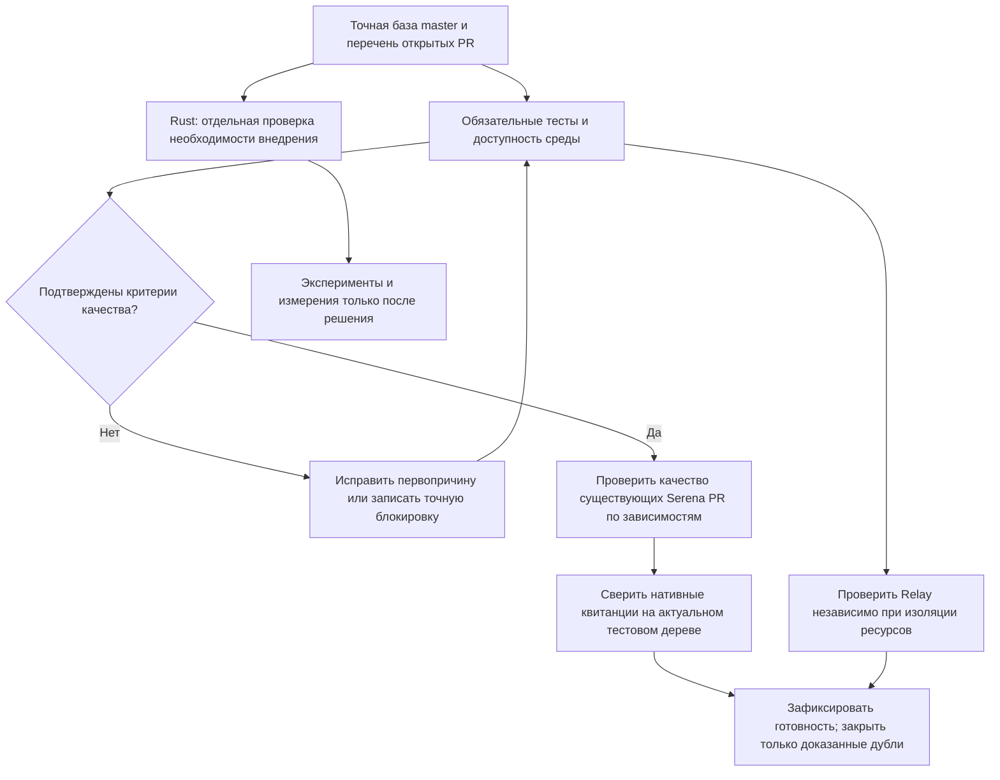

# План повышения качества и сокращения очереди PR mcp-local-hub

**Снимок:** 17.11.2026, `master=a7d92d2852c4f6eb8afb0569ef76a545e38aacf7`. **Статус:** аудит и план качества; не свидетельство готовности PR и не разрешение на слияние.

## Оглавление

1. [Цель, источники и ограничения](#1-цель-источники-и-ограничения)
2. [Результат аудита](#2-результат-аудита)
3. [Порядок выполнения](#3-порядок-выполнения)
4. [Обязательные критерии приёмки](#4-обязательные-критерии-приёмки)
5. [Что сознательно исключено](#5-что-сознательно-исключено)
6. [Отчёт по каждому шагу](#6-отчёт-по-каждому-шагу)
7. [Ссылки и обозначения](#7-ссылки-и-обозначения)
8. [Адресная диагностика тайм-аутов и зависимостей, 17.11.2026](#8-адресная-диагностика-тайм-аутов-и-зависимостей-17112026)
9. [Измеренная ёмкость Go-тестов и оставшиеся квалификационные блокеры](#go-gates-20261117)
10. [Диагностическое разбиение Go-тестов](#go-testshards-20261118)
    - [Проверка POSIX-среды и повторяемости Rust](#platform-preflight-20261118)
11. [Воспроизводимые измерения и ревью чтения файлов](#measurements-review-20261118)
12. [Serena: исправление окружения и проверка чистого исходника](#serena-clean-source-20261118)
13. [Serena: ревью очистки и границ доказательств](#serena-cleanup-review-20261118)
14. [Serena: завершённое ревью и точный остаток](#serena-independent-review-20261118)

## 1. Цель, источники и ограничения

Цель — повышать качество существующих запросов на включение изменений (**PR, pull request**) и уменьшать их количество **без слияния PR в любые ветки репозиториев**. Допустимы аудит, адресные исправления, упрощение зависимостей, устранение дубликатов и закрытие только доказанно поглощённых PR с сохранением уникального результата. Само слияние выполняет исключительно владелец, вне работы агента. Приоритет — корректность Hub и Serena, безопасность Windows и независимость исследований Rust.

Источники истины: текущие ветки GitHub, [правила репозитория](../../AGENTS.md), [подробный порядок приёмки](../../docs/agent-runbook.md#pr-review--merge-workflow-mandatory), [аудит всех 28 PR](https://github.com/applicate2628/mcp-local-hub/pull/637#issuecomment-6930360422) и сохранённые квитанции точных коммитов. Исторический результат не становится результатом нового HEAD только из-за совпадения имени ветки.

**На момент аудита:** 28 открытых PR, все Draft: 18 Serena, 1 Windows Product, 1 Relay и 8 Rust/измерений. Среди Serena 17 из 18 имеют завершённый ответ бота без замечаний к **своему текущему** коммиту; #632 обновлён после последнего ответа. У остальных десяти PR такого подтверждения нет. На протяжении аудита новых технических дублей, полностью поглощённых `master`, не доказано.

## 2. Результат аудита

**Таблица 1 — группировка без дублирования ответственности**

| Группа | PR | Решение |
|---|---|---|
| Подготовка Serena | [#632](https://github.com/applicate2628/mcp-local-hub/pull/632) → [#635](https://github.com/applicate2628/mcp-local-hub/pull/635) → [#636](https://github.com/applicate2628/mcp-local-hub/pull/636) → [#637](https://github.com/applicate2628/mcp-local-hub/pull/637) | Сохранить именно **цепочку зависимостей**: обнаружение UV → издатель исходников → защищённое пространство → реальные тесты |
| Serena, среда сборки и запуска | [#639](https://github.com/applicate2628/mcp-local-hub/pull/639), [#646](https://github.com/applicate2628/mcp-local-hub/pull/646)–[#649](https://github.com/applicate2628/mcp-local-hub/pull/649) | Проверять согласованно по контракту среды, не дублировать изменения в новом PR |
| Serena, файлы и очистка | [#643](https://github.com/applicate2628/mcp-local-hub/pull/643), [#645](https://github.com/applicate2628/mcp-local-hub/pull/645), [#651](https://github.com/applicate2628/mcp-local-hub/pull/651)–[#652](https://github.com/applicate2628/mcp-local-hub/pull/652) | Проверить общий владелец каталога, запрет подмены, файловые атрибуты и сроки |
| Serena, сеть и завершение | [#650](https://github.com/applicate2628/mcp-local-hub/pull/650), [#653](https://github.com/applicate2628/mcp-local-hub/pull/653)–[#656](https://github.com/applicate2628/mcp-local-hub/pull/656) | Проверить правильную последовательность получения, валидации и закрытия ресурсов |
| Настоящий тестовый Product | [#657](https://github.com/applicate2628/mcp-local-hub/pull/657) | Сохранить полученный нативный результат (§10.1) и завершить самостоятельное ревью границ тестовой сборки; устанавливаемый Product не менять |
| Relay | [#629](https://github.com/applicate2628/mcp-local-hub/pull/629) | Одна самостоятельная зона; ранее влитый **в #629** [#630](https://github.com/applicate2628/mcp-local-hub/pull/630) повторно не переносить |
| Rust: план, базовые испытания и эксперименты | [#623](https://github.com/applicate2628/mcp-local-hub/pull/623)–[#628](https://github.com/applicate2628/mcp-local-hub/pull/628), [#644](https://github.com/applicate2628/mcp-local-hub/pull/644), [#631](https://github.com/applicate2628/mcp-local-hub/pull/631) | Отделить исследовательские доказательства от промышленного перехода, не сливать ради численного уменьшения очереди |

Пересечения `serena_build_environment.go`, `serena_owned_tree_windows.go`, `serena_prepared_acquisition.go` и `relay_qualification.go` означают **необходимость совместной проверки**, но не тождество правок. Историческое тестовое дерево `4c600ef` содержит 70 изменённых файлов относительно того же `master`, а его успешная нативная Serena-проверка привязана к точным исходникам; эти результаты нельзя автоматически переносить на новые коммиты PR.

## 3. Порядок выполнения

**Актуальный остаток на 18.11.2026 — в [§14.3](#143-действующий-остаток).** Тринадцать ревью Serena из таблицы 13 завершены. Последовательность ниже задаёт общие критерии, а исходные отказы таблицы 2 сохраняются как история; полученные позже результаты приведены в §10–§14.

**Рис. 1 — минимальный поток повышения качества PR без слияния**



### Шаг 1. Зафиксировать базовую приёмку и реальные блокеры

- Сверить `master`, открытые PR и локальные деревья перед тестами; не запускать проверки по старым SHA (идентификаторам коммитов).
- На отдельном проверочном окружении выполнить обязательные Go build/vet/full/default/state-tag команды из `AGENTS.md`, сохранить настоящие имена отказов и отделить дефект программы от недостающих прав/политик среды. Не перезапускать неизменившийся сценарий без новой проверяемой гипотезы.
- Для [#657](https://github.com/applicate2628/mcp-local-hub/pull/657) продолжить самостоятельное ревью границ тестового режима: обычный JSON-план не должен получать его поля. Точный нативный Product/RunV5-результат на `4fa52b60` уже получен (§10.1); повторять его без изменившихся входов или конкретной гипотезы не требуется. Отказ хоста в отдельной PowerShell-фикстуре не обходить другим исполняющим путём.
- Не расширять локальный токен Windows или системные политики, чтобы искусственно сделать успешным тест чужого владельца. Отдельно сохранить CST/право-владения как внешние ограничения, пока нет разрешённого окружения.

**Выход шага:** воспроизводимый комплект обязательных проверок и матрица блокеров; наличие PASS не даёт агенту права сливать PR.

**Проверенный baseline на `master=a7d92d2` (17.11.2026, Comet, Go 1.27.4, локальный кеш, изолированные временные каталоги):** `go build ./...` и `go vet ./...` — PASS; `go test -count=1 -timeout 5m ./...` — **FAIL**; `go test -tags=test_state_path_env -count=1 -timeout 5m ./internal/api/ ./internal/cli/` — **FAIL**. Сохранены фактические журналы, коды возврата и SHA-256 в приватном изолированном каталоге проверки, вне `trash`. Полная готовность этих изменений не подтверждена; прав на слияние у агента нет независимо от результатов.

**Таблица 2 — исходные причины неуспешной приёмки 17.11.2026 (без ложной классификации всех как дефектов); последующие результаты — §10–§14:**

| Область | Наблюдение | Следующее действие без лишних повторов |
|---|---|---|
| `internal/api` | Оба полного прогона остановились по 300-секундному лимиту, на разных сценариях `Adopt` и `DeAdopt` | Отдельно установить зависимость от нагрузок и блокировок, без изменения лимитов вслепую |
| `internal/cli` | Полные прогоны остановились по 300 с; `RunV5UpgradeWindows_UnreadableIntentAbortsUpgrade` потребовал квалифицированный CLI Product, которого в обычном `go test` нет | Проверить актуальный #657 на нативном тестовом Product; отдельно исследовать таймауты |
| Serena | 14 сценариев не дошли до цели из-за консольного PE (фактически subsystem 3, требовался GUI subsystem 2); ещё один — `SERENA_BUILD_SOURCE_INVALID` | Использовать уже предусмотренную цепочку #632/#635–#637 и квалифицированную среду; не подменять предпосылку заглушкой |
| `internal/daemonrecovery` | Отказ записи аудита по deadline и зависший портовый запрос | Адресно воспроизвести на текущей основе; не переносить чужие исторические PASS |
| `internal/process` | Отсутствуют квалифицированные вводные для двух Windows Job-тестов; у другого теста дочерняя среда не содержит ожидаемого значения | Разделить входные предпосылки и действительную ошибку окружения |
| tagged API | `TestAttachExisting_PublicCLIReceiving` требует исходный tagged Product и ожидаемый digest | Готовить только реальный проверенный исполняемый тестовый артефакт, без ослабления проверки |

### Шаг 2. Повысить качество фундаментальных Serena PR без создания новых веток

- Сверить тесты изменённого #632 и восстановленную защиту пустых элементов `PATH`; зафиксировать, относится ли уже опубликованный ответ бота к текущему HEAD. Новый квотный запуск ревью требует отдельного разрешения и не является условием продолжения доступного аудита исходников.
- Затем проверить и при необходимости исправить **уже открытые** #635 → #636 → #637. Сравнить историю и самостоятельные изменения каждой ветки; записать отсутствующие исправления родителей, не перенося их между ветками. Не сливать и не удалять базовые ветки. Существенное изменение исходника требует новой проверки зависящего от него образа; прежняя квитанция остаётся привязанной к прежнему коммиту.
- Не объединять ответственность #635–#637 с несвязанными Rust, Relay или тестовым Product; никакого слияния PR не выполнять.

**Выход:** фундаментальные PR с подтверждённым качеством и документированными блокировками, сохранённые открытыми до действий владельца.

### Шаг 3. Довести оставшиеся Serena PR до проверенного состояния

- Улучшать существующие PR по их реальной зависимости: среда запуска #639/#646–#649 → файловые владельцы/очистка #643/#645/#651/#652 → протокол/квитанции #650/#653–#656. Пересечения проверять чтением точных исходников, самостоятельных патчей и сохранённых квитанций. **Не объединять PR-ветки или их изменения даже в локальном проверочном дереве.** Исторические объединённые деревья не считать текущими исходниками и не использовать для обхода этого ограничения.
- Не создавать «общий исправительный PR» и не объединять ветки с разными владельцами только ради числа открытых PR. Не наслаивать повторные фиксы поверх исправленной первопричины; если правки эквивалентны, доказать полноту поглощения до закрытия лишнего PR.
- Нативные проверки выполнять на точном чистом исходнике одной существующей ветки в разрешённом изолированном окружении. Если сквозной сценарий требует отсутствующих изменений других PR, зафиксировать зависимость и продолжить доступное самостоятельное ревью; необходимый единый исходник должен предоставить владелец. Установка пакетов и загрузка новых входов требуют отдельного разрешения. При доступных предпосылках проверять протокольный обмен, завершение исходных процессов, закрытие ресурсов, запись `Ready`, защитные записи и ожидаемые отказы по **квитанциям**, а не только по коду возврата.
- Полные проверки и точные ревью каждого PR остаются самостоятельными обязательными gates; прежний интеграционный PASS не подменяет их.

**Выход:** отдельный статус качества каждого исходного PR, нативные результаты для фактически проверенных коммитов и точные зависимости незавершённой приёмки; никаких слияний или объединения PR-изменений.

### Шаг 4. Проверить качество Relay отдельно

- Вести #629 параллельно Serena только при реально независимых тестовых ресурсах; иначе запускать последовательно без конкуренции за порты и рабочие каталоги. Проверить передачи ввода/вывода, отказы и закрытие владельца. Изменения #630 **уже внутри** #629; не открывать ещё один PR и не cherry-pick их вторично.
- После подтверждения тестов, ревью и совместимости с текущим `master` зафиксировать статус готовности #629 для владельца, не сливая его в репозиторий.

**Выход:** одно независимо проверенное изменение Relay либо точно описанная причина, мешающая признать качество достаточным.

### Шаг 5. Rust и производительность — не мешать основной приёмке

- Сохранить #623 как целевой документ перехода, но сначала проверить, **доказана ли необходимость** замены конкретного Go-владельца Rust-компонентом и какие реальные измерения это подтверждают. Нет решения — не интегрировать эксперимент в производственный код.
- При положительном решении последовательно проверить #625 → #644 → #631 (владение процессом → исходная идентичность → интерфейс Go/Rust); #627 — отдельный защищённый reader; #624/#626/#628 — независимые исходные измерения. Они не являются дубликатами.
- В #623 три исторических JSON-снимка занимают **12 312 из 15 171 изменённой строки**. Если есть верная архивная копия и проверенные хеши, можно заменить тяжёлое текстовое представление компактным индексом **в том же PR**. Уникальные доказательства не удалять и не помещать в `trash`.
- Локальные проверки Rust допустимы в разрешённом окружении; не запускать внешние модели, квотные CI, платные инструменты или установку ПО без отдельного подтверждения.

**Выход:** небольшое подтверждённое решение «внедрять / продолжать исследование / отложить» с сохранёнными текущими PR.

### Шаг 6. Сократить очередь только после доказательства избыточности

- Ещё раз сопоставить `master`, PR, коммиты и их конечные деревья. Закрыть как дубликат **только доказанно полностью поглощённый** PR, с ссылкой на преемника. Не закрывать уникальные черновики по возрасту или размеру.
- Проверить отсутствие несохранённых правок, живых ресурсов и использующих ветку параллельных сессий. Подтверждённо ненужные локальные материалы переносить в согласованный `trash` (не очищать); уникальные коммиты, необходимые сборки и доказательства оставить вне `trash`.
- Не удалять удалённые или базовые ветки действующего стека автоматически. Закрытие полностью дублирующего PR не должно уничтожать уникальные коммиты, доказательства или необходимые базы других открытых PR.

**Выход:** перечень действительно оставшихся независимых работ, а не искусственно нулевой счётчик PR.

## 4. Обязательные критерии приёмки

Для каждого изменяемого PR: (1) точный текущий коммит и обозримый diff; (2) обязательные тесты и честный отчёт об отказах; (3) действующий no-major-issues результат бота без inline-замечаний **на текущем HEAD** при разрешённой проверке; (4) самостоятельное ревью корректности и безопасности; (5) разрешения владельца на все платные/квотные агенты, ручную CI и публикацию; (6) проверка конечного дерева и квитанций только в изолированной тестовой копии. Неполный пункт не позволяет объявить PR готовым, но не запрещает независимую работу над качеством. **Агент не выполняет слияния PR ни при каких положительных результатах проверки; решения владельца остаются вне его операций.**

## 5. Что сознательно исключено

Не выполнять слияния PR в `master` или другие ветки, включая auto-merge, squash и merge отдельных PR-веток. Не создавать ещё один координационный/агрегирующий PR. Не «чинить» 28 PR пересозданием 28 веток. Не запускать полную дорогостоящую миграцию на каждом неизменном тестовом артефакте. Не повторять уже слитый #630. Не переписывать Rust-эксперименты в промышленный Go/Rust backend до архитектурного решения. Не менять Windows-политику, Task Scheduler, установленный Hub и разрешения. Не удалять необходимые исторические материалы ради уменьшения diff.

## 6. Отчёт по каждому шагу

После **каждого** шага обновлять в существующем PR или этом плане одну короткую сводку: `Что сделано → точный коммит → фактические проверки (PASS/FAIL/NOT RUN) → открытые блокеры → изменившийся остаток`. Сведения об уже принятых шагах не дублировать; следующий шаг не расширять до неавторизованной работы.

## 7. Ссылки и обозначения

1. [Полный аудит 28 PR, 17.11.2026](https://github.com/applicate2628/mcp-local-hub/pull/637#issuecomment-6930360422).
2. [Ревью Rust-веток и материалов](https://github.com/applicate2628/mcp-local-hub/pull/623#issuecomment-6930368840).
3. [Режим и неизменные правила ревью](../../docs/agent-runbook.md#pr-review--merge-workflow-mandatory).
4. [Обязательные инструкции агентов](../../AGENTS.md).

**Обозначения:** PR — запрос на включение изменений (pull request); CI — автоматизированная непрерывная интеграция (continuous integration); GUI — графический интерфейс; E2E — сквозной тест; MCP — Model Context Protocol; FFI — интерфейс вызова функций между языками (foreign function interface); Rust — системный язык программирования; UV — менеджер пакетов и сред Python; SHA — криптографический идентификатор содержимого; TCP — протокол управления передачей данных.

## 8. Адресная диагностика тайм-аутов и зависимостей, 17.11.2026

**Область доказательств:** отдельная чистая копия `#658 HEAD=c00241d0475c157c57bd1699239293799911e6e1` на Comet (Windows/amd64, Go 1.27.4), изолированные `TEMP=TMP=TMPDIR=GOTMPDIR`, `HOME=USERPROFILE`, только локальные кеши модулей; установок, изменения политики Windows, CI и запуска внешних моделей нет. Фактический исходный `master=a7d92d2` не менялся.

**Таблица 3 — воспроизведение адресных сценариев:**

| Сценарий | Команда (к `go test -count=1 -timeout 90s -run`) | Результат |
|---|---|---|
| Adopt: все обязательные приёмники | `'^TestExecuteAdoptExitZeroRequiresAllReceivers$' ./internal/api` | PASS, 4,499 с |
| StrictMode: возврат при ошибке shim | `'^TestStrictModeEnable_RevertOnShimFailure$' ./internal/cli` | PASS, 0,549 с |
| MCP-front: отказ при недоступном маршруте | `'^TestRunReconcileMCPFront_FailsClosedWhenRouteNotLive$' ./internal/cli` | PASS, 30,317 с |

Все три теста закончились с кодом 0; после них рабочее дерево чистое. Два предварительных диагностических запуска с **неверной изоляцией временных переменных** не считаются результатом о качестве продукта: их остановил штатный аудит песочницы. Данные действительного запуска сохранены в `.scratch/go-timeout-triage-20261117-verified-env` проверочной копии, вне `trash`.

Сохранённые полные прогоны на `#658 HEAD=c00241d` ранее дали **FAIL**: в `internal/api` 300-секундный пакетный предел достигнут на Adopt/DeAdopt, в `internal/cli` — на Reconcile/StrictMode. В дампах Windows видны `StringToSid`, `FlushFileBuffers` и ожидание проверки маршрутного слушателя. Поскольку отдельные тесты завершились, **постоянное зависание именно этих тестов не подтверждено**. Влияние общей длительности пакета, числа параллельных проверок, дискового ввода-вывода и порядка тестов остаётся гипотезой. Канонический предел `5m` и проверки безопасности не менялись.

**Зависимости Serena:** #635 (HEAD `6ca53c8`) построен от старого #632 `8cead42`, тогда как текущий #632 `ff4ba7f` содержит исправление пустых элементов `PATH`. Сравнение Git и исходных blob подтвердило отсутствие этого исправления также в HEAD #636 и #637. [Доказательства](https://github.com/applicate2628/mcp-local-hub/pull/635#issuecomment-6953061676). В существующих ветках не выполнялось слияние и не создавалось дублирующее исправление; до согласования зависимостей их совокупная проверка не квалифицирована.

**Windows Product:** #657 HEAD `4fa52b60` прошёл точный нативный тестовый билд, проверку хешей и RunV5, отдельную PowerShell-регрессию (без `ExecutionPolicy Bypass`). Это не означает прохождение обязательных полных Go-тестов или независимых security/bot-review; детали в [#657](https://github.com/applicate2628/mcp-local-hub/pull/657).

**Последующее состояние:** адресные тесты, совокупная локальная проверка 18 Serena PR, текущего Relay #629 и Rust-аудит зафиксированы в [аудите #658](https://github.com/applicate2628/mcp-local-hub/pull/658#issuecomment-6958877563). Расхождение истории #632→#635→#637 на GitHub не устранено слиянием. Количественная повторная проверка обязательного 300-секундного предела, отдельные нативные требования и дальнейший порядок приведены в [разделе 9](#go-gates-20261117).

<a id="go-gates-20261117"></a>
## 9. Измеренная ёмкость Go-тестов и оставшиеся квалификационные блокеры

**Повторная база и границы:** действующий `master=a7d92d2852c4f6eb8afb0569ef76a545e38aacf7`, отдельная чистая проверочная копия на Comet (Windows/amd64; Go 1.27.4), `GOMAXPROCS=4`, локальный кеш модулей без сети, временные каталоги и HOME только в разрешённой области диска D. Не запускались установщик Product, реальные пакеты Serena, внешние модели и ручные GitHub Actions. Ничего не менялось в `master` либо ветках PR. Результаты полного запуска из раздела 8 относятся к другому, хотя и совместимому по Go-коду, коммиту документации `c00241d`; нижеприведённые прогоны относятся **именно к master**.

**Таблица 4 — обнаружение реально компилируемых корневых тестов с помощью `go test -list '^Test'` (без выполнения их тел):**

| Пакет | Обычный Windows/amd64 | `-tags=test_state_path_env` | Дополнительных корневых тестов |
|---|---:|---:|---:|
| `internal/api` | **3436** | **3442** | 6 |
| `internal/cli` | **1960** | **1963** | 3 |
| **Итого** | **5396** | **5405** | **9** |

Списки уникальны внутри каждого режима. Это количество обнаруженных **корневых** функций `Test...`; они не включают дочерние `t.Run`, примеры (`Example...`) и начальные корпуса фаззинг-тестов (`Fuzz...`). Для любой будущей проверки полного покрытия нужно перечислять все применимые категории, а не только эту таблицу. Шесть дополнительных API-тестов включают получение `USERPROFILE`/Known Folder и публичную CLI-квитанцию; три CLI-теста — отдельные сценарии исходной привязки и восстановления.

**Таблица 5 — реальные повторные проверки на том же коммите (не подмена обязательных команд):**

| Команда/сценарий | Итог | Значение |
|---|---|---|
| `go test -json -count=1 -p=1 -timeout 300s ./internal/daemonrecovery` | **PASS**, 101 успешное событие, 0 отказов; ~4 с полная оболочка | Исторические ошибки committed-audit и port-owner deadline не воспроизведены вне общей нагрузки |
| `TestExecuteTerminationCommittedOutcomeMatrix`, `TestExecuteBlockingPortProbeReturnsOnContextDeadlineAndClosesHeldGeneration`, `TestStartWithJob_ChildSeesNormalizedEnvironment` | **3/3 PASS каждый** | Нет основания исправлять эти тесты по одному историческому отказу |
| `go test -json -count=1 -p=1 -timeout 300s ./internal/api` | **FAIL, exit 1**; пакет достиг `300.103s`, внешняя оболочка `320.983s` | До общего тайм-аута **655 корневых PASS**, **1112 PASS-событий** с подтестами и 18 SKIP; не наблюдалось отдельного `Test` FAIL до тайм-аута |
| `TestExecuteDeAdoptProviderPreInstallColdRetryAfterE2WithMissingManifest` | **3/3 PASS**, 0,78/0,62/0,57 с | Именно этот тест выполнялся около 1 с при срабатывании пакетного 300-секундного таймера; отдельное зависание не подтверждено |
| `TestRunReconcileMCPFront_FailsClosedWhenRouteNotLive` | **PASS**, 30,41 с | Ранее попадал в stack trace полного CLI-пакета; собственный отказ не воспроизведён |
| `TestStrictModeEnable_RevertOnShimFailure` | **3/3 PASS** | Ранее также фигурировал при общем CLI-тайм-ауте |

Журнал самостоятельного полного API-запуска: SHA-256 `eae32da1c146443d79b50542ec7ab147a30e28d81b24049c97d12514acdaa5ad`, 1 085 554 байта. Журнал полного `daemonrecovery`: `82a3b223e6fa6b20e13e5295a8a6d01ada0009b4e8849956bbb1822224e25767`. Списки обычных корневых тестов API и CLI: соответственно `d5235fd2ca7b822f44982e9a2ac616c7d0d0571109af6fe3f110d8e2ecc4f85f` и `1db89f4e328bb30032e5de97414b0748594cbb76e3c1f7c95ce70f52214cb84d`. Необходимые исходные квитанции сохранены в `.scratch/go-gate-isolated-full-20261117`, `.scratch/go-gate-focused-followup-20261117` и `.scratch/go-gate-test-inventory-20261117` проверочной копии, вне `trash`.

**Вывод о первопричине:** полный API-пакет действительно превышает 300-секундный общий бюджет **даже при отдельном запуске с `-p=1`**, без одновременных Go-пакетов. Пакет продолжал последовательно завершать тесты вплоть до тайм-аута. Поэтому «исправить последний тест из stack trace» — ложная локальная цель. Это доказывает несоответствие достигнутой длительности **текущему пакетному лимиту**, но не отсутствие дефектов в оставшихся невыполненных тестах и не полное объяснение причин затрат времени. Новый полный CLI-пакет на этом exact HEAD **не запускался**; его исторические 300-секундные отказы и 1960 корневых тестов зафиксированы отдельно.

**Независимые нативные входы — не лечить отключением тестов:** `TestRunV5UpgradeWindows_UnreadableIntentAbortsUpgrade` требует исходно квалифицированный тестовый Product и абсолютную `MCPHUB_CANONICAL_ENTRY_FIXTURE` (точная нативная проверка отдельно проходила в #657); два теста `internal/process` требуют `MCPHUB_JOB_FIXTURE_ENTRY_CONFIG` с проверяемой исходной Job-квитанцией; tagged `TestAttachExisting_PublicCLIReceiving` требует отдельные бинарный файл и ожидаемый digest; положительные Serena-сценарии требуют правильный Windows-subsystem и source-issued образ. Наличие `go test`-бинарника не создаёт этих полномочий. Провалы от отсутствующих квалифицированных входов отличать от истинных регрессий.

**Порядок дальнейшей приёмки (решение о смене обязательного gate не принималось):**

1. Сохранить обе обязательные команды из `AGENTS.md`/`docs/agent-runbook.md` и их реальный красный статус; **не повышать тайм-аут, не скрывать FAIL/SKIP и не объявлять выборочные PASS полным покрытием**.
2. Если владелец одобрит изменение механизма приёмки, спроектировать воспроизводимое разбиение большого пакета на полные неизменённые корневые тесты с исходным `TestMain`, примерами и фаззинг-корпусами, с отдельным ограничением `5m` **на каждый осколок** и без потери/повтора тестовых имён, с изолированными каталогами, совокупной fail-closed проверкой полноты и отказов. Такой дополнительный диагностический прогон **не превращает автоматически старую обязательную команду в PASS**; новый gate должен быть отдельно утверждён и доказан.
3. Квалифицировать требуемые Windows Product/Job/CLI/Serena источники отдельно, с исходными идентичностями и разрешениями на необходимые реальные пакетные операции. До этого полные tagged/positive сценарии честно остаются blocked/FAIL, а не SKIP-приёмкой.
4. После восстановленного обязательного тестового контракта — завершить точную нативную Serena-проверку, независимую безопасность, Rust-эксперименты и повторный аудит дублирующих PR. Ни одна проверка не даёт агенту полномочий на merge. Сохраняются **29 открытых PR**, пока не доказано поглощение уникальной работы.

<a id="go-testshards-20261118"></a>
## 10. Диагностическое разбиение Go-тестов

**Область и статус.** [Инструмент](../../tools/testshards/main.go) и его [тесты](../../tools/testshards/main_test.go) — дополнительная диагностика матрицы из [раздела 9](#go-gates-20261117), **не замена обязательных команд** `go test -count=1 -timeout 5m ./...` и tagged API/CLI. Эти команды остаются FAIL/не квалифицированы, пока не получен их собственный итог.

**Проверяемая схема.** На чистом HEAD `go test -list .` перечисляет реально собранные корневые `Test*`, `Example*`, `Fuzz*`; `Benchmark*` учитываются отдельно, потому что обычный тест их не запускает. Имена сортируются и без пересечений распределяются по точным `-run`-шаблонам. План содержит SHA коммита, Go version, теги, все имена и селекторы. При `-execute` каждая часть исполняется отдельным настоящим Go-процессом с исходным `TestMain`, `-count=1`, `-p=1` и неизменным `-timeout=5m`. Сохраняются исходный JSON-журнал и SHA-256. Процессный exit code, PASS пакета, все ожидаемые корни, отсутствие лишних или дублированных результатов и любой вложенный `SKIP` проверяются как единый fail-closed контракт. Входные каталоги и кеши должны быть изолированы вне рабочего дерева; скачивание модулей запрещено.

Повторный `TestMain` на каждую часть **не эквивалентен** одному процессу полного пакета. Наличие исходного кода, плана или результата отдельной части не подтверждает полное тестовое покрытие, отсутствие межтестовых зависимостей или нативную Product/Job/Serena-квалификацию. Никакие недостающие квитанции не имитируются.

**Таблица 6 — реальные инвентаризации**, `master=a7d92d2`, Go 1.27.4, Windows/amd64:

| Пакет / сборка | Корневых тестов | Частей по ≤80 |
|---|---:|---:|
| API, обычная | 3436 | 43 |
| CLI, обычная | 1960 | 25 |
| API, `test_state_path_env` | 3442 | 44 |
| CLI, `test_state_path_env` | 1963 | 25 |

Тесты самого инструмента `go test -race -count=3`, `go vet` и `go build` — PASS. Реальный одиночный CLI-тест `TestStrictModeEnable_RevertOnShimFailure` — PASS без пропусков. Диагностическая часть API завершила 80/80 корневых тестов, но содержит **8 событий SKIP** при exit 0; инструмент верно записал FAIL, не превратив его в ложный PASS. Другие части не выполнялись.

**Порядок запуска:** в чистом checkout заранее направить `GOROOT`, `GOCACHE`, `GOMODCACHE`, `TEMP`, `TMP`, `TMPDIR`, `GOTMPDIR`, `HOME`, `USERPROFILE`, `APPDATA` и `LOCALAPPDATA` в разрешённое окружение (на Comet — `D:\dev\ChatGPT`, кроме уже установленного read-only Go). Затем:

```powershell
& 'C:\msys64\ucrt64\bin\go.exe' run ./tools/testshards -repo (Get-Location).Path -evidence 'D:\dev\ChatGPT\new-go-test-evidence' -go 'C:\msys64\ucrt64\bin\go.exe' -package './internal/api' -max-roots=80
```

Без `-execute` выполняется только планирование; `-execute -shard=N` — явная диагностическая проверка одной части. Каталог `-evidence` обязан быть новым. Полный запуск частей требует проверки разрешённых нативных предпосылок и не меняет основную обязательную команду без отдельного решения владельца. PR не сливаются.

### 10.1. Windows: классификация пропусков и подлинные тестовые фикстуры, 18.11.2026

**Точная база наблюдений:** `master=a7d92d2852c4f6eb8afb0569ef76a545e38aacf7`, Comet, Windows/amd64, Go 1.27.4, локальные кеши и файлы только на D. Ни один установленный Product, системная политика, удалённая PR-ветка (кроме этого документа) или посторонний процесс не менялись.

**Таблица 7 — восемь событий `SKIP` в первой диагностической части API (80 корневых тестов):**

| Причина | Количество | Проверенный механизм |
|---|---:|---|
| `TestA3_*` | 7 корневых | [Исходные тесты](../../internal/api/client_write_init_a3_toctou_test.go) сами вызывают безусловный `t.Skip` для `runtime.GOOS == "windows"`. Простое получение Windows-привилегии их не запускает; требуются отдельные POSIX-проверки либо отдельно согласованное кроссплатформенное изменение тестов |
| `TestAdoptLeaseLeafWindowsRejectsWrongOwnerNilAndCallbackDACLBeforeLock/wrong-owner` | 1 вложенный | [Нативный тест](../../internal/api/adopt_lease_owner_windows_test.go) вызвал `SetSecurityInfo`, но ОС отказала в установке SID другого владельца: «This security ID may not be assigned as the owner of this object». Не требуется исправлять код допуска на основании этого `SKIP`; исходная privilege-квалификация здесь не пройдена |

**Таблица 8 — отдельно воспроизведённые Windows-фикстуры без установки Product:**

| Сценарий | Результат | Граница доказательства |
|---|---|---|
| Tagged `TestAttachExisting_PublicCLIReceiving` | **PASS**, шесть test-owned дочерних CLI с exit 0, без `SKIP` | Первый отрицательный запуск с обычной сборкой CLI вернул `ATTACH_SUPERVISOR_UNVERIFIED stage=plan`: дочерний CLI не имел тега `test_state_path_env` и не использовал изолированный `MCPHUB_STATE_DIR_OVERRIDE`. После сборки **обоих** участков с тегом тест прошёл, без изменения кода. SHA-256 tagged CLI: `3bb4b607f6ebaa2e70313e945512b0aac0d06f0e505336062adde65869777dcb`; журнала: `52e0f30e66cf7726a3dbde2d3594b8dba15bfc0cb04812d28b30a811d7eb45e9` |
| [`tools/test-job-entry`](../../tools/test-job-entry/README.md): два Job-теста и обязательный native subtest | **PASS**, оригинальный Job-владелец и три проверки | Контроллер собран из той же исходной копии без `trimpath`; тестовый исполняемый файл — с GUI-subsystem. Работа только внутри нового каталога с защищёнными правами для текущего пользователя и SYSTEM. Выдана оригинальная `MCPHUB_JOB_FIXTURE_ENTRY_CONFIG`, проверены `READY/GRANT/ACK`, хеши пакета/бинарников, исходное ожидание, отсутствие чужих участников и закрытие ресурсов. `success=true`, `originalExitCode=0`, `settlementComplete=true`, `stdoutEOF=true`, `stderrEOF=true`. SHA-256 `result.json`: `ec1f41c8a64a5bc26e1d0a03b445d81502625501199caa971aa8a0286543f088` |

Контроллер Job прошёл собственные unit-тесты; `go vet -p=1 ./internal/process ./tools/test-job-entry` — **PASS**. Все тестовые дочерние процессы завершены и дожданы, исходная рабочая копия чистая; оригинальные квитанции оставлены вне `trash`. Исходный [#657](https://github.com/applicate2628/mcp-local-hub/pull/657) подтверждал отдельную каноническую RunV5 Product-фикстуру на **своём** точном HEAD, но этот результат не переносится на `master` или #658 автоматически.

**Оставшиеся ограничения:** POSIX-контракты `TestA3_*` не выполнялись на Linux/macOS; `wrong-owner` остаётся неподтверждённым на данном токене Windows. Положительная Serena подготовка требует отдельного source-issued native образа, а полные Go default/tagged команды остаются **FAIL / не квалифицированы**. Эти адресные PASS не изменяют обязательные лимиты, правила приёмки или запрет агенту сливать PR.

<a id="platform-preflight-20261118"></a>
### 10.2. Пригодность POSIX-среды и независимый Rust-аудит, 18.11.2026

**Таблица 9 — новые проверки, не подменяющие прежние свидетельства.**

| Граница | Проверено | Итог и следующий необходимый вход |
|---|---|---|
| Семь `TestA3_*` на Comet | Существующая Ubuntu в WSL (Windows Subsystem for Linux, подсистема Windows для Linux), UID 1000; разрешённый диск D смонтирован через DrvFS/9p без `metadata`. В отдельном одноразовом каталоге после `chmod 700` каталог имеет режим **777**, после `chmod 600` файл — **777**; символическая ссылка создаётся | **BLOCKED**, не запуск тестов и не FAIL продукта. Для утверждений об owner-only/расширенных POSIX-правах этот рабочий путь непригоден. Go не найден в PATH и проверенных стандартных Linux-путях. Нужны разрешённые POSIX-файловая система и toolchain; монтирование, установки, права пользователя и системные политики не менялись |
| Принимающая Go-сторона [#631](https://github.com/applicate2628/mcp-local-hub/pull/631), точный `2fd3f017a9e5ccd0460293d71ea34aceb62f245e` | Из `experiments/rust-process-owner/ffi/go`: `go test -json -race -count=3 -p=1 -timeout 120s -run '^TestOutcome(AcceptsDefinedStatesWithoutCollapsingCleanup|RejectsIncoherentFields)$' .`, затем `go vet ./...` | **PASS**: 2 разных корневых теста и 32 разных подтеста повторены 3 раза — 6/96 PASS-событий, 0 FAIL/SKIP; vet exit 0. Это проверка валидатора результата ABI (Application Binary Interface, двоичный интерфейс), без запуска Rust DLL |
| Повтор нативной Rust/FFI-квалификации | Установленные Rust/Cargo 1.99.1; прямой установленный Cargo, отдельные CARGO_HOME/target под D, `cargo metadata --offline --locked --format-version 1 --manifest-path experiments/rust-process-owner/ffi/Cargo.toml` | **BLOCKED**, exit 101: отсутствует `windows-sys` в изолированном offline-кеше. Lock требует `windows-sys=0.61.2` и `windows-link=0.2.1`. Не загружались зависимости и не изменялся lock. Исторические native/DLL PASS из #644/#631 не являются новым запуском на Comet |

SHA-256 исходных журналов: POSIX preflight — `731d895af834c18c3c650cc9be212a1836399bfc578565a13aa3214241b930fe`; Go outcome/race — `f680da42ede0cd9fe751c936149adf81946692d430a441643ce4ab659662a25c`; Cargo offline — `cde5040dae7112d38238add7adbbcdd7ed37afec384e69c1e5e2400e34d018c1`. Журналы и исходники сохранены вне trash. Первая попытка через rustup-прокси не нашла default toolchain после изоляции HOME; прямой вызов уже установленного Cargo отделил эту ошибку окружения от настоящего отсутствия кеша.

При ограниченном чтении пути `NativeOwner::process_view()` → `mh_query_identity1` → `Owner.QueryIdentity()` сохранены раздельные observation/admission, исходный process/Job, блокировка после stop/terminal, единственный receiver и отказ без частичного результата. [Ревью на точном коммите #631](https://github.com/applicate2628/mcp-local-hub/pull/631#pullrequestreview-5948270182) фиксирует проверенный объём; это не полное ревью PR, не новый native PASS и не независимая сертификация безопасности. Новая абстракция, второй владелец и перенос Rust в продукт не нужны для этого этапа.

**Остаток:** подходящая разрешённая POSIX-среда и Windows wrong-owner-права; полная Go-приёмка с честным учётом SKIP; чистая source-issued Serena-квалификация; разрешённые offline-входы для Rust/DLL и независимые измерения; заключительный аудит поглощённых PR. Заблокированные внешними условиями действия не повторять без изменившегося входа. Слияния любых PR агентом по-прежнему запрещены.

<a id="measurements-review-20261118"></a>
## 11. Воспроизводимые измерения и ревью чтения файлов, 18.11.2026

**Таблица 10 — новый проход на Comet, Windows build 22631, Intel Core i5-10400, Go 1.27.4, `GOMAXPROCS=4`.** Измерения двух PR выполнялись последовательно, без детектора гонок и профилировщика; функциональные проверки с `-race` выполнялись отдельно.

| PR / точный измеренный исходник | Фактически выполнено | Сохранённый результат |
|---|---|---|
| #624, `87bf2fe6d612de296d4f30a8a5087adb8ee5cdbc` | Все тесты cmaketrace/publicresult: 45 разных корневых тестов и 15 подтестов ×3, 135/45 PASS-событий, 0 FAIL/SKIP; vet exit 0; 36 пробных сочетаний и 40 измерительных образцов | [Отчёт и исходные журналы](https://github.com/applicate2628/mcp-local-hub/blob/251fb4f03405ba438662976137afec0d9c27105e/docs/modernization/verification/cmaketrace-2026-11-18/RESULTS.md). Для repeated 50 000 медианы: разбор 84,260 мс, файл с индексами 99,811 мс, подготовленный публичный JSON 0,245 мс, файл → JSON 100,140 мс |
| #628, `c028db723295f02909969b57f9d1ee8837a22344` | Два native-observation теста ×3, 6 PASS-событий, 0 FAIL/SKIP; vet exit 0; 3 пробных сочетания и 30 измерительных образцов | [Отчёт и исходные журналы](https://github.com/applicate2628/mcp-local-hub/blob/9c2ae02bc1c3a5cf2e1fcd16101043d63bbd6fd9/docs/modernization/verification/native-observation-2026-11-18/RESULTS.md). Два поля собственного процесса: медианы 3175,500 / 1875,000 / 564,150 нс для двух открытий / одного открытия / удерживаемого дескриптора |

В каждом архиве сохранены все 14 исходных файлов: stdout/stderr шести команд, запись выполнения и сводка. SHA-256 архивов: #624 — `3ab9c0ccd2d69bc6e6fa6606457b5f8e9a5d5b42bf81e4d9107570f291ea7f02`; #628 — `5691d2fc6e077c241ea76d198a018e50c5e23d8c6358e3b1633e43129e0961e3`. Медианы повторно вычислены из сырых образцов; команды воспроизведения и гиперссылки оглавления проверены. Контрольные суммы сверены с байтами Git-коммитов; локальные `.gitattributes` в каталогах доказательств исключают изменение байтов при замене концов строк. Производственные исходники, тесты и зависимости в новых коммитах этих PR не изменены.

**Ограничения измерений:** синтетический вход CMake, прогретый файловый кеш, собственный процесс в #628; стоимость приобретения удерживаемого дескриптора исключена из его таймера. B/op означает суммарные выделения байтов на операцию, а не пиковую память. Старые числа с другой машины/версии Go не являются сравнением «до/после». Выигрыш Rust и всего Hub, другие платформы и производственная нагрузка не измерены.

В [#627 опубликовано ограниченное ревью](https://github.com/applicate2628/mcp-local-hub/pull/627#pullrequestreview-5953798373) точного `2c13114eabc7ad6cab416788b6e32faaa8c99935`: удержание исходных дескрипторов, контрольный байт над лимитом, хеш возвращаемых байтов и завершение ресурсов. Подтверждённого нового дефекта не найдено. Реальный отказ `CloseHandle`, полная заменяемость Go-интерфейса и новые нативные тесты не квалифицированы. Поиск существующих архивов `windows-sys`/`windows-link` в разрешённых каталогах проекта на Comet не дал нужного кеша; заблокированный Cargo-прогон повторно не запускался.

Сопоставлены самостоятельные изменения #624/#628 и изменённые пути #626. Полное поглощение уникальной работы не доказано; PR не закрывались. Сохраняются **29 открытых PR**. Обязательные полные Go-команды остаются FAIL / не квалифицированы; узкие PASS таблицы 10 их не заменяют. Слияния, интеграция веток, установки, ручной CI и платные запуски не выполнялись.

**Остаток:** подходящая разрешённая POSIX-среда и Windows wrong-owner-квалификация; полная Go-матрица и межтестовые эффекты; расхождение зависимостей Serena #632→#635→#636→#637 и чистый source-issued образ; разрешённые offline-зависимости Rust, нативные отказы/FFI и представительные измерения; дальнейший аудит доказанно поглощённых PR без слияний.

<a id="serena-clean-source-20261118"></a>
## 12. Serena: исправление окружения и проверка чистого исходника, 18.11.2026

**Таблица 11 — актуальные состояния проверенного стека.** Ветки не объединялись; номера коммитов различают исходник проверки и последующую публикацию доказательств.

| PR / текущий HEAD | Результат этого прохода | Сохраняющаяся граница |
|---|---|---|
| #632 — `ff4ba7f85fef35e19b39dced17d9df47bb9237a0` | Подтверждено расхождение истории: общий предок с #635 — `8cead428a6cee57c597e2bd3ed7b3877a6445d30`; новый запрет пустых элементов PATH остаётся только в своей ветке | Прежние адресные тесты не повторялись без изменения кода; дочерние PR этот коммит не содержат |
| #635 — `1c135914c108dda8b63816175347c5da77da26d9` | Исправлен воспроизведённый выход файлов телеметрии Go за work-root: сброс `TEST_TELEMETRY_DIR` и связанных `GO_TELEMETRY_CHILD*`. RED → GREEN; весь пакет сборщика с `-race -count=3`: 3 разных корневых теста и 10 подтестов, 9/30 PASS-событий, 0 FAIL/SKIP; vet PASS | Две строки реализации и четыре строки регрессии; это не новый полный source-issued build обновлённой #635. Поздняя правка #632 здесь отсутствует |
| #636 — `acac454e539a6b951d4b6ee998cc2142ee153069` | Собственное и дополнительное ревью владения каталогами, контекстов, закрытия и конкретных потребителей; нового доказанного дефекта не найдено. [Ревью на точном коммите](https://github.com/applicate2628/mcp-local-hub/pull/636#pullrequestreview-5955306325) | Старый родитель `6ca53c8`; новые исправления #632 и #635 сюда не переносились. Нативная проверка этой реализации выполнена в точном исходнике #637 ниже |
| #637 — `2542d63d2f917dc414a387e0ed2ceb494d118cfe` | Новый коммит содержит только доказательства. Из чистого `84615d465c54d52588ac17c37174d68096d0da90` выпущен и запущен настоящий qualification-образ: `TestSerenaQualificationNamespaceLifetime` и 4 подтеста PASS, exit 0, 0 FAIL/SKIP | Пятнадцать положительных сценариев подготовки пакета, их длинные рабочие пути и независимая очистка #643 в этом запуске не выполнялись |

На установленном Go 1.27.4 последовательность `go telemetry off` → `go version` с унаследованным `TEST_TELEMETRY_DIR` создала один файл `.count` и `local/weekends` во внешнем по отношению к work-root каталоге. Обе стороны опыта находились внутри `D:\dev\ChatGPT`; внешний режим был `local`, `GO_TELEMETRY_CHILD=2` подавлял служебный процесс. После очистки переменных внешний каталог содержал только исходный `mode`. Глобальная телеметрия, сеть и установки не включались. Дополнительные child-переменные сброшены как часть той же границы; отдельная утечка или отправка данных для них не заявляется.

Чистый source-issued образ #637 связан с **3227 исходными файлами**, source epoch `c882ff60ee204e41f79764cf53312ef9e0e4b7483a3df7aca0513017a3d31cd9` и SHA-256 образа `c67713e56639a5b0ff611ee43d02901d89914c3f135d20956913733bf919643e`. Все четыре шага сборщика завершились с известным exit 0, полным native/process и input/output settlement; удерживаемые входные дескрипторы закрыты. Ordinary Product admission отказал. В квитанции сборщика честно осталось `tests_executed=false`; отдельный журнал фиксирует последующий фактический запуск теста. Установленный Product, uv и подготовка пакетов для этого теста не требовались.

**Сохранённые материалы:** [#635 — ошибка окружения, правка, RED/GREEN и первичные источники](https://github.com/applicate2628/mcp-local-hub/blob/1c135914c108dda8b63816175347c5da77da26d9/docs/modernization/verification/serena-publisher-2026-11-18/RESULTS.md); [#637 — полный source snapshot, квитанции владельцев и нативный журнал](https://github.com/applicate2628/mcp-local-hub/blob/2542d63d2f917dc414a387e0ed2ceb494d118cfe/docs/modernization/verification/serena-namespace-2026-11-18/RESULTS.md). Архивы содержат 29 и 34 файла; SHA-256 соответственно `86fd4be6bf6fef814dc703f1ae02ccf3a558b528d61e5f825948cf501a35897a` и `89951300f1df94eb73f8a04c8f834af327106120f33b478bafb52f65f3824f3f`. Байты каждого члена архива сверены; `.gitattributes` сохраняют байты журналов. В публичной копии внешней квитанции только SID текущего пользователя заменён маркером; исходная контрольная сумма сохранена.

В описании #637 исправлен счётчик: **386** вызовов ошибок/утверждений `testing.T` (49 Fatal, 200 Fatalf, 21 Error, 116 Errorf) сохранены в базе и HEAD; прежние 392 включали шесть `fmt.Errorf`, создающих ошибки. Код проверок не ослаблялся. Квалификация lifetime проверяет отмену запроса, а не контекста владельца, и сравнивает живые сроки без ожидания истечения. Реальные отказы CloseHandle и освобождения native-ресурсов экспериментально не установлены.

Обязательные полные Go-команды остаются **FAIL / не квалифицированы**. Новый образ не содержит поздние исправления #632/#635 или независимую #643; для безопасного запуска старого сборщика runner заранее очищал telemetry-переменные. Никаких слияний, интеграции PR-веток, установок, ручного CI и квотных внешних ревью не выполнялось.

**Остаток:** ревью связанной очистки Serena #643 и остальных независимых изменений; устранение подтверждённых дефектов в владеющих PR без объединения веток; полная Go-матрица и межтестовые эффекты; положительная Serena-подготовка при наличии согласованного исходника и разрешённых входов; подходящие POSIX/native/offline-входы, Rust/DLL и представительные измерения; заключительный аудит полностью поглощённых PR. Точное внешнее ревью актуальных HEAD и все обязательные критерии готовности остаются открыты.

<a id="serena-cleanup-review-20261118"></a>
## 13. Serena: ревью очистки и границ доказательств, 18.11.2026

Проверены семь изменённых файлов #643, реальные потребители дерева, привязка политики и учёт завершения ресурсов. Собственное ревью дополнено тремя независимыми по предмету проверками: привязка родителя, жизненный цикл, зависимости/сложность. **Нового конкретного дефекта исполнения в проверенном объёме не установлено.** Результат не является нативной приёмкой или независимой сертификацией безопасности.

**Таблица 12 — самостоятельные обязанности и пересечения.**

| PR / точный исходник | Проверенная обязанность | Результат и ограничение |
|---|---|---|
| #643 — `527574928335142d95bc073c6ca4459fef9f9f90` | Исходный срок очистки, новое наблюдение родителя, удержание идентичности и ошибок закрытия | [Опубликованное ревью](https://github.com/applicate2628/mcp-local-hub/pull/643#pullrequestreview-5956820088). Новый коммит меняет только комментарий (+4/-3) относительно `5002fc643c80cabaab20c1b36483fd9ac2aaa09d`; все байты вне комментария совпадают. Поведение, тесты и зависимости сохранены |
| #645 — `98511ab9ea633b7e47e825396f002dc783c51d9f` | Пустой перечень файловых потоков при нативном `ERROR_HANDLE_EOF` | Самостоятельная коррекция, отсутствующая в #643. Для воспроизведённого поведения Windows нужна дополнительно к исправлению времени жизни; ревью пересечения не заменяет полное ревью этого PR |
| #648 — `fc4dc5c7145e4f4d709b91654ab4bc1fd7abe259` | Владение файлом ограничений сборки и его закрытие при установке | Не поглощает #643. Пересечения в owner.close и acquireRoots требуют сохранения обеих причин ошибки (`cleanupParentErr`, `constraintErr`), обоих сроков дерева и владения файлом; объединение не выполнялось |

Все четыре места создания дерева — проба, поколение, попытка установки и квалификация — передают уже выделенный абсолютный срок очистки. Закрытые владельцы, опубликованные читатели, отменённые/продлённые контексты и сохранённые ошибки отвергаются до нового наблюдения. Нативная проверка нового наблюдения и привязка полного идентификатора файла/тома предшествуют очистке; исходное рабочее наблюдение остаётся неизменным. Инвентаризация сохраняемых жёстких ссылок и итогового поколения использует путь очистки. Новый владелец, срок, зависимость или дополнительный слой не вводились; обоснованного удаления либо упрощения кода в этом объёме не найдено.

**Исправленная граница комментария.** `createMissing=false` запрещает создание компонентов проверяемого родительского пути. Однако при допускающем ослабление отказе строгой проверки существующий наблюдатель может вызвать запись аудита, прежде чем #643 отвергнет результат `default-relax`. Журнал может открываться/создаваться, ротироваться, дополняться и синхронизироваться. Формулировка «read-only» заменена точным описанием; подавление аудита или изменение исполнения не требуются. Источники: [наблюдатель политики](https://github.com/applicate2628/mcp-local-hub/blob/5002fc643c80cabaab20c1b36483fd9ac2aaa09d/internal/api/config_parent_policy_observed_windows.go), [приобретение родителя аудита](https://github.com/applicate2628/mcp-local-hub/blob/5002fc643c80cabaab20c1b36483fd9ac2aaa09d/internal/api/hub_mcp_log_parent_observed_windows.go), [новый комментарий](https://github.com/applicate2628/mcp-local-hub/blob/527574928335142d95bc073c6ca4459fef9f9f90/internal/api/serena_owned_tree_windows.go#L211-L215).

**Что действительно проверялось.** [Сохранённый прогон 17.11](https://github.com/applicate2628/mcp-local-hub/pull/643#issuecomment-6956230884) относится к `5002fc6`: `go test -count=1 -timeout 90s -run '^TestSerenaOwnedTreeCleanup' ./internal/api` и `go vet ./internal/api` — PASS, Windows/amd64, Go 1.27.4. В семи Windows-функциях 42 конечных случая: срок 8, привязка родителя 28, исходный издатель 1, отменённый контекст 1, опубликованный читатель 1, закрытый владелец 1, сохранённые ошибки 2. Это условия допуска и сравнения построенных данных; успешное приобретение реального дерева и его удаление позже рабочего срока ими не выполняются. Ошибки закрытия внесены в состояния теста, а не получены настоящим отказом `CloseHandle`. Прежний результат 27 семейных случаев сохранён как исторический; точный селектор из предположенного префикса не восстанавливается.

В этом проходе тесты, сборки и нативная очистка **не запускались**. Комментарий проверен точным сравнением коммитов и повторным чтением опубликованных байтов; это не новый результат исполнения. Прежний завершённый ответ бота относится к `5002fc6`; новый внешний запуск не запрашивался. Комментарий меняет идентичность исходника, поэтому прежняя квитанция образа не становится квитанцией нового HEAD.

**Открытая нативная граница.** Самостоятельная #643 ещё использует обычный нативный механизм определения системного каталога Windows; её валидатор принимает только `CoTaskMemFree-void`. Проверка заимствованного издателя на искусственных данных не доказывает реальное закрытие/повторное открытие пространства #636. Выполненный ранее тест пространства #637 не содержит #643. Узкий прямой опыт с деревом на D не объявляется невозможным, но безопасная изоляция политики и настоящие доказательства закрытия исходных владельцев здесь не установлены; одной подмены временных/профильных переменных недостаточно. Требуются фактическое приобретение под рабочим контекстом, очистка в ранее выделенном более позднем сроке, инвентаризация/удаление, сохранение исходного наблюдения и правдивые квитанции ресурсов.

**История и действующий порядок.** [Прежняя проба #643+#645](https://github.com/applicate2628/mcp-local-hub/pull/643#issuecomment-6956230884) и [проба #643+#645+#648](https://github.com/applicate2628/mcp-local-hub/pull/648#issuecomment-6956465238) были незафиксированными объединёнными деревьями. Эти записи объясняют прежние результаты, но не доказывают включение изменений в текущие ветки, готовность чистого образа или полное поглощение PR. В действующих шагах 2–3 устранены устаревшие указания повторять объединение: проверять каждый точный исходник самостоятельно; для общего сценария записать недостающий исходник как вход от владельца и продолжить доступное ревью. Запрет распространяется и на локальные проверочные деревья. История проверок сохранена.

Обязательные полные Go-команды остаются **FAIL / не квалифицированы**. Изменения опубликованы только в существующих #643 и #658; новых PR, слияний, объединений веток, установок, ручных запусков CI (непрерывной интеграции) или квотных внешних ревью не выполнялось. Три рассмотренных PR сохраняют уникальную работу и остаются открытыми черновиками.

**Остаток на момент §13 (исторический):** самостоятельное ревью #645/#648 и следующих файловых владельцев #651/#652, затем оставшихся изменений среды и протокола; нативная очистка и положительная подготовка Serena при доступных точных исходниках и разрешённых входах; полная Go-приёмка и межтестовые эффекты; подходящие POSIX-права, Windows wrong-owner и offline-входы Rust/DLL; проверка актуальности внешних ревью и заключительный аудит только доказанно поглощённых PR. Объединение PR-изменений агентом не является шагом плана. Завершение перечисленных самостоятельных ревью и действующий остаток записаны в [§14](#serena-independent-review-20261118).

<a id="serena-independent-review-20261118"></a>
## 14. Serena: завершённое ревью самостоятельных изменений и точный остаток, 18.11.2026

Завершено собственное ревью всех изменённых файлов и необходимых потребителей **13 самостоятельных Serena PR** из таблицы 13. Дополнительные независимые проверки охватили контракты среды, файловых владельцев, времени жизни, протокола и доказательств. **Нового конкретного дефекта исполнения в проверенных изменениях не установлено.** Вывод ограничен рассмотренными исходниками; полная нативная приёмка и независимая сертификация безопасности им не установлены.

Опубликованы 13 ревью с типом `COMMENT`, уточнены описания этих PR и связанные исторические статусы #635/#637/#643 — **16 описаний**. Исполняемые исходники, тесты, зависимости и HEAD этих PR не менялись. **В этом проходе не выполнялись тесты, сборки, нативные пробы или установки.** Исторические PASS остаются результатами своих исходников и селекторов; новых результатов исполнения или статусов CI не заявляется.

**Таблица 13 — точные исходники, установленные контракты и границы ревью.**

| PR / опубликованное ревью | Точный HEAD | Что установлено и чем ограничен вывод |
|---|---|---|
| [#639](https://github.com/applicate2628/mcp-local-hub/pull/639#pullrequestreview-5959654251) | `98c4b54a69f2776fdabc2b8b8d19f09110e02a74` | Точный ключ `PYTHONUNBUFFERED` исключается до разрешения значения и не входит в идентичность сборки. Случай NUL проверяет нормализатор непосредственно, а не отказ подготовки на уже исключённой декларации. Новые тесты не запускают Python/UV и не сравнивают полные идентичности запросов. |
| [#645](https://github.com/applicate2628/mcp-local-hub/pull/645#pullrequestreview-5959530115) | `98511ab9ea633b7e47e825396f002dc783c51d9f` | Только `ERROR_HANDLE_EOF` принимается как пустой перечень потоков; текущая ошибка контекста сохраняется. Для обычного файла инвентаризация требует единственный основной поток нужного размера. Восемь нативных случаев проверяют примитив, а не полную очистку; отмена и слишком малый буфер заданы до вызова. |
| [#646](https://github.com/applicate2628/mcp-local-hub/pull/646#pullrequestreview-5959654873) | `1df32782e7ade719e1d7f8c6153b4455a6ea740a` | Предпочтение UV `system` сохраняет последующую нативную квалификацию Python, работу без сети и запрет загрузки интерпретатора. Это не поиск только в PATH: реестр и управляемый Python остаются возможными источниками. Текущий тест проверяет аргументы; историческое сравнение двух вариантов UV не является полной подготовкой. |
| [#647](https://github.com/applicate2628/mcp-local-hub/pull/647#pullrequestreview-5959655249) | `6de482cdd09034f71b5e091cc9e385e229cd96a2` | Фиксированные `PATHEXT=.EXE` и параметры процесса Git `core.longpaths=true` входят в проекцию идентичности вместе с правилами. Пользовательские декларации Git получают отказ; PATHEXT исключается из входов сборки. Девять конечных случаев проверяют среду и отказы без запуска Git/UV. |
| [#648](https://github.com/applicate2628/mcp-local-hub/pull/648#pullrequestreview-5959530461) | `fc4dc5c7145e4f4d709b91654ab4bc1fd7abe259` | Байты `setuptools<84\n` и правило связаны с идентичностью до вычисления пакета; путь попытки исключён. Проверены передача управления исполнителю, удержание файла до завершения исходного процесса и сохранение ошибок закрытия. Новые тесты не выполняют успешный полный производственный цикл файла ограничения. |
| [#649](https://github.com/applicate2628/mcp-local-hub/pull/649#pullrequestreview-5959655594) | `73caa97a860f1eaec205ec84c1502c47ce05cdc0` | `USERPROFILE` указывает на принадлежащий исходному запросу каталог квалификации; закрытая среда проверяется перед созданием процесса. Прямого положительного теста `HostInputs/USERPROFILE` нет. Историческая проба `Path.home()` использует стандартную библиотеку Python, без Serena и производственного цикла ресурсов. |
| [#650](https://github.com/applicate2628/mcp-local-hub/pull/650#pullrequestreview-5959915031) | `686a54c0efbe9f99cb6ffa8d6480b289c6f465bf` | Приватная привязка сохраняет исходные срок и отмену POST/DELETE; `activeDials` охватывает валидацию и закрытие при ошибке. Приём завершённого протокола не отменяет отдельные доказательства освобождения endpoint, процесса и ввода/вывода. Пять выбранных корней содержат 18 конечных случаев; реальные локальные сокеты доходят до контролируемого отказа валидатора, а не успешного MCP. |
| [#651](https://github.com/applicate2628/mcp-local-hub/pull/651#pullrequestreview-5959530807) | `01c08819cb0d3fc4fe2b9e11833e40de3c28c3d6` | Удаление получает `FILE_WRITE_ATTRIBUTES` и использует `DELETE \| IGNORE_READONLY_ATTRIBUTE`, не меняя общий атрибут readonly. Нативный тест сохраняет другую жёсткую ссылку, но закрывает её наблюдающий дескриптор до удаления. Полный `RemoveOwned`, каталоги readonly и реальные отказы закрытия не проверены этой выборкой. |
| [#652](https://github.com/applicate2628/mcp-local-hub/pull/652#pullrequestreview-5959531154) | `b079e4c9503f080d8ab09742270c89a3bf88d7d5` | Чтение установленных файлов связано с исходным владельцем поколения; приватная ссылка не сериализуется. UV не объявляется исполняемым файлом поколения, установленный Python проверяется через него. Пять корней содержат 50 конечных случаев; положительный внутренний пакет чтений не является успешным внешним квалификатором с настоящим исходным владельцем. |
| [#653](https://github.com/applicate2628/mcp-local-hub/pull/653#pullrequestreview-5959915445) | `90fd6f69ea4a59856375e29b34cebf4953cb2ff4` | Округление бюджета вниз сохраняет абсолютный срок. Точная грамматика заголовков и числовых зон IPv6 сохраняет положительную привязку IPv4 и отказ слушателю на всех интерфейсах. Полная описанная выборка — 6 корней / 85 случаев; селектор 17.11 — 5 / 84. Нативный запрос получает настоящее завершение ресурсов, но не требует адреса с зоной в живом сетевом кадре. |
| [#654](https://github.com/applicate2628/mcp-local-hub/pull/654#pullrequestreview-5959915844) | `d01fb6e73013d6a47628b1a9cbecd2d5f3b8e32c` | `readyWritten` принимает исходное чтение с пределом `len(raw)`, отдельно сохраняя непустоту и потолок 1 MiB; вызывающий код закрывает исходное пространство Ready. Два выбранных корня содержат 10 случаев. Положительное условие теста — следующий отказ `PREREQUISITES_MISSING`, без выдачи публикации. |
| [#655](https://github.com/applicate2628/mcp-local-hub/pull/655#pullrequestreview-5959916312) | `2defe618259f7db4144824d19927b032300d160d` | Конкретный финализатор и получение его результата предшествуют локальному `workCancel`, затем отменяется контекст очистки. Сроки, родительская отмена и ранние отказы сохранены. Два выбранных корня содержат восемь случаев с настоящим writer при контролируемой ошибке `LockPackage`; установка не выполняется. |
| [#656](https://github.com/applicate2628/mcp-local-hub/pull/656#pullrequestreview-5959916789) | `5efac36d1e2b4be998fadfa4ccfed1a5da098cff` | Единственный исходный `Conn.Close` публикует фактический результат; получатель затем ждёт исходный ввод/вывод. Сохранены проверка контекста и неизменность ранее полученного отказа. Три корня содержат 12 случаев; ошибка Close внесена после настоящего закрытия сокета. Первый синхронный Close и весь `CloseIdleConnections` сохраняют прежние ограничения. |

Числа в таблице 13 описывают прочитанные тесты и сохранённые селекторы, **не новый запуск**. Конечный случай — тест без вложенных подтестов; отдельный результат родительского теста не увеличивает число конечных случаев. Нативные примитивы, искусственно построенные отрицательные состояния, реальные локальные соединения и полный сценарий с проверенным исходником различаются по силе доказательства. Подробные сведения и ссылки на точные квитанции находятся в ревью.

Здесь HTTP — протокол передачи запросов; POST и DELETE — его методы. IPv4/IPv6 — версии интернет-протокола; зона IPv6 уточняет сетевую область адреса. MiB — мебибайт, 1 048 576 байт. `Ready` — сохранённая запись готовности пакета; writer/readback — исходный записывающий владелец и результат контрольного чтения. Термины PR, CI, MCP, UV и TCP определены в §7.

### 14.1. Уже принятая историческая Serena-серия

[Итоговый отчёт 15.11.2026](https://github.com/applicate2628/mcp-local-hub/pull/653#issuecomment-6896966516) подтверждает выбранные сценарии на чистом историческом исходнике **`4c600ef464769e0766edf276408a5f89464f3433`**, дерево `c7853dba6f96f4d2503b0b37a845399716509819`, образ квалификации SHA-256 `35310c00af3cf77b7e74c8ce6398032c85cd387dcabda1b6740108fba249bbe9`. Эта серия уже выполнена; её нельзя оставлять в действующем остатке как ещё не начатую.

**Таблица 14 — историческая серия без повторного сложения одинаковых результатов.**

| Часть серии на `4c600ef` | Нативных запусков | Сохранённых конечных случаев | Терминальных результатов PASS | Граница |
|---|---:|---:|---:|---|
| Исходная миграционная проба | 1 | 1 | 1 | Реальная подготовка и квалификация с публикацией защищённого состояния |
| Последующее продолжение | 8 | 9 | 10 | Последний запуск содержит родительский тест и два конечных случая |
| **Вся серия, включая обе строки выше** | **9** | **10** | **11** | Продолжение повторно к этому итогу не прибавляется |

В десяти сохранённых случаях выполнялись **реальная установка закреплённой Serena и MCP-квалификация**. Все девять процессов завершились с кодом 0, пустым stderr и без внешнего тайм-аута. Отчёт связывает исходник, образ, операции, поколения, Ready и квитанции; одноразовые каталоги попытки и квалификации отсутствуют после завершения. **Запуск, получение результата завершения и согласование состояния Supervisor выполнялись заглушками.** Supervisor — процесс управления запущенными сервисами; успешный тест ожидаемой ошибки не доказывает его настоящий перезапуск или готовность установленного продукта.

[Проверка целостности 16.11](https://github.com/applicate2628/mcp-local-hub/pull/653#issuecomment-6923787383) повторно сопоставила те же девять запусков и десять случаев, журналы, конфигурации, исходник, образ, состояния и старый журнал отказа. SHA-256 отчёта: `96028dd6702c521cd7e74f407127663ceb350a0b6f1705110e4dcbf549f5edb0`. Это повторное чтение доказательств, а не новая установка или восстановление исходного нативного владения.

**Старый stage06 не переклассифицирован.** Запуск на `72f4e9e5a618b347c79a269cf665f7995f5a3bb7` сохраняет **FAIL / original settlement NOT_ESTABLISHED** — исходное полное завершение ресурсов не установлено. Его исходный TCP-кадр не сохранён, а отдельная последующая диагностика не содержала TCP-адресов с зоной. Исправление IPv6 и новый успешный случай поэтому не доказывают причину старого отказа и не восстанавливают утраченное свидетельство завершения. **Пять ранее принятых конечных случаев продолжения остаются на `72f4e9e`; все пятнадцать случаев не объявляются заново выполненными на `4c600ef`.** Неисполненные стадии старой серии сохраняют NOT_RUN. [Исходная запись отказа](https://github.com/applicate2628/mcp-local-hub/pull/653#issuecomment-6895352400).

Историческая серия не подтверждает полный Go-набор, новые HEAD, установленный Product или текущий статус CI. Product здесь — обычный исполняемый продукт, отдельный от образа квалификации. Поздние незафиксированные совместные деревья также не становятся исходником `4c600ef` и не заменяют его квитанции. Исторические ограничения фикстур из отчёта 15.11 не переносятся автоматически в действующий остаток: отдельный RunV5 Product-тест #657 уже имеет свой результат (§10.1).

### 14.2. Поздние изменения имеют разные последствия для доказательств

**Таблица 15 — изменения после исторической серии.**

| PR / текущий HEAD | Характер позднего изменения | Что сохраняется и что остаётся открытым |
|---|---|---|
| #635 — `1c135914c108dda8b63816175347c5da77da26d9` | **Изменение исполнения:** очистка `TEST_TELEMETRY_DIR` и связанных `GO_TELEMETRY_CHILD*`; отдельная регрессия | RED/GREEN и проверки пакета сборщика сохранены в §12. Историческая Serena-серия предшествует этой правке и не проверяет её в полной подготовке. Поздняя защита PATH из #632 в этой ветке отсутствует. |
| #637 — `2542d63d2f917dc414a387e0ed2ceb494d118cfe` | **Только доказательства:** архив исходников, квитанций и журналов | Образ выпущен из чистого `84615d465c54d52588ac17c37174d68096d0da90`; проверены время жизни пространства и четыре подтеста. Этот исходник является предком `4c600ef`. Сам прогон 18.11 не добавляет результата подготовки пакета и не включает позднюю телеметрическую правку. |
| #643 — `527574928335142d95bc073c6ca4459fef9f9f90` | **Только комментарий:** +4/-3 относительно `5002fc643c80cabaab20c1b36483fd9ac2aaa09d` | Исправлена формулировка «read-only»: проверяемый родитель не создаётся, но аудит может записываться. Остальные байты совпадают; `5002fc6` является предком `4c600ef`. Условия допуска и историческая интеграционная серия не заменяют полную матрицу реальных отказов закрытия и очистки. |

[Сравнение #635](https://github.com/applicate2628/mcp-local-hub/compare/4c600ef464769e0766edf276408a5f89464f3433...1c135914c108dda8b63816175347c5da77da26d9), [сравнение #637](https://github.com/applicate2628/mcp-local-hub/compare/4c600ef464769e0766edf276408a5f89464f3433...2542d63d2f917dc414a387e0ed2ceb494d118cfe) и [сравнение #643](https://github.com/applicate2628/mcp-local-hub/compare/4c600ef464769e0766edf276408a5f89464f3433...527574928335142d95bc073c6ca4459fef9f9f90) показывают по одному более позднему коммиту и разные общие предки. Квитанция не переименовывается в результат нового HEAD/эпохи, но правка только комментария или доказательств не объявляется новым изменением исполнения, требующим повторной миграции сама по себе.

### 14.3. Действующий остаток

1. **Следующие самостоятельные зоны ревью — #632, #629 и #657.** У #632 проверить полный контракт обнаружения UV и последнюю защиту PATH, сохранив уже выполненные RED/GREEN. У #629 — сквозное владение вводом/выводом и передачу разрешения CLI на прерывание ввода; #630 уже входит в #629. У #657 — границы тестового режима, обычного плана и допуска Product; его точные нативные RunV5-результаты уже получены. Объём полного самостоятельного ревью этих зон ещё не подтверждён; прежние адресные проверки и авторские ревью сохраняются.

2. **Затем — оставшийся объём Rust и измерений.** Проверять #625 → #644 → #631 по самостоятельным обязанностям; узкое ревью `QueryIdentity` не является полным ревью двоичного интерфейса между языками и владельца процесса. Для #627 уже выполнено ограниченное ревью reader; остаются заменяемость интерфейса и неподтверждённые нативные отказы. В #623/#624/#626/#628 нужны архитектурная необходимость и представительность измерений; сохранённые выборки #624/#628 не повторяются без нового вопроса.

3. **Общие критерии и внешние вводные.** Полные обязательные Go-команды — **FAIL / не квалифицированы**. Диагностические части не доказывают эквивалентность полному запуску в одном процессе. Нужны подходящие файловая система POSIX (стандарт интерфейсов операционных систем) и инструментарий Go, Windows-фикстура `wrong-owner` для чужого владельца и разрешённые локальные архивы Rust `windows-sys=0.61.2` / `windows-link=0.2.1`. В адресных самостоятельных тестах не покрыты полный цикл ограничения #648, внешний квалификатор #652 и отдельные ветви очистки/закрытия; это не отменяет принятую серию `4c600ef` и не требует её повторения ради неизменного PASS. Заблокированные прогоны не повторяются без изменившегося входа или проверяемой гипотезы; сроки и критерии не ослабляются.

4. **Зависимости и актуальность ревью.** Если сценарию недостаёт изменений других PR, необходимый точный исходник предоставляет владелец. Агент не объединяет ветки или патчи, включая локальные проверочные деревья. Уже существующие внешние квитанции сопоставляются с точными HEAD; новые платные/квотные запуски, ручной CI и установки требуют отдельного разрешения. Отсутствие внешней квитанции не мешает доступному собственному ревью.

Повторная сверка сохраняет **29 открытых PR, все Draft**, и `master=a7d92d2852c4f6eb8afb0569ef76a545e38aacf7`. Полного поглощения уникальной работы какого-либо PR не доказано. Исправления описаний и этого плана не являются основанием для закрытия. Слияний, объединения исходников, создания новых PR или закрытия существующих не выполнялось.
