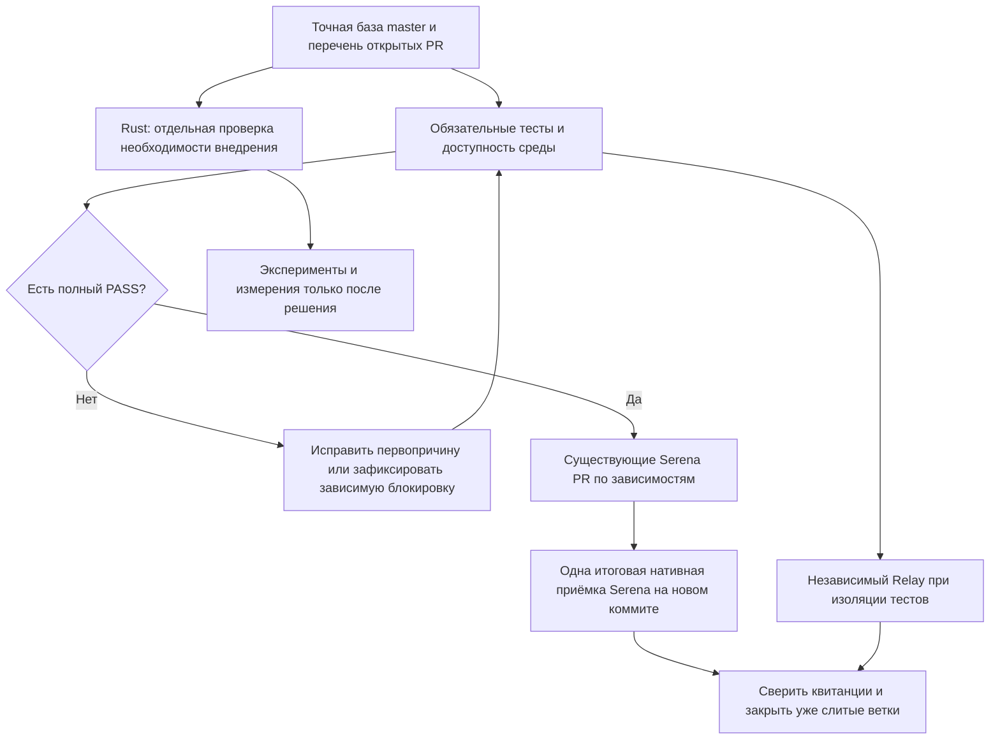

# План приёмки и сокращения очереди PR mcp-local-hub

**Снимок:** 17.11.2026, `master=a7d92d2852c4f6eb8afb0569ef76a545e38aacf7`. **Статус:** аудит и план; не свидетельство готовности к слиянию.

## Оглавление

1. [Цель, источники и ограничения](#1-цель-источники-и-ограничения)
2. [Результат аудита](#2-результат-аудита)
3. [Порядок выполнения](#3-порядок-выполнения)
4. [Обязательные критерии приёмки](#4-обязательные-критерии-приёмки)
5. [Что сознательно исключено](#5-что-сознательно-исключено)
6. [Отчёт по каждому шагу](#6-отчёт-по-каждому-шагу)
7. [Ссылки и обозначения](#7-ссылки-и-обозначения)

## 1. Цель, источники и ограничения

Цель — закрывать существующие запросы на включение изменений (**PR, pull request**) обоснованными слияниями и отказом от действительно дублирующих правок, **не заменяя 28 черновиков одним огромным PR**. Приоритет — рабочий Hub, реальная миграция Serena и сохранение безопасности Windows; Rust остаётся самостоятельным исследованием.

Источники истины: текущие ветки GitHub, [правила репозитория](../../AGENTS.md), [подробный порядок приёмки](../../docs/agent-runbook.md#pr-review--merge-workflow-mandatory), [аудит всех 28 PR](https://github.com/applicate2628/mcp-local-hub/pull/637#issuecomment-6930360422) и сохранённые квитанции точных коммитов. Исторический результат не становится результатом нового HEAD только из-за совпадения имени ветки.

**На момент аудита:** 28 открытых PR, все Draft: 18 Serena, 1 Windows Product, 1 Relay и 8 Rust/измерений. Среди Serena 17 из 18 имеют завершённый ответ бота без замечаний к **своему текущему** коммиту; #632 обновлён после последнего ответа. У остальных десяти PR такого подтверждения нет. На протяжении аудита новых технических дублей, полностью поглощённых `master`, не доказано.

## 2. Результат аудита

**Таблица 1 — группировка без дублирования ответственности**

| Группа | PR | Решение |
|---|---|---|
| Подготовка Serena | [#632](https://github.com/applicate2628/mcp-local-hub/pull/632) → [#635](https://github.com/applicate2628/mcp-local-hub/pull/635) → [#636](https://github.com/applicate2628/mcp-local-hub/pull/636) → [#637](https://github.com/applicate2628/mcp-local-hub/pull/637) | Сохранить именно **цепочку зависимостей**: обнаружение UV → издатель исходников → защищённое пространство → реальные тесты |
| Serena, среда сборки и запуска | [#639](https://github.com/applicate2628/mcp-local-hub/pull/639), [#646](https://github.com/applicate2628/mcp-local-hub/pull/646)–[#649](https://github.com/applicate2628/mcp-local-hub/pull/649) | Принимать совместно по контракту среды, но не дублировать изменения в новом PR |
| Serena, файлы и очистка | [#643](https://github.com/applicate2628/mcp-local-hub/pull/643), [#645](https://github.com/applicate2628/mcp-local-hub/pull/645), [#651](https://github.com/applicate2628/mcp-local-hub/pull/651)–[#652](https://github.com/applicate2628/mcp-local-hub/pull/652) | Проверить общий владелец каталога, запрет подмены, файловые атрибуты и сроки |
| Serena, сеть и завершение | [#650](https://github.com/applicate2628/mcp-local-hub/pull/650), [#653](https://github.com/applicate2628/mcp-local-hub/pull/653)–[#656](https://github.com/applicate2628/mcp-local-hub/pull/656) | Проверить правильную последовательность получения, валидации и закрытия ресурсов |
| Настоящий тестовый Product | [#657](https://github.com/applicate2628/mcp-local-hub/pull/657) | Закончить отдельную нативную проверку тестовой сборки, не менять устанавливаемый Product |
| Relay | [#629](https://github.com/applicate2628/mcp-local-hub/pull/629) | Одна самостоятельная зона; ранее влитый **в #629** [#630](https://github.com/applicate2628/mcp-local-hub/pull/630) повторно не переносить |
| Rust: план, базовые испытания и эксперименты | [#623](https://github.com/applicate2628/mcp-local-hub/pull/623)–[#628](https://github.com/applicate2628/mcp-local-hub/pull/628), [#644](https://github.com/applicate2628/mcp-local-hub/pull/644), [#631](https://github.com/applicate2628/mcp-local-hub/pull/631) | Отделить исследовательские доказательства от промышленного перехода, не сливать ради численного уменьшения очереди |

Пересечения `serena_build_environment.go`, `serena_owned_tree_windows.go`, `serena_prepared_acquisition.go` и `relay_qualification.go` означают **необходимость совместной проверки**, но не тождество правок. Историческая сборка интеграции `4c600ef` содержит 70 изменённых файлов относительно того же `master`, а её успешная нативная Serena-проверка привязана к точным исходникам; её нельзя автоматически перенести на будущие коммиты слияния.

## 3. Порядок выполнения

**Рис. 1 — минимальный поток принятия изменений**

### Шаг 1. Зафиксировать базовую приёмку и реальные блокеры

- Сверить `master`, открытые PR и локальные деревья перед тестами; не запускать проверки по старым SHA (идентификаторам коммитов).
- На отдельном проверочном окружении выполнить обязательные Go build/vet/full/default/state-tag команды из `AGENTS.md`, сохранить настоящие имена отказов и отделить дефект программы от недостающих прав/политик среды. Не перезапускать неизменившийся сценарий без новой проверяемой гипотезы.
- Для [#657](https://github.com/applicate2628/mcp-local-hub/pull/657) проверить **его последний HEAD**: обычный JSON-план не должен получить поля тестового режима; настоящий файл Product, RunV5, контрольные суммы и закрытие ресурсов должны пройти. Отказ хоста в PowerShell не обходить другим исполняющим путём.
- Не расширять локальный токен Windows или системные политики, чтобы искусственно сделать успешным тест чужого владельца. Отдельно сохранить CST/право-владения как внешние ограничения, пока нет разрешённого окружения.

**Выход шага:** воспроизводимый комплект обязательных проверок + матрица конкретных текущих блокеров; отсутствие PASS не превращать в разрешение слияния.

**Проверенный baseline на `master=a7d92d2` (17.11.2026, Comet, Go 1.27.4, локальный кеш, изолированные временные каталоги):** `go build ./...` и `go vet ./...` — PASS; `go test -count=1 -timeout 5m ./...` — **FAIL**; `go test -tags=test_state_path_env -count=1 -timeout 5m ./internal/api/ ./internal/cli/` — **FAIL**. Сохранены фактические журналы, коды возврата и SHA-256 в приватном изолированном каталоге проверки, вне `trash`. Из-за отсутствия успешно завершённой обязательной приёмки это **не основание для merge**.

**Таблица 2 — текущие причины неуспешной приёмки (без ложной классификации всех как дефектов):**

| Область | Наблюдение | Следующее действие без лишних повторов |
|---|---|---|
| `internal/api` | Оба полного прогона остановились по 300-секундному лимиту, на разных сценариях `Adopt` и `DeAdopt` | Отдельно установить зависимость от нагрузок и блокировок, без изменения лимитов вслепую |
| `internal/cli` | Полные прогоны остановились по 300 с; `RunV5UpgradeWindows_UnreadableIntentAbortsUpgrade` потребовал квалифицированный CLI Product, которого в обычном `go test` нет | Проверить актуальный #657 на нативном тестовом Product; отдельно исследовать таймауты |
| Serena | 14 сценариев не дошли до цели из-за консольного PE (фактически subsystem 3, требовался GUI subsystem 2); ещё один — `SERENA_BUILD_SOURCE_INVALID` | Использовать уже предусмотренную цепочку #632/#635–#637 и квалифицированную среду; не подменять предпосылку заглушкой |
| `internal/daemonrecovery` | Отказ записи аудита по deadline и зависший портовый запрос | Адресно воспроизвести на текущей основе; не переносить чужие исторические PASS |
| `internal/process` | Отсутствуют квалифицированные вводные для двух Windows Job-тестов; у другого теста дочерняя среда не содержит ожидаемого значения | Разделить входные предпосылки и действительную ошибку окружения |
| tagged API | `TestAttachExisting_PublicCLIReceiving` требует исходный tagged Product и ожидаемый digest | Готовить только реальный проверенный исполняемый тестовый артефакт, без ослабления проверки |

### Шаг 2. Принять фундамент Serena без повторного создания веток

- Сначала актуализировать точный ответ ревью бота для изменённого #632. Сверить его тесты и восстановленную защиту пустых элементов `PATH`.
- Затем принимать **уже открытые** #635 → #636 → #637. Перед слиянием/удалением базовой ветки **переназначить base дочернего PR**, проверить итоговый diff и отсутствие отката обновлений родителя. При новой исходной SHA заново выдать и проверить соответствующий исходникам квалификационный образ.
- Не сливать #635–#637 вместе с unrelated Rust, Relay или тестовым Product.

**Выход:** принятые небольшие фундаментальные изменения или ровно названная блокировка конкретного PR.

### Шаг 3. Завершить остальные исправления Serena одной согласованной цепочкой

- Применять существующие PR по их реальной зависимости: среда запуска #639/#646–#649 → файловые владельцы/очистка #643/#645/#651/#652 → протокол/квитанции #650/#653–#656. Перед каждым влияющим на один файл слиянием сравнить итог с ранее проверенной объединённой веткой.
- Не создавать «общий исправительный PR» и не объединять ветки с разными владельцами только ради количества. Не наслаивать повторные фиксы поверх уже принятой первопричины.
- После окончательного набора исходников **один раз** собрать новое квалифицированное изображение и пройти требуемую положительную нативную миграцию Serena: установка закреплённой версии, протокольный обмен, завершение исходных процессов, закрытие ресурсов, запись `Ready`, неизменность защитных записей и ожидаемые отрицательные сценарии. Проверять **квитанции**, а не только код возврата сценария.
- Полные проверки и точные ревью каждого PR остаются самостоятельными обязательными gates; прежний интеграционный PASS не подменяет их.

**Выход:** нативный функциональный PASS на актуальном интегрированном исходнике, без незавершённых процессов, плюс принятые PR.

### Шаг 4. Relay отдельным потоком

- Вести #629 параллельно Serena только при реально независимых тестовых ресурсах; иначе запускать последовательно без конкуренции за порты и рабочие каталоги. Проверить передачи ввода/вывода, отказы и закрытие владельца. Изменения #630 **уже внутри** #629; не открывать ещё один PR и не cherry-pick их вторично.
- После подтверждения тестов, ревью и совместимости с текущим `master` принять #629 независимо от исследовательских веток Rust.

**Выход:** одно независимое принятое изменение Relay или точная причина блокировки.

### Шаг 5. Rust и производительность — не мешать основной приёмке

- Сохранить #623 как целевой документ перехода, но сначала проверить, **доказана ли необходимость** замены конкретного Go-владельца Rust-компонентом и какие реальные измерения это подтверждают. Нет решения — не интегрировать эксперимент в производственный код.
- При положительном решении последовательно проверить #625 → #644 → #631 (владение процессом → исходная идентичность → интерфейс Go/Rust); #627 — отдельный защищённый reader; #624/#626/#628 — независимые исходные измерения. Они не являются дубликатами.
- В #623 три исторических JSON-снимка занимают **12 312 из 15 171 изменённой строки**. Если есть верная архивная копия и проверенные хеши, можно заменить тяжёлое текстовое представление компактным индексом **в том же PR**. Уникальные доказательства не удалять и не помещать в `trash`.
- Локальные проверки Rust допустимы в разрешённом окружении; не запускать внешние модели, квотные CI, платные инструменты или установку ПО без отдельного подтверждения.

**Выход:** небольшое подтверждённое решение «внедрять / продолжать исследование / отложить» с сохранёнными текущими PR.

### Шаг 6. Очистка только после приёмки

- Ещё раз сопоставить `master`, PR, коммиты и их конечные деревья. Закрыть как дубликат **только доказанно полностью поглощённый** PR, с ссылкой на преемника. Не закрывать уникальные черновики по возрасту или размеру.
- Проверить отсутствие несохранённых правок, живых ресурсов и использующих ветку параллельных сессий. Подтверждённо ненужные локальные материалы переносить в согласованный `trash` (не очищать); уникальные коммиты, необходимые сборки и доказательства оставить вне `trash`.
- Удаление remote-ветки — только после успешного принятия и проверки всех зависимых PR; не удалять родительскую базу действующего стека.

**Выход:** перечень действительно оставшихся независимых работ, а не искусственно нулевой счётчик PR.

## 4. Обязательные критерии приёмки

Для каждого изменяемого PR: (1) точный текущий коммит и обозримый diff; (2) обязательные тесты и честный отчёт об отказах; (3) действующий no-major-issues результат бота без inline-замечаний **на текущем HEAD**; (4) самостоятельное ревью корректности и безопасности; (5) разрешения владельца на все платные/квотные агенты, ручную CI, публикацию/установку; (6) постслияльная сверка дерева и ресурсоёмких тестов. Неполный пункт **останавливает зависимое слияние**, но не другие независимые проверки.

## 5. Что сознательно исключено

Не создавать ещё один координационный/агрегирующий PR. Не «чинить» 28 PR пересозданием 28 веток. Не запускать полную дорогостоящую миграцию на каждом неизменном тестовом артефакте. Не повторять уже слитый #630. Не переписывать Rust-эксперименты в промышленный Go/Rust backend до архитектурного решения. Не менять Windows-политику, Task Scheduler, установленный Hub и разрешения. Не удалять необходимые исторические материалы ради уменьшения diff.

## 6. Отчёт по каждому шагу

После **каждого** шага обновлять в существующем PR или этом плане одну короткую сводку: `Что сделано → точный коммит → фактические проверки (PASS/FAIL/NOT RUN) → открытые блокеры → изменившийся остаток`. Сведения об уже принятых шагах не дублировать; следующий шаг не расширять до неавторизованной работы.

## 7. Ссылки и обозначения

1. [Полный аудит 28 PR, 17.11.2026](https://github.com/applicate2628/mcp-local-hub/pull/637#issuecomment-6930360422).
2. [Ревью Rust-веток и материалов](https://github.com/applicate2628/mcp-local-hub/pull/623#issuecomment-6930368840).
3. [Режим и неизменные правила ревью](../../docs/agent-runbook.md#pr-review--merge-workflow-mandatory).
4. [Обязательные инструкции агентов](../../AGENTS.md).

**Обозначения:** PR — запрос на включение изменений (pull request); CI — автоматизированная непрерывная интеграция (continuous integration); GUI — графический интерфейс; E2E — сквозной тест; MCP — Model Context Protocol; FFI — интерфейс вызова функций между языками (foreign function interface); Rust — системный язык программирования; UV — менеджер пакетов и сред Python; SHA — криптографический идентификатор содержимого; TCP — протокол управления передачей данных.
