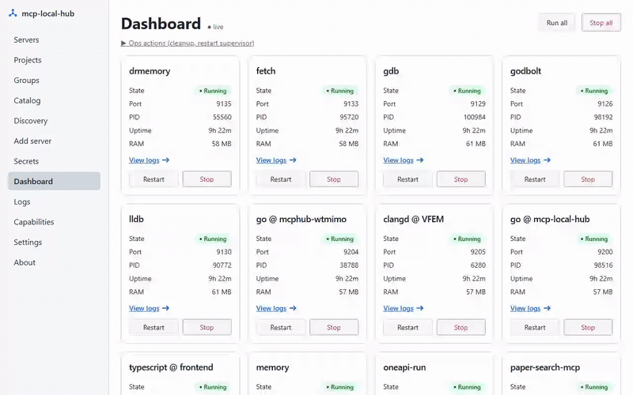

# mcp-local-hub

**Manage Model Context Protocol (MCP) servers on your workstation.**

`mcphub` connects supported clients to locally managed MCP servers. Compatible clients can reuse a server process. Servers that need per-client or per-project state can keep separate instances.

> [!NOTE]
> The Hub is in preview. Windows 11 x64 is the primary desktop path. Check the status of the server and client you use, and preview configuration changes before applying them.

## Install (npm)

The published npm package targets **Windows x64** and requires **Node.js 18 or newer**. Use a maintained Node.js release and keep npm optional dependencies enabled so npm can install the native Windows binary.

~~~powershell
npm install -g mcp-local-hub@latest
mcphub version
mcphub gui
~~~

You can check the npm release version without a global installation.

~~~powershell
npx mcp-local-hub@latest version
~~~

npm installs the package **`mcp-local-hub`** and exposes the command **`mcphub`**. The shim runs the native executable from npm's installed platform package. `mcphub setup` is available for an explicit local installation from a source build.

## Connect a client

The GUI provides a dashboard and a server catalog. You can also install and manage servers from the command line with the GUI closed. The example below previews adding the Memory server to Codex CLI.

~~~powershell
mcphub scan
mcphub install --server memory --clients codex-cli --dry-run
~~~

Review the proposed changes, then remove `--dry-run` to apply them.

~~~powershell
mcphub install --server memory --clients codex-cli
mcphub status
~~~

Reload the MCP configuration in the selected client and check that it can use the server. The Memory server uses a per-user store shared by clients connected to that instance. Choose a server whose runtime and any external tools it needs are available on your machine.

Claude Code and Codex CLI are the default install targets. Use `--clients` to select a subset. Other targets include Cursor, VS Code, Gemini CLI, Qwen Code CLI, Antigravity, Zed, Kiro, Windsurf, Cline, Kilo Code, OpenCode, Hermes and OpenClaw. See the setup guide for client-specific configuration and preview limits. [Client setup](INSTALL.md#per-client-notes)

## Manage servers

| Command | Use |
| --- | --- |
| `mcphub gui` | Open the local dashboard and catalog. |
| `mcphub status` | Check the state of managed servers. |
| `mcphub scan` | Inspect MCP entries in supported client configurations. |
| `mcphub marketplace search` | Browse catalog recipes and documentation entries. |
| `mcphub install --server memory --no-client-config` | Set up the selected server without reading or writing MCP client configurations. |
| `mcphub rollback` | Deliberately restore client configuration files from backup. This can replace edits made after the backup. |

The catalog includes embedded Go servers and adapters that run external tools. For example, GDB and LLDB need the corresponding debugger, and engineering adapters may require vendor software. Read the server's requirements before installing it. [CLI reference](docs/cli-reference.md) · [Server requirements](INSTALL.md#per-server-notes-beyond-serena)

## Update or uninstall

For an npm installation, rerun the global install command with `@latest` and check the result with `mcphub version`. This replaces the npm-managed package files. If you also have an explicit local installation, use `Get-Command mcphub` in PowerShell to see which command your PATH selects. [Source-built setup](INSTALL.md#setup-canonical-install)

Before removing the npm package, stop each managed server you want to remove with `mcphub stop --server <name>` and remove its registration and client entries with `mcphub uninstall --server <name>`. Then remove the npm package.

~~~powershell
npm uninstall -g mcp-local-hub
~~~

[Uninstall and rollback](INSTALL.md#uninstall--rollback)

## How it works

Clients reach managed servers over Streamable HTTP on the loopback interface. A native Go bridge can expose a standard-input/output server over HTTP. When a client needs a standard-input/output entry, a relay forwards its requests to the Hub. The Supervisor manages the lifetime of the servers it starts.

Sharing follows the server's scope. Global servers can serve compatible clients from one managed instance. Servers that require isolated configuration or state use separate instances. [Supervisor architecture](docs/supervisor-architecture.md) · [Architecture overview](docs/architecture-highlights.md)

## Building from source

Use the repository's PowerShell build script on Windows.

~~~powershell
pwsh ./build.ps1
.\bin\mcphub.exe version
~~~

The build guide covers the toolchain and other build entry points. [Prerequisites](INSTALL.md#prerequisites) · [Build](INSTALL.md#build) · [Go toolchain declaration](go.mod) · [Contributing](CONTRIBUTING.md)

## Feature & readiness matrix

The npm instructions apply to the published package. This matrix describes the features in the repository. Preview features have partial runtime coverage or open compatibility work. [Review criteria](CONTRIBUTING.md#review)

| Surface | Status | Scope |
| --- | --- | --- |
| Run on Windows | ⚠ Preview | Windows 11 x64 is the primary desktop path and the published npm target. |
| Run on Linux | ⚠ Preview | Source builds and a systemd user-service backend are available. |
| Run on macOS | ⚠ Preview | Source builds and a LaunchAgent backend are available. |
| Auto-start on logon — Windows | ⚠ Preview | Uses Windows Task Scheduler. |
| Auto-start on logon — Linux | ⚠ Preview | Uses a systemd user unit. |
| Auto-start on logon — macOS | ⚠ Preview | Uses a LaunchAgent. |
| Default client install | ⚠ Preview | Claude Code and Codex CLI. |
| Opt-in client install | ⚠ Preview | Other supported clients can be selected explicitly. |
| GUI dashboard | ⚠ Preview | Local dashboard and server controls. |
| GUI logs viewer | ⚠ Preview | View and follow server logs. |
| Workspace-scoped LSP lazy proxies | ⚠ Preview | Workspace registration and on-demand language-server startup. |
| Encrypted secrets vault | ⚠ Preview | Encrypted storage for server credentials. |
| Local manifest authoring | ⚠ Preview | Create and import local server configurations. |
| Backups, rollback and migration | ⚠ Preview | Client configuration backups and explicit restore and migration commands. |
| Per-server HTTP API | ⚠ Preview | Managed servers expose a local MCP endpoint. |
| Unified health and status | ⚠ Preview | Dashboard view of managed-server state. |
| Capability browser | ⚠ Preview | Inspect a server's declared tools, resources and prompts. |
| Catalog and marketplace | ⚠ Preview | Browse server recipes and documentation from the GUI or CLI. |

## Documentation and releases

- [Client setup](INSTALL.md#per-client-notes) and [troubleshooting](INSTALL.md#troubleshooting)
- [CLI reference](docs/cli-reference.md)
- [Changelog](CHANGELOG.md)
- [GitHub Releases](https://github.com/applicate2628/mcp-local-hub/releases)
- [Issue tracker](https://github.com/applicate2628/mcp-local-hub/issues) and [security reporting](SECURITY.md)

## License

Mozilla Public License Version 2.0 (`MPL-2.0`) — see [LICENSE](LICENSE).

Commercial licenses and commercial versions are available by separate agreement
for teams that need different licensing terms, private distribution, support,
warranty, indemnity, integration, packaging, or proprietary deployment terms.
To discuss a commercial version or commercial license, contact Dmitry Denisenko
through GitHub at [@applicate2628](https://github.com/applicate2628).

Unless and until a separate commercial agreement is signed, use, modification,
and distribution of this repository remain governed by `MPL-2.0`. A commercial
offer does not reduce the rights granted for the public source code under
`MPL-2.0`.

Copyright 2026 Dmitry Denisenko ([@applicate2628](https://github.com/applicate2628))

## Terms and Abbreviations

- **CLI** — command-line interface.
- **GUI** — graphical user interface.
- **LSP** — Language Server Protocol.
- **MCP** — Model Context Protocol.
