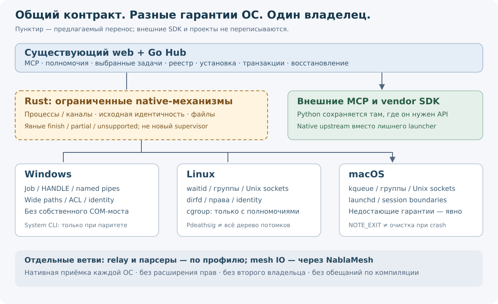

# MCP Local Hub: кроссплатформенный Rust, отказ от собственных COM-мостов и сокращение Python

**Дата:** 12 ноября 2026 года. **Статус:** proposed, documentation-only. Это план после исходникового аудита, не выполненная миграция и не подтверждение готовности платформ.

Документ дополняет [каноническую программу](../README.md), не создаёт второго владельца roadmap и не меняет принятые ADR, схемы состояния или разрешения. При принятии реализации требуется согласованный amendment в `design.md`/`traceability.yaml`. **R01–R24** ниже — Rust-кандидаты, не исторические findings **R-01–R-36** канонического аудита.

## Оглавление

1. [Решение и ограничения](#decision)
2. [База и применённые методики](#evidence)
3. [Результаты аудита](#findings)
4. [Матрица платформ](#platforms)
5. [План устранения COM](#com)
6. [План сокращения Python](#python)
7. [Все 24 Rust-кандидата](#candidates)
8. [Границы реализации](#boundaries)
9. [Поставки и зависимости](#rollout)
10. [Приёмка и откат](#acceptance)
11. [Саморевью и пределы результата](#review)
12. [Источники и термины](#references)

## 1. Решение и ограничения

Сохраняем web-интерфейс TypeScript/Preact и предметное Go-ядро: MCP, регистрацию, полномочия, выбор задач, установку, транзакции и восстановление. Rust рассматриваем для ограниченных нативных владельцев и измеренных интенсивных операций. **Пилот ограничивает первый инкремент, а не карту кандидатов.**

Обязательные ограничения:

- Общий контракт не обещает одинаковые гарантии разных ОС без нативной проверки. Windows Job Object, Linux process group/cgroup и macOS kqueue не взаимозаменяемы.
- Не добавляем и не переносим на Rust собственные COM-клиенты. PowerShell `New-Object -ComObject`, WMI-мост и Rust-binding к тому же COM не являются устранением зависимости.
- Сокращаем прежде всего собственный нативный Python-код и лишние Python-launchers. Не переписываем SDK поставщиков, NumPy, FastMCP, Serena и чужие MCP-проекты; не принимаем их постоянное сопровождение ради языка.
- Нет нового C++ GUI, универсального platform-daemon или второго supervisor. Сборочные неудобства исключены из оценки; стоимость FFI при исполнении, область аварии, полномочия и идентичность executable остаются критериями.

## 2. База и применённые методики

**Таблица 1. Раздельные исходные состояния.**

| Источник | Проверенное состояние | Ограничение |
|---|---|---|
| Опубликованный master | `76d11b33bd37e30125525ce8e0e582122f29e91b` | База этого docs-only PR, не всей будущей реализации |
| PR #616 | `92bc059c87d958db2474aee5c61c560c3e48e86f` | Учитываются уже включённые исправления #618–622; полная приёмка не заявлена |
| Локальная consolidation-ветка | HEAD `59b5a687773cd86ef8622b5bcf70fc0dd02c8905` | Read-only сверка указателя и выбранных зависимостей; рабочее дерево не равно HEAD |
| Локальная выбранная интеграция | два указателя на `6efb0e49d06792ab66f3bbf301328b52c3f139ec` | Будущие selected-activation контракты наследуются; не все строки повторно проверены |
| Частная работа 0.4.60 | Отдельно оговорена в #616 | Сохраняются bundle/transaction-обязательства, неизвестный полный состав не считается проверенным |

Прочитаны существующие Graft-карточки; отсутствующие/устаревшие сведения проверены по исходникам. Выполнены read-only `git show`, `git grep`, `git ls-tree` и GitHub readback. На exact #616 есть **83 отслеживаемых `.py` файла: 35 в EM source, 46 в тестовых каталогах и 2 вспомогательных файла**. В закреплённом marketplace v2 — **34 строки, 18 с командой `uvx`**. Это не число работающих Python-процессов и не характеристика будущего каталога v3.

Локальный `pyproject.toml` дополнительно содержит `nabla-mesh-extract[hfss]==0.1.0`; это наблюдение рабочего дерева, не принятая поставка. Никакие секреты, сырые machine-local журналы или private patches в PR не включены.

**Таблица 2. Пятнадцать применённых методик и результат.**

| Навык | Что изменил в аудите |
|---|---|
| Software Architect / architecture-review | Разделение механизмов ОС, политики Хаба, SDK и внешних серверов |
| Software Architect / architecture-decisions | Явные COM-ограничения, альтернативы и условия пересмотра |
| Ponytail / ponytail-audit | Исключение лишнего daemon, второго supervisor и rewrite чужого кода |
| Go project-and-api-design | Узкие consumer-owned контракты; сохранение CLI/API/состояния |
| Go concurrency-lifecycle | EOF, блокировки, stop/drain/join и retained owner |
| Go distributed-coordination | Поколения, stale owner, передача и неопределённый результат |
| Go service-boundaries | Лимиты сообщений, очереди, partial outcome и shutdown |
| Go security-hardening | Root-bound доступ, наследование, отсутствие новых полномочий |
| Go performance-and-diagnostics | Сравнение трёх реализаций; RSS отдельно от Go heap |
| Go testing-and-verification | Нативные сценарии ОС вместо одной кросс-компиляции |
| Go production-operations | Autostart, clean exit/crash, logout и readiness |
| Intuitive Software Design / connected-experience-design | OFF, stored/not-running, unsupported и безопасное восстановление |
| Agent Consent Patterns | Нет скрытого повышения прав, linger, сетевого SDK или COM-only activation |
| Rust unsafe-checker через omgskills | FFI, ABI, указатели, panic и `Send/Sync` |
| Rust m12-lifecycle через omgskills | Явный finish; `Drop` не является доказательством завершения |

Rust-навыки прочитаны на `actionbook/rust-skills@5c40d3ad785193231b7d0dbfb8e1eb447e5edd94`, без установки. Это одно авторское ревью с методиками, не пятнадцать независимых агентов. Визуальный редизайн не проводился.

## 3. Результаты аудита

Приоритеты относятся к исправлению плана; статический риск не выдаётся за воспроизведённый отказ продукта.

**Таблица 3. Существенные находки.**

| ID | Место и факт | Условие / последствие | Изменение плана |
|---|---|---|---|
| CP01 / P1 | `process/start_with_job_original_unsupported.go`: !windows возвращает `ErrContainmentUnavailable` | Общий wrapper скроет отсутствие original owner/admission | Capabilities по сценарию; не заменять строгий путь поиском по PID |
| CP02 / P1 | Pdeathsig, waitid и kqueue имеют разные гарантии | Exit observation или сигнал ребёнку объявлен whole-tree cleanup | Отдельные gates для reap, групп, descendants и parent-death |
| CP03 / P1 | Windows hook до ResumeThread не переносится буквально в Unix | Go/Python callback после fork может использовать unsafe locks/allocator | Никаких произвольных callbacks в post-fork child; отдельный Unix admission |
| CP04 / P1 | Scheduler смешивает schtasks с PowerShell/COM | Rust COM bridge сохранит зависимость и может перенести зависание внутрь Хаба | Удаление моста по операциям; прежние права, errors и readback сохраняются |
| CP05 / P1 | `api/processes.go`: WMIC → PowerShell/CIM | Неполный native snapshot ошибочно становится доказательством отсутствия | R16 поднят в первую очередь; unknown не absent; наблюдение не даёт kill rights |
| CP06 / P1 | macOS owner/start-time proof отсутствует; RSS вне Windows unknown | Заглушка false/0 выдаётся за отрицательное наблюдение | Различать unsupported, denied, unknown и истинное отрицание |
| CP07 / P1 | Linux Restart=on-failure; macOS KeepAlive=true; CLI вызовы без context | Несогласованный clean-exit restart, зависание и stored-but-not-enabled | Закрепить OFF/stop/partial, общий deadline; поведение GUI проверить отдельно |
| CP08 / P1 | Python содержит наши ctypes и внешний SDK | «Убрать Python» создаёт свой SDK и второго job owner | Переносить законченные native-механизмы; внешний SDK сохранить |
| CP09 / P2 | Grafana Go binary запускается через Python wheel | Лишняя runtime-зависимость конкретного способа доставки | Готовый upstream native release; без переписывания сервера |
| CP10 / P1 | Excel, Photoshop, Origin используют COM | No-Python принимается за no-COM; purge ломает конфигурацию | Явная совместимость и согласие; не включать COM-only rows автоматически |
| CP11 / P1 | Windows UTF-16/ACL и POSIX byte paths/mode различны | UTF-8-only и canonicalize/open ослабляют гарантии | Lossless path boundary; retained identity и no-follow отдельно |
| CP12 / P1 | Mesh export не тождествен proprietary decode | Generic C++ writer объявлен заменой SLIM/HFSS и E/H-полей | Приёмка через NablaMesh #183 по форматам/метаданным, не новый Rust decoder |

CP07 устанавливает локальное поведение функции, но не доказывает ложный GUI-статус: при реализации нужно проследить потребителей. Исторические timings в комментариях `process_probe_exec.go` не являются новыми измерениями.

## 4. Матрица платформ

**Предлагаемые линии квалификации:** Windows/amd64, Linux/amd64, Linux/arm64, macOS/amd64, macOS/arm64. Это цели проверки, не пять готовых поставок. В просмотренном exact head `npm/packages` содержит `win32-x64`. Windows/arm64, BSD и Linux/musl не получают поддержку автоматически. Минимальные ОС/kernel/libc/SDK фиксируются для каждой принимаемой поставки.

**Таблица 4. Основа и обязательная проверка.**

| Гарантия | Windows | Linux | macOS | Требование к новой реализации |
|---|---|---|---|---|
| Original process/admission | Suspended create, retained handles | Original API unsupported, другие launch-пути есть | Original API unsupported | Не подменять stricter admission обычным spawn |
| Exit до reap | Исходный handle | waitid WNOWAIT | kqueue NOTE_EXIT | Один reaper; PID/PGID не становятся authority |
| Потомки | Job membership с наследованием/breakaway | Process group; cgroup при разрешённом профиле | Process group; kqueue наблюдает exit | Group не защищает от всех способов выхода из группы |
| Авария создателя | Kill-on-close соответствующего Job | Pdeathsig только ребёнку/родительскому потоку | Общего эквивалента Job не показано | Отдельно доказать заявленный descendant settlement |
| IPC | Named pipe + DACL + identity | Unix socket + права/peer credentials | Unix socket, часть owner proofs отсутствует | Имя/PID недостаточны; observer не creator |
| File root/identity | HANDLE, reparse checks, ACL | dirfd/no-follow/mode/owner | Собственные POSIX ограничения | Проверка и эффект на том же объекте |
| Publication | Native replace/flush/metadata | rename и необходимая синхронизация каталога | Отдельная квалификация flush/rename | Visible, durable, verified и cleaned — разные исходы |
| Пути/аргументы | Wide paths, quoting, insensitive env | Byte paths, argv, sensitive env | Не угадывать case/Unicode-normalization FS | Без lossy conversion, shell-free структурированные аргументы |
| Метрики | RSS helper реализован | В данном helper unknown | В данном helper unknown | Denied/unknown не ноль и не право завершения |
| Autostart | Смешанный Task Scheduler adapter | systemd --user и доступный manager | launchd GUI session | Сходная семантика OFF/stop, разные системные механизмы |
| Vendor tools | Точная версия и installation probe | Только принятый vendor-путь | Не наследует поддержку от Хаба | Возможность инструмента проверяется отдельно |

Cgroup v2 может делегироваться менее привилегированному процессу, поэтому «всегда нужен root» неверно. Но наличие `cgroup.kill` и полномочия на нужное поддерево проверяются фактически. `pidfd` не является whole-tree контейнером. Само создание cgroup не обещает очистку после смерти Хаба: нужен установленный owner, например квалифицированный service manager [14–15].

Не вводить watchdog-daemon ради искусственного сходства ОС. Недостающая сильная гарантия на macOS остаётся явной; её развитие — самостоятельная обоснованная работа.

## 5. План устранения COM

«Профиль без COM» здесь — критерий допуска и описание возможностей, не новая служба, сборка или автоматически добавленная настройка.

**Цель собственного кода:** нет COM automation в Go/Rust/Python, нет собственного PowerShell ComObject или WMI/CIM обхода для тех же обязанностей. Win32 API процессов, файлов, токенов и pipes сами по себе не являются COM.

Документированный `schtasks.exe` допустим как системный CLI, **но это не обещание отсутствия COM внутри Windows**. Когда прежняя гарантия через выбранный интерфейс не достигается, нужен безопасный иной механизм или явный unsupported нового профиля. Старый установленный путь не удаляется до квалификации; временная совместимость не становится новым рекомендуемым COM backend.

### Scheduler

**Таблица 5. Пооперационная миграция.**

| Операция | Основа без собственного COM | Сохраняемый контракт |
|---|---|---|
| Create / Import | Уже используемый schtasks /Create /XML | Кодировки, exact команда/owner, no-window, timeout, условный rollback |
| Export | schtasks /Query /TN /XML | Exact definition; absent отличается от denied/unavailable |
| Status / List | XML для definition; отдельно qualified runtime query | XML не доказывает running; локализованный CSV/текст не считать стабильным wire format |
| Run / guarded RunOwned | Документированный запуск с существующими fences | Query-then-run не атомарен относительно внешнего writer; такой атомарности не обещает и текущий COM-путь |
| Stop / Delete | /End, /Delete над доказанно принадлежащим объектом | No-op только при доказанном отсутствии; mismatch не разрешает разрушительное действие |

`/XML` и `/HRESULT` документированы, но не являются полным эквивалентом COM API [12]. Не читать недокументированный TaskCache, не переходить молча на Registry Run и не придумывать absence по неизвестному exit code. Каждый helper имеет bounded stdout/stderr, общий deadline без обновления бюджета fallback и реальный readback. Этот adapter может остаться Go: устранение COM не требует Rust.

### Наблюдение процессов

Сначала использовать retained identities управляемых процессов. Для discovery/metrics — поддерживаемые native API Windows, `/proc` Linux и квалифицированные macOS API. Снимок для отображения не даёт права завершать процесс.

Не читать недокументированный PEB ради полного совпадения старой CSV command line. Недоступное поле — unknown; опасные действия сохраняют прежние preconditions image/owner/start/generation. Сначала проверить существующий batch/cache, затем сравнить Go-native с Rust-native. Не подменять WMI на другой PowerShell-мост и объявлять зависимость устранённой.

## 6. План сокращения Python

**Таблица 6. Диспозиция по владельцам.**

| Группа | Решение |
|---|---|
| Наши ctypes OS-механизмы: containment, transfer, broker/daemon/enrollment | Приоритетный R20 с переиспользованием R01–R06; Python — тонкий клиент |
| Ранний C bootstrap CST | R19 условен: сохранить до-main ограничения loader/наследования; маленький C stub может остаться |
| jobs/provenance/contracts/cst_bundle | Перенос только при исчезновении дублирующего owner или измеренном bottleneck; не две state machines |
| cst.interface, cst.results, ScriptEnv, возможный PyAEDT | Сохранять поддерживаемый внешний SDK; не писать собственный vendor протокол |
| FastMCP, Pydantic, NumPy | Использовать upstream; не переписывать framework/численные kernels |
| SLIM/NGMesh/extraction | Передавать квалифицированные функции NablaMesh; разные проекты не отождествлять по имени |
| Serena, PyMAPDL, KiCad, Zotero, Jupyter и чужие MCP | Сохранять upstream и pins; замена только готовой поддерживаемой альтернативой после parity |
| Python-launcher вокруг native binary | Убирать лишнюю оболочку, первым проверить Grafana |
| Тесты и package-verification scripts | Не считать первоочередным runtime debt; сохранять необходимые проверки |

Не встраивать CPython в Go/Rust Hub. Vendor-модули остаются в своём изолированном процессе. FFI передаёт законченные ограниченные команды/результаты, не поэлементные вызовы для больших массивов. Снятие GIL не делает vendor SDK thread-safe; серийность solver/license операций сохраняется.

Количество `.py` строк — не критерий успеха. Если CPython всё равно нужен SDK, перенос маленького JSON-клея может лишь увеличить число границ.

### HFSS и CST

Текущий HFSS adapter Windows-ограничен и использует batch/ScriptEnv; готовая переносимая PyAEDT-связка в этой проверке не установлена. Отдельный кандидат — **официальный PyAEDT с явно выбранным gRPC**, без COM fallback и без нашего клона SDK.

Upstream документирует gRPC для AEDT 2022 R2+ на Windows/Linux с оговорками EDB; защищённые режимы зависят от версии/service pack [16]. Это не доказательство parity solve/export/cancel/license/isolation. Закрепить конкретные SDK/Python/AEDT версии; не менять `requires-python` вслепую. Не открывать сеть и insecure gRPC автоматически. Сохранять job-owned копию проекта, реальные outcomes и согласие на запуск solver.

CST сохраняет официальный Python-интерфейс. Непрозрачные IPC vendor SDK не объявляются COM-free без доказательства. Windows-only путь Хаба не доказывает глобальную недоступность CST на Linux, но и наличие vendor-продукта не квалифицирует наш adapter на другой ОС.

### Grafana: уменьшение зависимости без rewrite

Текущая строка v2: `uvx mcp-grafana==0.17.0 -t stdio`, сервер внутри — Go [4]. В upstream **v0.17.0** проверено наличие native assets Windows x86_64, Linux/macOS x64/arm64 и checksums. Наличие upstream Windows ARM64 asset не означает поддержку всего Хаба на ARM64 [17].

Отдельный ограниченный PR должен заменить способ доставки/запуска тем же upstream binary, сохранить release, tools, flags, `GRAFANA_URL`, секретный `GRAFANA_SERVICE_ACCOUNT_TOKEN` и activation. Проверить bytes/hash/provenance и реальный CLI. Архивы в этом аудите не скачивались и не исполнялись.

### Внешние COM-only серверы

Excel MCP на .NET, Photoshop MCP и Origin/OriginPro используют COM. **No-Python не означает no-COM.** Не предлагать их автоматически в новом профиле без COM; действующие настройки/версии не удалять. Совместимый Windows opt-in явно показывает зависимость. При исключении — честный unsupported, не замена live automation файловым редактором под прежним именем. Не форкать чужой код для порта.

## 7. Все 24 Rust-кандидата

Сохранены stable ID. Первая очередь означает приоритет проверки, не разрешение реализовать всё сразу; многие строки — потребители общих механизмов, не новые crates.

**Таблица 7. Пересмотр полной карты.**

| ID | Область | Решение с учётом ОС, COM и Python |
|---|---|---|
| R01 | Исходный process owner | Первый pilot; Windows strict admission, явный Unix контракт с начала |
| R02 | Pipes/capture/drain | Общий слой; EOF/partial writes/borrowed handles, отдельно Windows/POSIX |
| R03 | Process/token/IPC identity | Первая очередь с R01/R16; observer не creator, без COM |
| R04 | Anchored file read | Первая параллельная исследовательская очередь; path/identity/permissions |
| R05 | Atomic publish/remove | С R04; visible/durable/cleanup outcomes, не весь transaction layer |
| R06 | Native lock/lease | Часть R04/R05, не новый lock manager |
| R07 | PE/VERSIONINFO/image admission | Bounded parser/retained image; PE чтение не заменяет POSIX runtime identity |
| R08 | Launcher/early dispatch | Потребитель R01/R03; не переписывать весь CLI |
| R09 | Отдельный relay | Ранний performance-профиль на целевых ОС; весь executable, не Go+Rust двойной процесс |
| R10 | StdioHost/HTTPHost JSON-RPC | После WP-11E и профиля; сохранить session/cancellation mapping |
| R11 | LLDB/LSP stream pump | Потребитель R02; общий stop/drain исправляется независимо от языка |
| R12 | Большие CMake JSON-lines | Приоритетный переносимый compute-профиль; caps/incomplete reasons сохраняются |
| R13 | CMake graph/vcpkg log parsing | После профиля; CMake и чужие backends не переписываются |
| R14 | Registry snapshots/lookup | После WP-11D и улучшенного Go; durable authority остаётся Go |
| R15 | Events/SSE/logging | Профиль очередей/копий; Rust не меняет drop-vs-durable policy автоматически |
| R16 | Native metrics/process/network observation | Повышен приоритет: вывести WMIC/CIM shell; unknown безопасен |
| R17 | Scheduler/autostart | Прежнее Rust COM-предложение отменено; COM-free adapter, Rust необязателен |
| R18 | ZIP/package/copy/hash | После WP-11D/0.4.60; publish/close errors, не новый installer |
| R19 | CST C pre-main bootstrap | Условный Rust после pre-runtime proof; C stub допустимо сохранить |
| R20 | Наш Python ctypes CST | Повышен приоритет: native-механизм, не vendor SDK или дублированный job owner |
| R21 | CBuild/GDB/VTune/oneAPI/Kimi/Sonnet runners | Подключение к R01/R02, не семь независимых Rust runners |
| R22 | Secrets plaintext/native storage | После карты копий/прав; не переписывать age/криптографию |
| R23 | Supervisor/event loop/LazyProxy целиком | Поздняя альтернатива, если проще множества FFI-состояний; не второй supervisor |
| R24 | Существующий tray/активация | Только нужная native-интеграция; web не переносится на Qt/GPUI |

Rust speedup ни для одного кандидата здесь не измерен. Go-исправления ZIP finalization, relay byte caps, cancellation ID и stop/drain не ждут миграции. Сначала перепроверить принимаемую базу: параллельная ветка могла их уже исправить.

## 8. Границы реализации

**Рисунок 1.** Пунктир — предложение, не работающая Rust-реализация. Vendor SDK и upstream MCP остаются внешними, capabilities ОС различаются.

Go владеет полномочиями, selected scope, реестром, install/recovery и сессией. Rust — приобретёнными native-ресурсами или законченной вычислительной операцией. Создание остаётся в существующем процессе-создателе; новый daemon, меняющий parent/Job/наследование, не вводится. Общий код не означает один глобальный владелец всех процессов.

**FFI:** C-совместимый ABI без C++ зависимости; версии/размеры структур, allocator owner, lifetime и допустимые concurrent calls явны. Не экспортировать `String/Vec` как стабильный ABI, не удерживать временные Go/Python-указатели. Borrow checker не доказывает правильность вызывающего кода. `finish` возвращает исполнение и cleanup отдельно; incomplete outcome сохраняет исходного владельца. Не проводить panic/unwind через FFI; catch_unwind не защищает от abort/native crash/exhaustion. `Drop` не доказывает успешный wait/kill/flush [18–19].

**Unix spawn:** не вызывать Go/Python callbacks, allocator или locks после fork в child многопоточного host. Windows проверка suspended process требует отдельного Unix решения, не механического pre_exec hook [18].

**Файлы:** wide paths Windows, выбранный lossless byte-path контракт Unix; не применять lossy UTF-8. Go `os.Root` допускает некоторые ссылки внутри root и не автоматически заменяет stricter NoFollow [20]. Не выдавать canonicalize→open за защищённую identity. Сетевые/неподдержанные filesystem не наследуют локальные durability-гарантии.

**Отмена:** отмена ожидания и отмена операции различаются; timeout не разрешает повтор через Go. Сериализованные monotonic timestamps не становятся автоматически сравнимыми между перезапусками/машинами; сохранять текущий versioned clock contract и остаточный бюджет.

## 9. Поставки и зависимости

Текущий PR — proposed-plan и SVG, без смены статусов канонических WP. При принятии обновляется существующий граф/ADR; новый параллельный status-файл не нужен.

**Таблица 8. Независимые небольшие PR.**

| Пакет | Объём | Необходимые зависимости | Проверяемый выход |
|---|---|---|---|
| RX-00 | Inventory, capabilities, amendment | Exact base, сверка #616 и затрагиваемых deltas | Один owner и явные exclusions |
| RX-01 | Профили observation, relay, parser | RX-00 и существующие fixtures | CPU/RSS/очередь/ошибки, без выдуманного Rust speedup |
| RX-02 | R01 foreground/admission pilot | RX-00, нужные WP-11C/selected contracts | Native positive/fault tests; Unix projection не врёт |
| RX-03 | R02/R03 и OS lifecycle/peer | RX-02 и соответствующие consumers | Один owner, EOF/stop/identity на принятой ОС |
| RX-04 | R04/R05 file pilot | RX-00, нужные WP-11D/0.4.60 contracts | Exact object, permissions, publish/durability/cleanup |
| RX-05a | R16 native observation | RX-00/RX-01; R03 где нужна authority | Нет нового WMI shell; unknown не вызывает kill |
| RX-05b | R17 COM removal по операциям | RX-00; guarded-run/ownership parity | CLI/error/locales/readback, без нового COM fallback |
| RX-06 | R20 ctypes и при необходимости R19 | Нужные части RX-03/RX-04, CST boundary | Thin Python SDK adapter, без двух job owners |
| RX-07 | Grafana native upstream delivery | RX-00 и exact artifact admission | Те же release/tools/auth, без Python-launcher |
| RX-08a | R09 relay | RX-01 и protocol contract | Выигрыш всей замены executable |
| RX-08b | R12/R13, далее измеренные R10/R14/R15/R18 | RX-01 и свой WP-11D/E контракт | Паритет результата/ошибок/лимитов |
| RX-09 | Решение R23, вывод заменённых реализаций | Результаты соответствующих pilot/gates | Целый supervisor лишь если проще; иначе Go окончателен |

RX-01, RX-04 и RX-07 готовятся независимо от завершения Windows-пилота. Не ждать весь каталог/науку, но не переключать потребителя до приёмки его зависимости. RX-05b разбить по операциям, не один гигантский scheduler rewrite.

Сетки остаются отдельной задачей [NablaMesh #183](https://github.com/applicate2628/NablaMesh/pull/183). Передавать exporter-функции после parity формата, единиц, ориентации, material/boundary/port tags, порядка и canonical identity. C++ MFEM→VTU не подтверждает SLIM/HFSS reader. Saved-field E/H и vendor job policy не передаются автоматически с mesh IO.

## 10. Приёмка и откат

**Таблица 9. Минимальные различающие сценарии для затронутых путей.**

| Сценарий | Гарантия |
|---|---|
| Partial acquisition каждого шага | Полученные ресурсы удержаны одним owner, чужие не закрыты |
| Отказ admission / отмена до исполнения | Нет запрещённого эффекта и автоматического повторного запуска |
| PID/путь/endpoint заменён | Нет действия над новым чужим объектом; generation/source mismatch |
| Parent crash с descendants | Реальный OS-specific settlement, не предположение |
| Idle stdin, slow consumer, final response перед EOF | Owned interruption, bounded buffers, сохранённый terminal result |
| Borrowed stdio и inherited extras | Заимствованные не закрыты, наследуется только допустимое |
| Ошибка после commit/publish/transfer | Выполненное не выдаётся за rollback; cleanup отдельно |
| XML UTF-16/UTF-8 и Windows locales | Unknown не absent; correct definition/runtime distinction |
| Нет systemd/user manager/gui session/delegation | Unsupported или stored-not-active, не ложный running |
| OFF/explicit stop/clean exit/crash/logout | Одинаковое обещание пользователю при разных механизмах |
| Нет Python SDK / версия неподдержана | Ошибка конкретного provider, не обязательный Python для базового Хаба |
| COM-only provider в no-COM профиле | Нет скрытой активации и потери существующей конфигурации |
| Upstream asset подменён/неполон | Отказ до запуска, рабочая версия и данные сохранены |
| Два проекта/клиента, потерян ответ | Нет чужого stop, расширения selection, повторной мутации |
| Кросс-компиляция без native run | Нет runtime-qualified статуса |

Сравнивать **квалифицированный Go/Python → минимальную оптимизацию без смены языка → Rust** на одинаковой нагрузке. Фиксировать source/config/toolchain/OS/arch/filesystem, распределение входов, concurrency, warmup, повторы, ошибки и пределы.

Измерять CPU/wall time, descriptors/threads, RSS/peak RSS всего процесса, allocation traffic отдельно от живой памяти, FFI copies/стоимость переходов, p50/p95/p99 с очередью и задержку cancellation/settlement. Маленький Go heap не доказывает экономию после переноса в Rust allocator. По стабильности конкретное исключение класса неправильного владения допустимо без ускорения, но не без compatibility evidence.

Переключение — новый lifetime после завершения прежнего owner. Первому пилоту не нужна новая live-transfer схема. Нет автоматического Go fallback после неизвестного исхода Rust. Старый код удалять после замены всех потребителей, сохраняя нужные regression tests. Подтверждённо ненужные локальные артефакты — в trash без автоматической очистки; активные и единственные evidence туда не помещать.

## 11. Саморевью и пределы результата

Проверены реальные COM call sites, платформенные реализации/заглушки, Python inventory/upstream границы, наличие Grafana release assets, local branch refs и отдельная будущая mesh-зависимость. Не выполнены Rust-код, установки, package admission, vendor runs, benchmarks, full repository tests, native Windows/Linux/macOS приёмка или независимое внешнее ревью.

На собственном ревью отвергнуты: Rust COM wrapper; свой vendor RPC SDK; новый daemon на каждую ОС; UTF-8-only lossless path; PID-only ownership; shell-free как sandbox; квалификация по компиляции; признание всех Python tests runtime debt; выдача upstream Go binary за нашу Rust-реализацию; автоматическое удаление COM-only интеграций. Нужные исправления текущего Go не откладываются ради Rust.

Проверка документа/ссылок и GitHub readback не заменяет будущие product gates. Исторические PASS и timings не представлены как новые результаты.

## 12. Источники и термины

Внешние документы прочитаны 12 ноября 2026 года; их соответствие выбранной версии перепроверяется до реализации. Код закреплён; комментарий не является самостоятельным доказательством поведения.

1. [Master](https://github.com/applicate2628/mcp-local-hub/commit/76d11b33bd37e30125525ce8e0e582122f29e91b), [PR #616](https://github.com/applicate2628/mcp-local-hub/pull/616), [exact reviewed head](https://github.com/applicate2628/mcp-local-hub/tree/92bc059c87d958db2474aee5c61c560c3e48e86f).
2. [WP-11B–E](wp-11a-to-11f.md), [design](../design.md), [governance](../governance.md).
3. [Original API unsupported](https://github.com/applicate2628/mcp-local-hub/blob/92bc059c87d958db2474aee5c61c560c3e48e86f/internal/process/start_with_job_original_unsupported.go), [Windows foreground](https://github.com/applicate2628/mcp-local-hub/blob/92bc059c87d958db2474aee5c61c560c3e48e86f/internal/process/foreground_windows.go).
4. [Marketplace v2](https://github.com/applicate2628/mcp-local-hub/blob/92bc059c87d958db2474aee5c61c560c3e48e86f/marketplace/v2/catalog.json).
5. [Python dependencies](https://github.com/applicate2628/mcp-local-hub/blob/92bc059c87d958db2474aee5c61c560c3e48e86f/servers/electromagnetics-mcp/pyproject.toml), [EM sources](https://github.com/applicate2628/mcp-local-hub/tree/92bc059c87d958db2474aee5c61c560c3e48e86f/servers/electromagnetics-mcp/src/mcphub_em_mcp).
6. [AEDT batch](https://github.com/applicate2628/mcp-local-hub/blob/92bc059c87d958db2474aee5c61c560c3e48e86f/servers/electromagnetics-mcp/src/mcphub_em_mcp/aedt_batch.py), [CST](https://github.com/applicate2628/mcp-local-hub/blob/92bc059c87d958db2474aee5c61c560c3e48e86f/servers/electromagnetics-mcp/src/mcphub_em_mcp/cst.py).
7. [Linux parent-death](https://github.com/applicate2628/mcp-local-hub/blob/92bc059c87d958db2474aee5c61c560c3e48e86f/internal/process/pdeathsig_linux.go), [Linux waitid](https://github.com/applicate2628/mcp-local-hub/blob/92bc059c87d958db2474aee5c61c560c3e48e86f/internal/process/contained_stream_wait_linux.go), [macOS kqueue](https://github.com/applicate2628/mcp-local-hub/blob/92bc059c87d958db2474aee5c61c560c3e48e86f/internal/process/contained_stream_wait_kqueue.go).
8. [Owner unsupported](https://github.com/applicate2628/mcp-local-hub/blob/92bc059c87d958db2474aee5c61c560c3e48e86f/internal/process/process_owner_current_unsupported.go), [start-time other](https://github.com/applicate2628/mcp-local-hub/blob/92bc059c87d958db2474aee5c61c560c3e48e86f/internal/process/process_start_time_other.go), [RSS other](https://github.com/applicate2628/mcp-local-hub/blob/92bc059c87d958db2474aee5c61c560c3e48e86f/internal/process/process_rss_other.go).
9. [Mixed scheduler](https://github.com/applicate2628/mcp-local-hub/blob/92bc059c87d958db2474aee5c61c560c3e48e86f/internal/scheduler/scheduler_windows.go#L220-L410), [COM bridge](https://github.com/applicate2628/mcp-local-hub/blob/92bc059c87d958db2474aee5c61c560c3e48e86f/internal/scheduler/scheduler_com_windows.go).
10. [WMIC/CIM process observations](https://github.com/applicate2628/mcp-local-hub/blob/92bc059c87d958db2474aee5c61c560c3e48e86f/internal/api/processes.go#L485-L590).
11. [Linux autostart](https://github.com/applicate2628/mcp-local-hub/blob/92bc059c87d958db2474aee5c61c560c3e48e86f/internal/autostart/linux.go), [macOS autostart](https://github.com/applicate2628/mcp-local-hub/blob/92bc059c87d958db2474aee5c61c560c3e48e86f/internal/autostart/darwin.go).
12. [Microsoft schtasks query](https://learn.microsoft.com/en-us/windows-server/administration/windows-commands/schtasks-query).
13. [Windows anchored read](https://github.com/applicate2628/mcp-local-hub/blob/92bc059c87d958db2474aee5c61c560c3e48e86f/internal/api/state_read_beneath_root_windows.go), [POSIX secure write](https://github.com/applicate2628/mcp-local-hub/blob/92bc059c87d958db2474aee5c61c560c3e48e86f/internal/api/secure_write_posix.go).
14. [Linux kernel cgroup v2](https://cdn.kernel.org/doc/html/latest/admin-guide/cgroup-v2.html).
15. [systemd.kill](https://www.freedesktop.org/software/systemd/man/latest/systemd.kill.html), [Apple launchd jobs](https://developer.apple.com/library/archive/documentation/MacOSX/Conceptual/BPSystemStartup/Chapters/CreatingLaunchdJobs.html).
16. [Официальный PyAEDT gRPC/client-server](https://aedt.docs.pyansys.com/version/stable/Getting_started/ClientServer.html).
17. [Grafana v0.17.0 assets](https://github.com/grafana/mcp-grafana/releases/tag/v0.17.0), [официальная native installation](https://grafana.com/docs/grafana/latest/ai-tools/mcp/set-up/install-the-binary/).
18. [Rust pre_exec safety](https://doc.rust-lang.org/std/os/unix/process/trait.CommandExt.html), [Rust FFI](https://doc.rust-lang.org/nomicon/ffi.html).
19. [Go cgo](https://pkg.go.dev/cmd/cgo), [Rust Child](https://doc.rust-lang.org/std/process/struct.Child.html).
20. [Go os.Root](https://go.dev/blog/osroot), [Rust Windows OsStringExt](https://doc.rust-lang.org/std/os/windows/ffi/trait.OsStringExt.html).
21. [CST early bootstrap](https://github.com/applicate2628/mcp-local-hub/blob/92bc059c87d958db2474aee5c61c560c3e48e86f/servers/electromagnetics-mcp/native/cst-runtime/mcphub_cst_runtime.c), [ctypes containment](https://github.com/applicate2628/mcp-local-hub/blob/92bc059c87d958db2474aee5c61c560c3e48e86f/servers/electromagnetics-mcp/src/mcphub_em_mcp/cst_saved_field_containment_windows.py), [transfer](https://github.com/applicate2628/mcp-local-hub/blob/92bc059c87d958db2474aee5c61c560c3e48e86f/servers/electromagnetics-mcp/src/mcphub_em_mcp/cst_saved_field_transfer.py).

**Термины:** ABI — двоичный контракт вызова; API — программный интерфейс; CLI — интерфейс командной строки; COM — Component Object Model; CIM/WMI — инфраструктуры управления системными объектами; FFI — вызовы между языками; IPC — межпроцессный обмен; MCP — Model Context Protocol; SDK — набор интеграции поставщика; PID/PGID — идентификатор процесса/группы; RSS — резидентная память; ACL/DACL — списки контроля доступа; SSE — Server-Sent Events; gRPC — framework удалённых вызовов; EOF — конец потока; GIL — блокировка интерпретатора Python; WP — рабочий пакет; ADR — архитектурное решение. p50/p95/p99 — процентили задержки; lifetime — время жизни; containment — конкретная область наблюдения/остановки, не sandbox; readback — независимое получение фактического результата.
