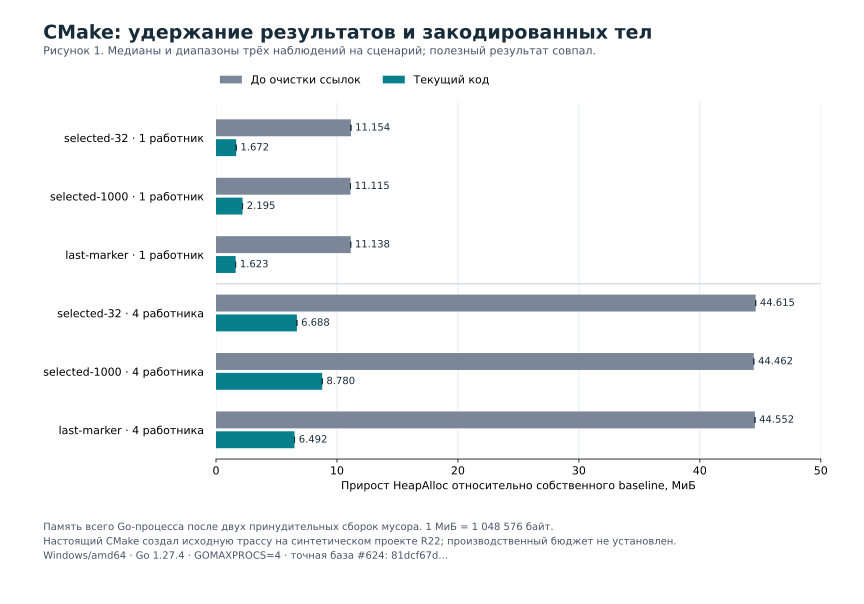

# R25 — нативные проверки, CMake, Rust reader и качество PR

**21 ноября 2026 года.** R25 добавляет проверенные тестовые изменения в #648 и отдельный небольшой Draft #661, измеряет удержание памяти потребителем CMake, выполняет все 15 библиотечных тестов Rust reader #627 и уточняет действующий план. PR (pull request, запрос на включение изменений) не сливались. Общая готовность программы не заявляется: адресные результаты не заменяют прежние общие FAIL и оставшиеся NOT_RUN — проверки, которые не выполнялись.

## Оглавление

1. [Опубликованные изменения и очередь](#1-опубликованные-изменения-и-очередь)
2. [Нативные границы Serena #648](#2-нативные-границы-serena-648)
3. [Более точная проверка ошибок #661](#3-более-точная-проверка-ошибок-661)
4. [Память потребителя CMake #624](#4-память-потребителя-cmake-624)
5. [Rust reader #627 и параллельная работа](#5-rust-reader-627-и-параллельная-работа)
6. [Диагностика бюджета Go](#6-диагностика-бюджета-go)
7. [Архивы и независимая проверка](#7-архивы-и-независимая-проверка)
8. [Ревью, навыки и сохранность](#8-ревью-навыки-и-сохранность)
9. [Действительный остаток программы](#9-действительный-остаток-программы)

## 1. Опубликованные изменения и очередь

**Таблица 1. Ответственность и точные источники R25.** Для двух изменений Go исполнены точная исходная база и закреплённые наложенные файлы (overlay). После публикации перечитаны их байты, дерево Git и единственный родитель. Отдельный запуск уже опубликованной вершины не выполнялся.

| PR | Результат | Опубликованный или испытанный commit |
|---|---|---|
| [#648](https://github.com/applicate2628/mcp-local-hub/pull/648) | Один новый Windows-файл тестов, 200 строк; проверка удерживаемых дескрипторов и завершения | [`184104c186108b150d1183318c3f6791f2a4ba5f`](https://github.com/applicate2628/mcp-local-hub/commit/184104c186108b150d1183318c3f6791f2a4ba5f), родитель `fc4dc5c7145e4f4d709b91654ab4bc1fd7abe259` |
| [#661](https://github.com/applicate2628/mcp-local-hub/pull/661) | Новый самостоятельный Draft: одна существующая функция теста, +35/−20 строк | [`23ed6b5c6a942812a72e345c5d886b3310e9017e`](https://github.com/applicate2628/mcp-local-hub/commit/23ed6b5c6a942812a72e345c5d886b3310e9017e), родитель `a7d92d2852c4f6eb8afb0569ef76a545e38aacf7` |
| [#624](https://github.com/applicate2628/mcp-local-hub/pull/624) | Новые измерения и отчёт; производственный код в R25 не менялся | `81dcf67db013ba2879878c2ee6fe07aa0bb4aec3` плюс диагностический helper; для сравнения явно подставлен прежний файл без очистки хвоста |
| [#627](https://github.com/applicate2628/mcp-local-hub/pull/627) | Форматирование и 15 библиотечных тестов; код ветки не менялся | `b827398ef127a1556b7b2bdcdcec7fe03fa6651d`, точный экспорт семи файлов эксперимента без наложений |
| #623 / #658 | Этот аудит / обновлённый действующий план | Документационные продолжения существующих веток, без слияния и переписывания истории |

В R24 пять доказанно поглощённых PR закрыты без слияния: **#639 → #647, #645/#651 → #643, #656 → #650, #636 → #637**. Их ветки и история сохранены; доказательства находятся в [аудите R24](../completion-r24-2026-11-21/README.md). После самостоятельного #661 очередь содержит **27 открытых Draft**: на четыре меньше первоначальных 31. Новый тест исправляет отдельный критерий ошибки; добавление его к несвязанному PR ради меньшего числа запросов не улучшило бы структуру изменений.

`master` остаётся на `a7d92d2852c4f6eb8afb0569ef76a545e38aacf7`. Свидетельства публикации кода: [#648](publication648.json), [#661](publication661.json). Окончательное чтение опубликованного документационного комплекта и сверка очереди закрепляются отдельной квитанцией завершения; сама эта исходная публикация их ещё не удостоверяет.

## 2. Нативные границы Serena #648

Добавленные тесты используют настоящий дескриптор файла Windows — `HANDLE`. Проверяются запрет открытия для записи и удаления, пока файл удерживается, освобождение после локального предварительного отказа, сохранение дескриптора при неполной квитанции завершения, настоящий путь без запуска дочерней команды и реальный отказ `CloseHandle` при установленном флаге защиты. После снятия флага исходная ошибка закрытия остаётся зафиксированной; очистка не переписывает её успешным результатом.

Два корневых теста содержат пять конечных сценариев. Каждый из двух режимов — обычный и `test_state_path_env` — с детектором гонок `-race` дал **6 событий PASS тестов/подтестов и один PASS пакета**. Итого 12 таких событий, 4 исполнения корней и 10 исполнений конечных сценариев. Полные команды `go build ./...` и `go vet ./...` с тем же наложением завершились с кодом 0. `vet` — статический анализ Go; это не исполнение всех тестов.

Первая редакция была отклонена при собственном ревью до запуска: она искала частную причину в намеренно безопасном внешнем сообщении. Вторая не скомпилировалась: закреплённая версия `x/sys` не экспортирует нужную константу Windows SDK (комплекта разработки). Третья использует документированное значение только внутри теста. Обе ранние редакции и фактическая ошибка компилятора сохранены; они не переименованы в PASS.

Это проверка уже полученного синтетического владельца и конкретных приёмников завершения. Она не доказывает получение полномочий, всю подготовку Serena, успешный дочерний процесс, издателя образа или установленный продукт. Подробности: [собственное ревью](serena/ROOT-REVIEW.md), [профильное ревью](serena/REVIEW.md), [дополнительная независимая сверка](serena/FINAL-REVIEW.md).

## 3. Более точная проверка ошибок #661

В `TestMCPFrontV3_SerenaConflictClassifierMutationTable` тридцать отрицательных случаев раньше принимали любую ненулевую ошибку чтения и отката. Поэтому отказ открыть файл, ошибка прав или разбора JSON могли удовлетворить тест до входа в предметную проверку, которую он должен проверять. Это установленный по коду риск ложного успеха теста; наблюдённого обхода производственной защиты не заявляется.

Теперь чтение и откат обязаны вернуть ожидаемый фрагмент предметной ошибки. Двадцать случаев проверяют общую структуру полномочий, десять — более ранние проверки привязки, идентичности, поколения или операции. Сохранены все **34 случая**, четыре положительных случая, запрет вызова pin-reader, общий настоящий журнал и все исходные вызовы `WriteStateFileAtomic`.

Оба режима с `-race` прошли: **35 PASS тестов/подтестов и один PASS пакета в каждом**, без FAIL/SKIP. Полные build/vet с тем же наложением также успешны. Это +35/−20 строк в одной функции без производственных изменений, новых импортов или зависимостей. [Разбор решения и измерений](go-budget/VALIDATION-ORACLE.md), [собственное ревью](go-budget/ROOT-REVIEW.md), [точный patch](go-budget/validation-oracle.patch).

Предшествующий эксперимент заменял тридцать устойчивых атомарных записей обычной записью файла. Его выбранные проверки прошли, но ускорение не подтвердилось: длительности корневого теста до изменения составили **1,99 / 2,21 / 1,66 с**, у кандидата — **6,63 / 3,24 / 2,89 с**. Эти наблюдения не устанавливают причину или общий коэффициент замедления. Эксперимент отклонён для публикации; итоговый #661 сохраняет прежний механизм записи и не обещает ускорение.

## 4. Память потребителя CMake #624

Проверен механизм уже опубликованной очистки отброшенного хвоста `Records`. Настоящий CMake ранее создал трассу для **синтетического проекта R22**. В R25 потребитель перечитывал исходные файлы трассы и эталона; CMake заново не запускался, публичные копии с заменёнными частными значениями не подставлялись в выполнение.

Сравнение: три сценария, один или четыре работника, три наблюдения — **18 строк до очистки и 18 после**. Полезный результат, длины и хеши публичного JSON совпали. Измерена разность `HeapAlloc` всего Go-процесса относительно собственного исходного снимка после двух принудительных сборок мусора. Это удерживаемая Go-память, а не точный размер объекта `Result`, пиковая память процесса или бюджет клиента.

**Таблица 2. Медиана прироста удерживаемой памяти, МиБ. Один мебибайт (МиБ) равен 1 048 576 байтам.**

| Сценарий | Работников | До очистки | Текущий код |
|---|---:|---:|---:|
| `selected-32` | 1 | 11,154 | 1,672 |
| `selected-1000` | 1 | 11,115 | 2,195 |
| `last-marker` | 1 | 11,138 | 1,623 |
| `selected-32` | 4 | 44,615 | 6,688 |
| `selected-1000` | 4 | 44,462 | 8,780 |
| `last-marker` | 4 | 44,552 | 6,492 |



**Рисунок 1** построен из закреплённых [целочисленных наблюдений](cmake/retention-result.json); [таблица данных](cmake/retention-cohorts.csv) и [код построения](cmake/plot_retention.py) доступны отдельно. Все столбцы используют одну шкалу. Округление в таблице 2 не заменяет исходные байты.

Ёмкость массива осталась 17 578 элементов: очищаются ссылки в отброшенных элементах, сам массив не уменьшается. Кумулятивное выделение памяти существенно не изменилось; длительности разнонаправлены, ускорение не заявляется. В каждом из 18 наблюдений с четырьмя работниками зафиксировано положительное пересечение их интервалов — от 57,1936 до 83,7904 мс. Это наблюдаемая одновременность работы, не модель производственной нагрузки. Полные определения счётчиков, преобразование единиц, исходники и ограничения приведены в [отчёте CMake](cmake/RUNTIME.md).

## 5. Rust reader #627 и параллельная работа

Прежняя блокировка отсутствующими локальными зависимостями снята для выбранного библиотечного эксперимента. В существующем кеше найдены **13 архивов**, их контрольные суммы сверены с `Cargo.lock`. Изолированная подготовка проверила 797 файлов зависимостей и 13 файлов их контрольных сумм; загрузки и установки не выполнялись.

На Windows x64 выполнены `rustfmt --check` и `cargo test --offline --locked --lib --target x86_64-pc-windows-msvc -- --test-threads=1`: **15 passed; 0 failed, ignored, measured, filtered**. Все семь исходных файлов и выбранные одиннадцать файлов инструментов сохранили контрольные суммы до и после фаз. Набор имён тестов проверен, одного счётчика «15» недостаточно. [Точный отчёт и границы](reader627/RUNTIME.md), [упаковка и проверка](reader627/PACKAGING.md).

Тесты покрывают реальные выбранные сценарии reparse-путей, подмены пути, роста файла, отмены, открытия и учёта дескрипторов. Ошибка, внесённая тестовым hook, не объявлена реальным отказом системного stat/read/close после получения дескриптора. Этот результат не квалифицирует отдельного владельца процессов Rust, FFI (межъязыковой интерфейс), Go-потребителя или установленную Serena.

Отдельно исходники параллельной Rust-работы найдены на `a217c7799a0214967bf86211542e508162c680b5`; формулировка «исходники отсутствуют» больше не является текущей. Выполнено только чтение. Подготовленная установочная попытка v2 явно имеет `approved=false`, `automatic_repeat_authorized=false` и **NOT_RUN**. Она не запускалась. Сохранённые более старые архивы и передача между устройствами не выданы за новую принятую поставку. [Матрица источников и состояния передачи](rust-inputs/HANDOFF.md).

## 6. Диагностика бюджета Go

Отдельный инструментированный запуск исходной таблицы дал **190 фазовых записей** для 34 случаев. Сумма измеренных фаз — **4,7502173 с**, из них 30 записей фикстур — **4,2347134 с (89,1478%)**. Медиана записи — 51,94625 мс, максимум — 2,1396955 с; причина этого выброса не установлена.

Граница таймера охватывает весь `WriteStateFileAtomic`, включая подготовку, запись и завершение; время отдельно `FlushFileBuffers` не измерено. Нулевые показания 34 вызовов классификатора означают разрешение таймера, а не отсутствие вычислений. Внешняя команда, длительность пакета, корневой тест и сумма фаз — разные интервалы. Этот опыт не объясняет прежние общие тайм-ауты сотен и тысяч тестов и не закрывает полные Go-критерии. [Отчёт с цепочкой расчётов](go-budget/RUNTIME.md).

Совокупность Go-свидетельств R25 содержит **11 попыток тестовой команды**: десять успешных и один исторический отказ компиляции. Успешные команды записали **16 исполнений корней и 360 исполнений подтестов — 376 событий PASS**, отдельно 10 PASS пакетов. Это повторные исполнения, включая диагностику и отклонённый кандидат, а не 376 уникальных принятых тестов. Исторический отказ имеет один package FAIL и ни одного события тела теста. Четыре команды build/vet успешны.

## 7. Архивы и независимая проверка

**Таблица 3. Публичные пакеты. SHA-256 — 256-битная криптографическая контрольная сумма точных байтов.**

| Пакет | Размер | SHA-256 |
|---|---:|---|
| [Go/CMake/Serena: public.zip](archive/public.zip) | 2 047 483 байт | `e4da7afcf31d5310df6fcd3d10e13938c01f5b997d7677c9708583c87a6dcf55` |
| [Rust reader: public.zip](reader627/public.zip) | 82 293 байта | `6038e3b56b74209dcf118117f767ceb180e55d398fcad0aeffe6c678edf1aec3` |

Для основного пакета внешний хеш индекса: `5143480a3c9be41a678301c49f60ec251e596f4432058591ecf10401016d39b6`. Для Rust reader внешний хеш `public-index.json`: `f64d58dd5a94a64d1196989f4e3dcfd671657433627345bee30aed05213fa8f3`. Эти значения должны быть получены независимо от проверяемого архива.

Основной пакет содержит 2 719 входных файлов, 2 721 ZIP-элементов. В двух версиях упаковщика заменён частный префикс профиля. Остальные 2 717 входных файлов побайтно равны оригиналам, включая все 1 038 потоков стандартного вывода и ошибок; их исходные хеши пересчитаны непосредственно. Проверяющий скрипт пересчитывает публичные хеши, проверяет CRC (циклическую контрольную сумму), точный состав, исходники, наложения и ожидаемые исходы всех семи областей. Подробности: [контракт архива](archive/README.md), [манифест](archive/manifest.public.json), [сводка](archive/summary.public.json), [итог упаковки](archive/archives.json).

Rust-пакет содержит 31 файл: 28 побайтно совпадают с оригиналами, в трёх заменён частный префикс пользовательского профиля. Все исходники и потоки вывода сохранены без изменений. Скрипт проверяет семь Git blob, 13 манифестов зависимостей и точный набор 15 имён тестов. Исключённые байты зависимостей и установленных инструментов по этому пакету не перепроверяются.

Оба пакета независимо проверены локально после переноса с совпадением внешних контрольных сумм. Проверка целостности и внутренней согласованности не удостоверяет сам факт исполнения и не восстанавливает исходные частные байты отредактированных файлов. Частные оригиналы, журналы, неуспешные попытки и материалы восстановления сохранены отдельно вне trash.

```text
python -I -B archive/verify_public_archive.py archive/public.zip --index-sha256 5143480a3c9be41a678301c49f60ec251e596f4432058591ecf10401016d39b6 --expected-sha256 e4da7afcf31d5310df6fcd3d10e13938c01f5b997d7677c9708583c87a6dcf55
python -I -B reader627/reader627_evidence.py verify reader627/public.zip reader627/public-index.json 6038e3b56b74209dcf118117f767ceb180e55d398fcad0aeffe6c678edf1aec3 f64d58dd5a94a64d1196989f4e3dcfd671657433627345bee30aed05213fa8f3
```

Для этих команд достаточно стандартной библиотеки Python; они не запускают продукт или содержимое архивов. Выход прямой команды не является доказательством завершения всего дерева процессов. Эта граница явно сохранена в квитанциях исполнения.

## 8. Ревью, навыки и сохранность

Собственное ревью охватило требования, корректность, безопасность, совместимость и сложность; независимые разборы использованы дополнительно. [AUDIT.md](AUDIT.md) связывает замечания с местами и последствиями. [SKILLS.md](SKILLS.md) фиксирует 12 прочитанных и применённых профильных навыков; перечень не заменяет результат работы. Формальное внешнее одобрение текущих опубликованных вершин не заявляется.

Первый запуск упаковщика остановился на несовпадении `ctime` между двумя Windows API чтения метаданных. Проверка 2 698 входов показала 684 таких случая при совпадении байтовой идентичности и стабильных парах наблюдений каждого API. Исправление сравнивает общие поля между API, а `ctime` — строго внутри каждого способа чтения и при конечном повторном чтении. Защита от подмены не заменена простым чтением файла. Сохранены ранний отказ, первоначальные скрипт/индекс, диагностика, пять проверок метаданных и двенадцать проверок основного архивного верификатора.

Перед обновлением описания PR сохранены в [original-pr-descriptions-r25.json](original-pr-descriptions-r25.json). Перенос в trash допускается только для проверенных ненужных транспортных копий и подтверждённо ненужного кеша; важные исходники, единственные копии, свидетельства и восстановление туда не помещаются. Очистка trash не выполняется.

## 9. Действительный остаток программы

Действующий план находится в [#658](https://github.com/applicate2628/mcp-local-hub/pull/658); его исторические якоря и прежние общие FAIL/NOT_RUN сохранены. Адресные результаты выше уточняют восемь направлений, но не закрывают их целиком.

**Таблица 4. Оставшиеся границы и влияние R25.**

| Направление | Что ещё требуется |
|---|---|
| Нативные границы #660 | Завершившиеся действия, состояния, права/владельцы, реальная отмена, срок всего дерева, Run/RunOwned/Stop и производственные Delete |
| Остальной R17 | Неизменённые настоящие экспорты, сквозная установка, неопределённость удаления, внешняя замена, другие откаты, учётные данные, расписания и хранение снимков |
| Остальной R16 | Подходящие реальные нагрузки и бюджеты, командная строка/родитель, оставшиеся наблюдения и память |
| Потребители измерений | CMake получил измерение удержания на конкретной нагрузке; остаются пики, бюджеты, задержки, производственная параллельность и Relay |
| Rust и reader #627 | 15 библиотечных тестов выполнены; остаются интеграция, реальные системные отказы, владение и передача полномочий; параллельная wait/close-линия сохраняется отдельно |
| Общие Go-критерии | Входы конкретных веток, полные обычные/tagged проверки и объяснение общих бюджетов; R25 исполнил только объявленные выборки |
| Продуктовые границы | Полная #648/#652, Relay, Unix ARM64 и установленный продукт; примитивы не заменяют сквозной сценарий |
| Внешнее ревью и очередь | Отзывы на точных опубликованных коммитах и только доказанная дальнейшая консолидация; COMMENTED и собственное чтение не равны APPROVED |

Публикация R25 повышает качество конкретных PR и делает несколько прежних неизвестных измеряемыми. Решение о готовности объединённого продукта требует оставшихся самостоятельных свидетельств.
