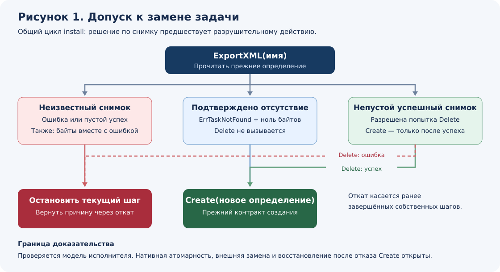

# Допуск к общей замене задачи — 21 ноября 2026 года

**Исправление опубликовано в существующем PR #660:** [`c55d9ca619f6f9301ba1113615370fc6218d608f`](https://github.com/applicate2628/mcp-local-hub/commit/c55d9ca619f6f9301ba1113615370fc6218d608f). Общая установка останавливает замену, если определение прежней задачи не удалось получить без ошибки, успешный снимок пуст или удаление вернуло ошибку. Подтверждённое отсутствие разрешает Create без предварительного Delete. Это ограниченная защита перед заменой; полное восстановление, владение и атомарность установки остаются открытыми.

## Оглавление

1. [Что изменено](#change)
2. [Фактические проверки](#checks)
3. [Как читать свидетельства](#artifacts)
4. [Границы и следующий шаг](#remaining)
5. [Термины](#terms)

## 1. Что изменено

Прежний общий цикл подавлял ошибки `ExportXML` и `Delete`, затем вызывал `Create`. Новый блок в `executeInstallToWithSymlinkConsents` возвращает именованную ошибку через существующий откат ранее завершённых шагов. Для исходной причины сохраняется `%w`, поэтому она доступна вызывающему коду через `errors.Is`. Непустые байты одновременно с ошибкой, включая признак отсутствия, не принимаются.

Изменены два файла: `internal/api/install.go` (**+12/−4**) и новый `internal/api/install_scheduler_snapshot_test.go` (**171 строка**). Интерфейсы и платформенные команды сохранены. [Точное сравнение с родителем](https://github.com/applicate2628/mcp-local-hub/compare/11c286fb634cc63d2c6019a790ff376a1d834af9...c55d9ca619f6f9301ba1113615370fc6218d608f) · [идентичность и прочтение публикации](code-publication.json).

**Рисунок 1 — реализованный допуск к замене.** Непустой снимок означает наличие сохранённых байтов; его полная пригодность к нативному импорту здесь не доказана. Схема описывает текущий шаг. В ветвях отказа вызывается прежний откат ранее завершённых шагов.

## 2. Фактические проверки

**Таблица 1 — основные результаты серии.** Время — длительность конкретной команды, без вывода об ускорении продукта.

| Проверка | Результат | Время, с |
|---|---|---:|
| Исходный производственный код + новые тесты | Ожидаемый FAIL: 15 событий тестов/подтестов и пакет; причины проверены | 228,146540300 |
| Кандидат, целевая выборка, `-race -count=2` | 30 тестовых и 1 пакетный PASS; FAIL/SKIP нет | 52,912820900 |
| Кандидат, соседний контракт создания и запуска, те же флаги | 8 тестовых и 1 пакетный PASS; FAIL/SKIP нет | 6,587194300 |
| `go build ./...` кандидата | PASS, код 0 | 15,630004800 |
| `go vet ./...` кандидата | PASS, код 0 | 10,065699000 |
| Чистый точный опубликованный коммит, целевая выборка | 30 тестовых и 1 пакетный PASS; FAIL/SKIP нет | 7,029847700 |

В новых тестах пять корневых функций, десять подтестов и двенадцать конечных сценариев. Один проход даёт 15 событий завершения тестов/подтестов; два — 30. Нативный Планировщик подменён. Тесты проверяют состояние и байты определения, допустимые вызовы, исходную причину, модель конфликта и восстановление предыдущего завершённого шага. [Подробные команды, наблюдение длительности и ограничения](RESULTS.md).

Обычный полный Go-набор и широкий тегированный API/CLI не запускались по двум сохранённым причинам: в данной ветке не квалифицированы четыре отдельные TestMain-границы из #658; продуктовые и тестовые входы широкого набора остаются открытыми. Предыдущие полные FAIL сохраняют собственные исходники и результаты.

## 3. Как читать свидетельства

**Таблица 2 — материалы и назначение.**

| Материал | Назначение |
|---|---|
| [RESULTS.md](RESULTS.md) | Фактические результаты, точные команды, границы временных выводов |
| [ACCEPTANCE.md](ACCEPTANCE.md) | Критерии, заданные перед исполнением; прогнозы отделены от результатов |
| [AUDIT.md](AUDIT.md) | Собственное ревью, остаточные условия, применённые навыки |
| [INDEPENDENT-REVIEW.md](INDEPENDENT-REVIEW.md) | Дополнительное статическое чтение кода и сценария исполнения |
| [CHECKOUT-REVIEW.md](CHECKOUT-REVIEW.md) | Дополнительное чтение перехода к опубликованным байтам |
| [PACKER-REVIEW.md](PACKER-REVIEW.md) | Дополнительное чтение проверок упаковщика |
| [EVIDENCE-REVIEW.md](EVIDENCE-REVIEW.md) | Независимая проверка фактического архива и событий |
| [execution-summary.json](execution-summary.json) | Машиночитаемые результаты шести фаз и 26 основных команд |
| [evidence-redacted.zip](evidence-redacted.zip) | Потоки, начальные и итоговые квитанции, сценарии, патчи и ограниченное наблюдение процессов |
| [MANIFEST.json](MANIFEST.json) | Раздельные размеры и хеши исходных и публичных байтов |
| [archive-metadata.json](archive-metadata.json) | Размер, контрольная сумма и состав архива |
| [local-archive-verification.json](local-archive-verification.json) | Проверка переноса, целостности, событий и временной разницы |
| [source-manifest.json](source-manifest.json), [code-publication.json](code-publication.json) | Связь исходного кода, кандидата и публикации |
| [QUEUE.md](QUEUE.md), [queue-snapshot.json](queue-snapshot.json) | Датированный исходный снимок очереди PR |
| [OWNERSHIP.md](OWNERSHIP.md), [ownership.json](ownership.json) | Владение файлами существующих PR и отсутствие интеграции веток |
| [SCOPE-NEXT.md](SCOPE-NEXT.md) | Ограниченный следующий вопрос восстановления текущей задачи |
| [documentation-amendment.py](documentation-amendment.py), [documentation-input.json](documentation-input.json), [documentation-audit.json](documentation-audit.json) | Процедура и вход обновления доски; проверка сохранения других строк и предыдущего текста |
| [SHA256SUMS](SHA256SUMS) | Контрольные суммы отдельных файлов этого каталога, кроме самого списка |

Архив содержит **129 элементов и 128 файловых хешей**, размер **118 332 байта**, SHA-256 `17ddbab64bca03b3f167bf293b2c402c33654440d8ee1c94134c1627626c4961`. Перед упаковкой проверены **52 исходных потока**. Из них 51 опубликован без изменения; в одном потоке клонирования заменён локальный путь. В целом отредактированы пути в 70 членах архива, включая сценарии и квитанции. Дополнительно известные локальные корни заменены в пяти отдельных публичных документах; исходные и публичные хеши перечислены в таблице 5 AUDIT.md. Исходные хеши связывают сохранённые первичные материалы; хеши `saved_*` относятся к публичным байтам. Публичные отредактированные сценарии служат материалами аудита, а не копиями для прямого запуска.

После переноса локально повторно проверены байты ZIP, его CRC и все 128 хешей. Manifest не хеширует сам себя; его контрольная сумма есть во внешних метаданных и SHA256SUMS. Проверка опубликованных GitHub-байтов выполняется после документационной публикации и сообщается отдельно; этот индекс не выдаёт её за уже выполненную на момент составления.

## 4. Границы и следующий шаг

Открыты успешный Delete с последующим неуспешным Create текущей задачи, неопределённый нативный исход Delete, внешняя замена между операциями, принудительный ImportXML с `/F`, пригодность снимка для нативного восстановления и другие операции R17. Полная установка и нативные изменяющие действия этой серией не выполнялись. Детектор гонок и модельные PASS не подтверждают атомарность внешних действий.

Следующий ограниченный вопрос — восстановление текущего определения без удаления или замещения внешней задачи. Для этого требуется самостоятельный контракт операции, которая отказывает при занятом имени, и различение отказа до применения от неизвестного исхода. Простая перестановка прежней компенсации перед Create опасна. [Разбор предпосылок и критериев](SCOPE-NEXT.md).

Код, свидетельства и общий план остаются в своих существующих PR. Новых PR, интеграции веток, слияний и формального внешнего одобрения эта серия не создаёт. Полная готовность восьми направлений не заявляется.

## 5. Термины

PR — запрос на включение изменений; Draft — черновик; XML — расширяемый язык разметки, здесь определение задачи; API — программный интерфейс; CLI — интерфейс командной строки; SHA-256 — контрольная сумма содержимого; CRC — контроль целостности записей ZIP; JSON — текстовый формат структурированных данных; PASS/FAIL/SKIP/NOT_RUN — успех/отказ/пропуск/отсутствие запуска конкретной проверки. `-race` включает детектор гонок Go; `-count=2` задаёт два исполнения выбранных тестов.
