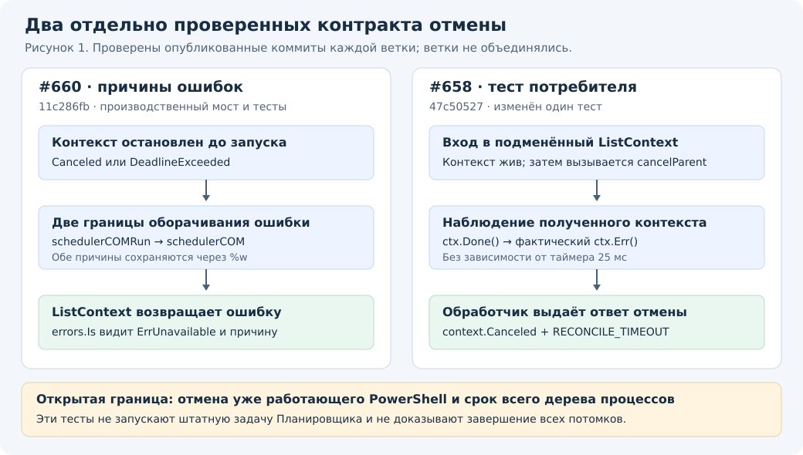

# Сохранение причин отмены и проверка потребителя — 20 ноября 2026

**Продолжение R17 и общей квалификации Go.** Исправление производственного моста Планировщика опубликовано в существующем PR (запросе на включение изменений) **#660**; отдельное исправление тестовой фикстуры интерфейса командной строки (CLI, Command-Line Interface) — в **#658**. Оба опубликованных коммита проверены адресными тестами повторно. Ветки не объединялись. Общая готовность PR и этапов не объявляется.

## Оглавление

1. [Опубликованные изменения](#опубликованные-изменения)
2. [Что установлено](#что-установлено)
3. [Материалы](#материалы)
4. [Открытые границы](#открытые-границы)

## Опубликованные изменения

**Таблица 1 — независимые владельцы изменений.**

| PR | Точный коммит | Объём этой правки |
|---|---|---|
| [#660](https://github.com/applicate2628/mcp-local-hub/pull/660) | [`11c286fb634cc63d2c6019a790ff376a1d834af9`](https://github.com/applicate2628/mcp-local-hub/commit/11c286fb634cc63d2c6019a790ff376a1d834af9) | Два файла, +61/−8 строк; три изменённые производственные строки и регрессионные проверки |
| [#658](https://github.com/applicate2628/mcp-local-hub/pull/658) | [`47c50527b051e3c40a426171eef42703155fc7f4`](https://github.com/applicate2628/mcp-local-hub/commit/47c50527b051e3c40a426171eef42703155fc7f4) | Один тестовый файл, +25/−16 строк; производственный код не меняется |

У каждого коммита ровно один родитель — прежняя вершина соответствующего PR. Полные деревья, полный список изменённых файлов и опубликованные байты сверены; свидетельства находятся в `publication-input.json` внутри архива и в квитанциях выбора опубликованных снимков. Последующее обновление плана в #658 является отдельным документационным коммитом.

## Что установлено

Мост `schedulerCOMRun` стирал стандартную причину остановленного контекста, заменяя её общей недоступностью и словом `timeout`. Затем `schedulerCOM` ещё раз терял причину раннера при форматировании через `%v`. Исправлены обе точки: `errors.Is` теперь распознаёт и прежний `ErrUnavailable`, и `context.Canceled` либо `context.DeadlineExceeded`. Частичный успешный ответ при ошибке по-прежнему отвергается. Пять новых конечных случаев сначала отказали на старом производственном коде с ожидаемым сообщением о потере причины; на исправленном и опубликованном коде адресная серия прошла [1].

Соседняя проверка CLI обнаружила отдельную проблему постановки теста: срок 25 мс мог закончиться до входа в подменённый `ListContext`. Тот же отказ дважды воспроизведён на чистом исходном #660 и на точной исходной вершине #658. Новый тест вызывает родительскую отмену только после входа в `ListContext` с живым контекстом и требует фактического `context.Canceled` и ответа `RECONCILE_TIMEOUT`. Отдельная проверка штатного срока 25 секунд сохранена побайтно [2].

Это два разных результата. В #660 старый CLI-тест остаётся неизменным и его наблюдённый FAIL сохраняется. Исправленный тест проверен в #658. Совместный снимок веток не создавался.

**Рисунок 1 — подтверждённые маршруты.** Стрелки показывают события и передачу ошибок внутри каждой отдельной проверки. Общий нативный запуск через обе ветки не изображён как выполненный.

## Материалы

- [RESULTS.md](RESULTS.md) — команды, длительности, точное число событий, сохранённые отказы и ограничения.
- [AUDIT.md](AUDIT.md) — собственное ревью, выполненные проверки безопасности и совместимости, реально применённые навыки, правила публикации.
- [CONTRACT-REVIEW.md](CONTRACT-REVIEW.md) — отдельный разбор контракта ошибок и настоящих побочных эффектов фикстур.
- [CLI-SOURCE-SNIPPETS.md](CLI-SOURCE-SNIPPETS.md) — привязанные к исходной версии фрагменты фикстур и изоляции.
- [TEST-FIX-REVIEW.md](TEST-FIX-REVIEW.md) — обоснование детерминированного теста и владения контекстами.
- [INDEPENDENT-REVIEW.md](INDEPENDENT-REVIEW.md) — дополнительное независимое ревью кода и проверки; не формальное внешнее одобрение.
- [EVIDENCE-REVIEW.md](EVIDENCE-REVIEW.md) — независимая проверка фактического архива и событий после переноса.
- [QUEUE.md](QUEUE.md), [queue-snapshot.json](queue-snapshot.json) — снимок очереди и принадлежности файлов **до** новой публикации; временная привязка сохранена.
- [execution-summary.json](execution-summary.json), [MANIFEST.json](MANIFEST.json), [archive-metadata.json](archive-metadata.json) и [evidence-redacted.zip](evidence-redacted.zip) — полные записи запусков с отделением исходных и обезличенных хешей.
- [preflight-redacted.json](preflight-redacted.json) — первоначальная ошибка декодирования при чтении установленного исходника Go и успешное повторное чтение в UTF-8; продуктовые команды для исправления этой ошибки не повторялись.

В архивах есть исходный отрицательный контроль, неуспешная соседняя проверка, оба воспроизведения старой CLI-фикстуры, успешные проверки каждого кандидата, сборка, статический анализ и повторные проверки точных опубликованных снимков. Каждая квитанция связана с фактически использованной версией скрипта. Замена текста локальных путей при обезличивании явно меняет хеш; такие публичные скрипты служат материалами аудита, а не готовыми командами повторного исполнения.

## Открытые границы

Не квалифицированы отмена уже запущенного PowerShell, завершение всех потомков, срок всего дерева процессов, реальное истечение 15-секундного срока моста, реальные операции `Run`, `RunOwned`, `Stop`, `Delete`, остальные нативные состояния/права/владельцы и все общие тестовые критерии. Уже остановленный контекст проверяет настоящий Go-путь до запуска процесса; подменённый CLI scheduler проверяет передачу контекста потребителем. Ни один из этих случаев не является запуском штатной задачи Планировщика.

Действующие восемь направлений остатка сохраняются в [плане #658](https://github.com/applicate2628/mcp-local-hub/blob/docs/agents-canonical-plan-20261117/.plans/2026-11/open-pr-integration-20261117.md#remaining-after-r17-export-20261119). Состояние этапа 4 обновляется в [доске #623](../../plans/rust-independent-execution-plan-2026-11-12.md#scheduler-cancellation-20261120); остальные пять строк доски сохраняются побайтно.

## Источники

1. [Изменение производственного моста и его тестов](https://github.com/applicate2628/mcp-local-hub/commit/11c286fb634cc63d2c6019a790ff376a1d834af9), [стандартная библиотека Go: fmt.Errorf](https://pkg.go.dev/fmt#Errorf), [errors.Is и errors.Unwrap](https://pkg.go.dev/errors).
2. [Изменение только CLI-фикстуры](https://github.com/applicate2628/mcp-local-hub/commit/47c50527b051e3c40a426171eef42703155fc7f4), [неизменённый производственный обработчик](https://github.com/applicate2628/mcp-local-hub/blob/47c50527b051e3c40a426171eef42703155fc7f4/internal/cli/supervise_reconcile_ipc.go).
